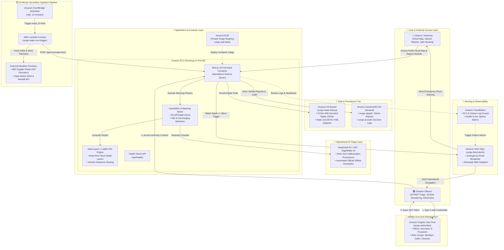

# 🌊 SURGE — Real-Time Urban Flood Early Warning & AI Triage Platform

**SURGE** is an enterprise-grade, multi-source meteorological fusion, 1D/2D DEM hydraulic simulation, and AI-assisted operational triage system designed for urban flood mitigation across major Indian metropolitan centers (Mumbai, Delhi NCR, and Chennai).

The platform ingests live IMD Doppler Weather Radar (DWR) imagery, cross-checks advection vectors against live Open-Meteo wind data, runs a CartoDEM-driven Manning hydraulic solver for street-level water depth accumulation, and synthesizes operational decision intelligence using a local **Ollama DeepSeek R1 1.5B** model.

☁️ **AWS Cloud Stack:** Amazon EC2 (`ap-south-1` Mumbai) · Amazon ECR · Amazon S3 · Amazon DynamoDB · Amazon SNS · Amazon Cognito

---

## 📑 Table of Contents

- [Key Architecture & Features](#-key-architecture--features)
  - [1. Multi-Source Precipitation Fusion Pipeline](#1-multi-source-precipitation-fusion-pipeline)
  - [2. Pure DEM-Driven Hydraulic Solver](#2-pure-dem-driven-hydraulic-solver)
  - [3. Local Ollama Decision Layer (DeepSeek R1 1.5B)](#3-local-ollama-decision-layer-deepseek-r1-1.5b)
  - [4. Vehicle-Aware Safe Routing & Spatial GIS](#4-vehicle-aware-safe-routing--spatial-gis)
- [System Architecture Diagram](#-system-architecture-diagram)
- [Project Prerequisites & Setup](#-project-prerequisites--setup)
- [Ollama Local AI Setup Instructions](#-ollama-local-ai-setup-instructions)
- [Development & Diagnostic Commands](#-development--diagnostic-commands)
- [API Documentation](#-api-documentation)
- [Directory Structure](#-directory-structure)

---

## ⚡ Key Architecture & Features

### 1. Multi-Source Precipitation Fusion Pipeline
- **Live IMD Doppler Radar (GIF Palette Decoder)**: Fetches DWR imagery on a 10-minute cycle for Chennai (`cni`), Mumbai (`vrv`), and Delhi (`delhi`). Decodes raw indexed palette colors using station-calibrated RGB palettes and adaptive matching tolerances ($45\% \times d_{\min}$). Automatically persists parsed JSON grid payloads to Vercel Blob (`radar-history/{station}/{yyyy}/{mm}/{dd}/{HHmm}.json`).
- **Optical-Flow Advection Nowcasting**: Maintains a 9-frame rolling history (~90m window at 10-minute cadence) to compute spatial normalized cross-correlation storm motion vectors ($\vec{v}_{\text{storm}}$ in km/h and direction°), projecting rainfall forward over a 0–3 hour horizon ($t=0$ to $t=180\text{m}$).
- **Wind Vector Cross-Check & Gap-Fill**: Compares radar motion vectors against live Open-Meteo wind observations. If $|\Delta \theta| > 45^\circ$, flags vector disagreement. When radar frame history is insufficient ($<2$ frames), uses live wind advection as a gap-fill (`nowcastMethod: 'wind_advection_gapfill'`).
- **Open-Meteo Divergence Tracking**: Tracks 3-hour volume divergence against Open-Meteo numerical weather forecasts.
- **Graceful Degradation**: Automatically falls back to Open-Meteo live API when radar is unavailable, transparently adjusting confidence scores down without injecting synthetic/fake numbers.

### 2. Pure DEM-Driven Hydraulic Solver
- **CartoDEM v3 Elevation Coupling**: Computes road runoff depth $D_{\text{cm}}$ and channel surcharge % strictly from real live fused rainfall rate $I(t)$, terrain slope, and base infiltration rates (`dem-service.ts`).
- **Tide & River Outfall Backwater**: Dynamically models astronomical ocean tide stage and river outfall backpressure (`tide-service.ts`).
- **SCADA Dewatering Pump Mitigation**: Simulates municipal pumping station discharge rates ($L/s$) and operational status (`pumping-station-service.ts`).
- **Physics-Derived Surcharging Manholes**: Solves 1D pipe hydraulic flow to compute manhole overflow rates ($L/s$) and surcharging neck depths (`physics-manhole-engine.ts`).

### 3. Local Ollama Decision Layer (DeepSeek R1 1.5B)
- **10-Minute Cycle & Rate Limiter**: Runs after each radar nowcast & hydraulic cycle completes, enforcing a 10-minute rate-limiting cooldown per city.
- **HARD CONSTRAINT — Zero Numerical Generation**: The LLM is strictly non-generative for physical numbers. It cannot invent, modify, or predict rainfall rates, water depths, or confidence scores. All numbers in its prompt payload are pre-computed by the radar/DEM solver.
- **Numerical Provenance Verification**: Every single number in the LLM text output is parsed and verified against the input payload. If an un-traceable number is generated, the LLM response is discarded in favor of raw compute synthesis.
- **Human-in-the-Loop Preservation**: Advisory text only (`ADVISORY ONLY — Requires Human Officer Sign-off`). Never auto-triggers SCADA pump actions, auto-dispatch, or evacuation modes.
- **Degradation Behavior**: If Ollama is offline or times out (>25s), the system defaults seamlessly to deterministic raw compute synthesis ("Raw Compute Only" mode).
- **Audit Logging**: Every invocation, prompt payload, raw LLM text, and provenance check status is logged to `scratch/ai_decision_audit.log`.

### 4. Vehicle-Aware Safe Routing & Spatial GIS
- **Inundation Vector Canvas**: Built with OpenLayers, rendering road risk severities (`safe`, `warning`, `critical`, `severe`), surcharging manholes, and crowdsourced citizen reports.
- **Vehicle Clearance Routing**: Calculates flood-safe navigation routes customized for 2-wheelers, sedans, SUVs, and heavy emergency vehicles based on max depth clearance (`routing-engine.ts`).
- **Situation Report (SitRep) Exporter**: Generates printable PDF MoES/NCMRWF official flood situation reports with AI executive summaries and advisory escalation suggestions.

---

## 📐 System Architecture Diagram



---

## 📦 Project Prerequisites & Setup

### Prerequisites
- **Node.js**: `v18.x` or `v20.x` (LTS recommended)
- **Package Manager**: `npm` (v9+)
- **OS**: Windows, macOS, or Linux
- **Ollama** *(Optional — for local DeepSeek R1 AI decision layer)*

### Step 1: Clone Repository & Install Dependencies

```bash
# Clone the repository
git clone https://github.com/1shikapandey/Project-Surge.git
cd Project-Surge

# Install Node.js dependencies
npm install
```

### Step 2: Environment Configuration

Create a `.env` file in the root directory (optional defaults provided in code):

```env
# Server Port (Default: 3000)
PORT=3000

# Local Ollama Endpoint (Default: http://localhost:11434/api/chat)
OLLAMA_ENDPOINT=http://localhost:11434/api/chat
OLLAMA_MODEL=deepseek-r1:1.5b
```

### Step 3: Run Development Server

```bash
npm run dev
```

Open [http://localhost:3000](http://localhost:3000) in your browser.

---

## 🤖 Ollama Local AI Setup Instructions

AquaAlert includes an optional local AI decision layer powered by **DeepSeek R1 (1.5B)** running via **Ollama**.

*Note: If Ollama is not installed or running, AquaAlert functions completely normally in **"Raw Compute Only"** mode.*

### Step 1: Install Ollama

- **Windows / macOS**: Download installer from [ollama.com](https://ollama.com)
- **Linux**:
  ```bash
  curl -fsSL https://ollama.com/install.sh | sh
  ```

### Step 2: Pull DeepSeek R1 1.5B Model

Open a terminal or command prompt and run:

```bash
ollama pull deepseek-r1:1.5b
```

*The `deepseek-r1:1.5b` model is compact (~1.1 GB download) and runs fast on CPU or low-VRAM GPUs.*

### Step 3: Start Ollama Server

Start Ollama in the background (default port `11434`):

```bash
ollama serve
```

### Step 4: Verify Ollama API Connection

You can verify that Ollama is responding by visiting [http://localhost:11434](http://localhost:11434) or running:

```bash
curl http://localhost:11434/api/tags
```

Once running, AquaAlert will automatically detect Ollama and switch the UI badge to **`🤖 AI-Assisted (DeepSeek R1 1.5B)`**.

---

## 🛠️ Development & Diagnostic Commands

### Run TypeScript Type Check
```bash
npx tsc --noEmit
```

### Run Multi-Source Fused Nowcast & Motion Vector Test
```bash
npx tsx scratch/test_motion_nowcast.ts
```

### Run DEM Hydraulic Solver Verification
```bash
npx tsx scratch/test_dem_hydraulic.ts
```

### Run Ollama Decision Layer Verification Harness
```bash
npx tsx scratch/test_flood_decision.ts
```

### Run Live Doppler Radar Fetch Test
```bash
npx tsx scratch/test_radar_live.ts
```

### Run Standalone Radar Palette Diagnostic Overlay Tool
```bash
npx tsx scripts/debug-radar-overlay.ts [mumbai|delhi|chennai]
```

---

## ⏰ Automated 10-Minute Ingestion Scheduler

GitHub Actions serves as the **PRIMARY and ONLY automated trigger** for the live radar ingestion pipeline (`.github/workflows/radar-fetch.yml`). Because Vercel Cron is unavailable at a 10-minute frequency on the Vercel Hobby plan, GitHub Actions triggers the plan-agnostic `/api/cron/radar-fetch` route every 10 minutes (`*/10 * * * *`) using bearer token authorization.

*Note: If upgrading to Vercel Pro in the future, Vercel Cron can be added as a primary or redundant trigger without any backend code changes.*

---

## 📡 API Documentation

### POST / GET `/api/cron/radar-fetch`

Triggers the plan-agnostic radar fetch, palette decode, optical-flow nowcasting, hydraulic solving, and Vercel Blob persistence pipeline across all stations (`cni`, `vrv`, `delhi`).

#### Headers / Authorization
- `Authorization: Bearer <CRON_SECRET>`

#### Sample Response Payload (`POST /api/cron/radar-fetch`)

```json
{
  "success": true,
  "timestamp": "2026-09-20T18:20:00.000Z",
  "executionDurationMs": 1420,
  "stationsProcessed": 3,
  "results": {
    "chennai": {
      "status": "success",
      "stationCode": "cni",
      "confidence": 0.942,
      "currentPrecipitationMmHr": 12.5,
      "nowcastMethod": "radar_motion_advection",
      "motionVector": "18.4 km/h @ 240°",
      "gridCellCount": 1840,
      "maxWaterDepthCm": 45,
      "floodedRoadsCount": 4
    }
  }
}
```

### GET `/api/nowcast`

Returns the complete 0-3hr fused precipitation nowcast timeline, DEM hydraulic snapshot, motion vector telemetry, and AI decision payload.

#### Query Parameters
- `city` (optional): `mumbai` | `delhi` | `chennai` (Default: `mumbai`)
- `time` (optional): Lead time offset in minutes: `0`, `15`, `30`, `45`, `60`, `90`, `120`, `150`, `180` (Default: `0`)
- `eventId` (optional): Select historical cloudburst event for backtesting (e.g., `mumbai-2005-cloudburst`, `delhi-2023-yamuna`)

#### Sample Response Payload (`GET /api/nowcast?city=mumbai&time=30`)

```json
{
  "success": true,
  "city": "mumbai",
  "timestamp": "2026-09-20T15:00:00.000Z",
  "forecastLeadTimeMins": 30,
  "timeLabel": "+00:30 (T+30m)",
  "fusedNowcastTimeline": [
    {
      "timeOffsetMins": 0,
      "timeLabel": "+00:00",
      "precipitationMmHr": 15.5,
      "confidenceScore": 0.93,
      "confidenceTier": "high",
      "nowcastMethod": "radar_motion_advection",
      "uncertaintyRangeMmHr": [14.0, 17.0]
    }
  ],
  "precipitationSource": {
    "active": "radar",
    "confidence": 0.832,
    "nowcastMethod": "radar_motion_advection",
    "motionVector": {
      "speedKmh": 18.4,
      "directionDeg": 240,
      "directionCardinal": "WSW",
      "confidenceScore": 0.88
    },
    "radarWindDisagreement": false,
    "openMeteoDivergencePct": 12.4
  },
  "metrics": {
    "maxWaterDepthCm": 257,
    "floodedRoadsCount": 13,
    "surchargingManholesCount": 5
  },
  "aiDecision": {
    "aiAssisted": true,
    "modelName": "deepseek-r1:1.5b",
    "status": "fresh_llm",
    "numericalProvenancePassed": true,
    "sitRepSummary": "Hydro-telemetry snapshot for Mumbai indicates peak inundation depth of 257 cm across 13 impacted corridors...",
    "prioritizedRoadRisks": [
      {
        "roadId": "galli-kurla-pipe-road",
        "roadName": "Kurla Pipe Road Corridor",
        "waterDepthCm": 257,
        "severity": "severe",
        "priorityRank": 1,
        "triageRationale": "Computed depth 257 cm (SEVERE) on terrain elevation 1.8m"
      }
    ],
    "advisoryEscalationFlags": [
      {
        "flagId": "esc-severe-depth",
        "severity": "critical",
        "recommendationText": "ADVISORY: 5 road segment(s) reached SEVERE depth threshold (>=40 cm). Recommend officer review."
      }
    ]
  }
}
```

---

## 📁 Directory Structure

```text
AquaAlert/
├── src/
│   ├── app/
│   │   ├── api/nowcast/route.ts       # Live nowcast & hydraulic API endpoint
│   │   ├── layout.tsx                 # Root layout & providers
│   │   └── page.tsx                   # Main application hub
│   ├── components/
│   │   ├── AuthorityDashboard.tsx    # Command center dashboard & AI triage panel
│   │   ├── CitizenAppView.tsx        # Mobile citizen app view
│   │   ├── OpenLayersMapCanvas.tsx   # Interactive spatial vector GIS canvas
│   │   ├── RoutingWidget.tsx         # Vehicle-aware safe route planner UI
│   │   ├── SitRepExporter.tsx        # Printable SitRep PDF exporter modal
│   │   └── TimeSlider.tsx            # 0–3 hour forecast scrubber
│   └── lib/
│       ├── flood-decision-service.ts # Local Ollama DeepSeek R1 1.5B decision layer
│       ├── hydraulic-engine.ts       # Pure DEM-driven Manning hydraulic solver
│       ├── precipitation-fusion-service.ts # Multi-source precipitation fusion layer
│       ├── radar-imagery-service.ts  # Radar GIF ingestion & advection engine
│       ├── openmeteo-service.ts      # Open-Meteo forecast & historical archive
│       ├── routing-engine.ts         # Depth-aware vehicle routing engine
│       ├── tide-service.ts           # Ocean tide & outfall backwater stage
│       ├── pumping-station-service.ts# Municipal SCADA pump telemetry
│       └── mock-data.ts              # City road network & drainage graph
├── scripts/
│   └── debug-radar-overlay.ts        # Standalone radar palette diagnostic tool
├── scratch/
│   ├── test_flood_decision.ts        # Ollama decision layer verification script
│   ├── test_dem_hydraulic.ts         # Manning hydraulic solver test
│   ├── test_motion_nowcast.ts        # Motion vector nowcast test
│   └── ai_decision_audit.log         # Audit logs for AI decision invocations
└── package.json
```

---

## 📜 License & Acknowledgments

Developed for urban flood resilience research, real-time meteorological forecasting, and early-warning operations.  
Uses public meteorological data from IMD DWR Caz radar feeds and Open-Meteo Weather API.
