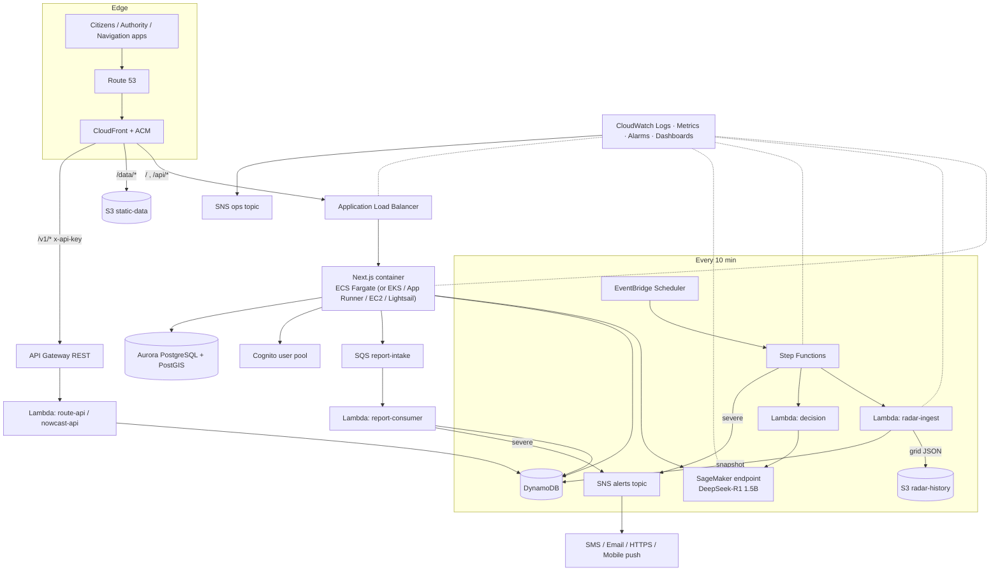

# SURGE on AWS — Complete Setup Guide

Everything needed to take SURGE from "runs on a laptop + Vercel + GitHub Actions" to a production-style AWS deployment that uses **SageMaker AI, EKS / ECS / Fargate, Lambda / API Gateway / Step Functions, EC2 / Lightsail / App Runner / Amplify Hosting, S3 / DynamoDB / RDS / Aurora, Cognito, CloudFront / Route 53 / EventBridge / SQS / SNS / CloudWatch**.

This guide is written against the actual code in this repository (Next.js 16, in-memory state, Vercel Blob for radar history, GitHub Actions cron, Ollama DeepSeek R1 1.5B). Every integration point names the real file it touches.

> **How to use this file:** work top to bottom. Each part says what it creates, gives copy-paste commands, and ends with a **✅ Verify** step. Don't skip verifies — most failures are caught there. Parts marked **(choose)** are alternatives; you only need one of them, but all are documented so you can try each.

---

## Table of contents

0. [Read this first — architecture, decisions, order of work](#0-read-this-first)
1. [Prerequisites & tooling](#1-prerequisites--tooling)
2. [Account foundation (IAM, budgets, region, variables)](#2-account-foundation)
3. [Networking — VPC](#3-networking--vpc)
4. [Secrets & configuration](#4-secrets--configuration)
5. [Amazon S3](#5-amazon-s3)
6. [Amazon DynamoDB](#6-amazon-dynamodb)
7. [Amazon RDS / Aurora PostgreSQL + PostGIS](#7-amazon-rds--aurora-postgresql--postgis)
8. [Amazon Cognito](#8-amazon-cognito)
9. [Amazon SNS — multi-channel alerting](#9-amazon-sns--multi-channel-alerting)
10. [Amazon SQS](#10-amazon-sqs)
11. [Amazon SageMaker AI](#11-amazon-sagemaker-ai)
12. [Container image & Amazon ECR](#12-container-image--amazon-ecr)
13. [Hosting the web app **(choose)**](#13-hosting-the-web-app-choose) — ECS Fargate · EKS · App Runner · Amplify · Lightsail · EC2
14. [Serverless pipeline: Lambda + API Gateway + Step Functions + EventBridge (AWS SAM)](#14-serverless-pipeline-aws-sam)
15. [Edge: CloudFront + Route 53 + ACM](#15-edge-cloudfront--route-53--acm)
16. [Observability: CloudWatch](#16-observability-cloudwatch)
17. [CI/CD with GitHub Actions + OIDC](#17-cicd-github-actions--oidc)
18. [Application code changes (adapters)](#18-application-code-changes)
19. [End-to-end verification](#19-end-to-end-verification)
20. [Cost guardrails & teardown](#20-cost-guardrails--teardown)
21. [Troubleshooting](#21-troubleshooting)
- [Appendix A — Environment variable reference](#appendix-a--environment-variable-reference)
- [Appendix B — IAM summary](#appendix-b--iam-summary)
- [Appendix C — Deliverables → AWS mapping](#appendix-c--deliverables--aws-mapping)

---

## 0. Read this first

### 0.1 What exists today (and why it matters for AWS)

| Today | Where in the repo | Consequence on AWS |
|---|---|---|
| Radar history persisted to **Vercel Blob** under `radar-history/{station}/{yyyy}/{mm}/{dd}/{HHmm}.json` | `src/lib/radar-blob-service.ts` | Maps 1:1 to **S3** keys. Retention (`RADAR_BLOB_RETENTION_DAYS`, 60) becomes an **S3 lifecycle rule**. |
| 10-minute ingest = **GitHub Actions** → `POST /api/cron/radar-fetch` with `CRON_SECRET` | `.github/workflows/radar-fetch.yml`, `src/app/api/cron/radar-fetch/route.ts` | Replaced by **EventBridge Scheduler → Step Functions → Lambda**. The route stays for manual triggers. |
| LLM = **Ollama** `deepseek-r1:1.5b` over REST (`OLLAMA_ENDPOINT`) in **3 files**; chatbot tries **NVIDIA NIM** first | `flood-decision-service.ts`, `chatbot-llm-service.ts`, `api/nowcast-predict/route.ts` | Replaced by a **SageMaker real-time endpoint** behind one adapter (`LLM_PROVIDER=sagemaker`). Ollama stays as local-dev fallback. |
| AI audit log written to local disk `scratch/ai_decision_audit.log` | `flood-decision-service.ts` → `logAuditEntry` | Containers/Lambda have ephemeral disks → **CloudWatch Logs + DynamoDB**. |
| Citizen signals, reports, SCADA audit chain, chatbot rate limiter, radar rolling history, LLM cache are **module-level in-memory state** | `citizen-signals-service.ts`, `hydro-routing-service.ts`, `chatbot-rate-limiter.ts`, `api/reports/route.ts`, `radar-imagery-service.ts` | Multiple containers/Lambdas would each have different state → move to **DynamoDB** (and S3 for radar history). |
| Authority login is a **client-side demo** (`*.aqua.gov.in` + passcode `12345678`) | `src/components/AuthorityAuthModal.tsx` | Replaced by **Cognito** (same login IDs, no visual change). |
| Static geodata: `public/data/*.geojson`, `src/lib/*-kml-data.json` | repo | Served from **S3 + CloudFront**; optionally loaded into **Aurora PostGIS** for the "scalable" deliverable. |

> ⚠️ **Important reality check (read before Part 18).** Several React *client* components (`CitizenSignalDesk`, `AdminModerationQueue`, `SubmitHazardResolutionForm`, `HydroRoutingPanel`, `page.tsx`) call the in-memory service functions **directly in the browser** — so today signals/SCADA state live *per browser tab*, not on a server. Moving them to DynamoDB therefore needs **API routes + `await fetch(...)` in those components** (they currently call synchronous functions). Part 18 separates changes into:
> - **Level 1 — server-side swaps, no UI code changes:** radar → S3, LLM → SageMaker, audit → CloudWatch/DynamoDB, cron → EventBridge, alerts → SNS, rate limiter → DynamoDB, auth route → Cognito.
> - **Level 2 — shared data (UI code changes):** signals/reports/SCADA chain → DynamoDB through API routes.
>
> Do Level 1 first. The app stays fully working at every step because every adapter is behind an env flag that defaults to the current behaviour.

### 0.2 Target architecture



### 0.3 Service → role → code map

| AWS service | Role in SURGE | Touches |
|---|---|---|
| **S3** | Radar history, static geodata, citizen photo evidence, build artifacts | `radar-blob-service.ts`, `public/data` |
| **DynamoDB** | Signals, reports, SCADA audit chain, AI audit, rate limiter, latest snapshots, decision cache | services listed in 0.1 |
| **RDS / Aurora** | PostGIS home for roads, drain graph, manholes, hotspots (scalable spatial queries) | optional loader + query helper |
| **Cognito** | Authority sign-in (per-city groups), citizen identity | `AuthorityAuthModal.tsx`, new `/api/auth/*` |
| **SNS** | Multi-channel alerts (SMS, email, push, webhooks), ops alarms | cron/Step Functions, report consumer |
| **SQS** | Decouple citizen report intake; DLQ for poison messages | `api/reports/route.ts`, consumer Lambda |
| **SageMaker AI** | Hosts the LLM (and optional custom nowcast model) | the 3 Ollama call sites |
| **ECS Fargate / EKS / App Runner / Amplify / Lightsail / EC2** | Run the Next.js server (pick one) | Dockerfile, `next.config.js` |
| **Lambda** | Radar ingest, LLM decision step, report consumer, public APIs | new `lambda/` folder |
| **API Gateway** | Public **flood-safe routing API** with API keys + usage plans | `routing-engine.ts` |
| **Step Functions** | Orchestrates the 10-minute pipeline with retries, branching, alerts | `infra/pipeline.asl.json` |
| **EventBridge** | 10-min schedule (replaces GitHub Actions), failure events | `template.yaml` |
| **CloudFront** | CDN/HTTPS front door for app, static data and API | `infra/edge.yaml` |
| **Route 53** | DNS | `infra/edge.yaml` |
| **CloudWatch** | Logs, EMF metrics, alarms, dashboard, Container Insights | all |

### 0.4 Which hosting option? (Part 13)

| Option | Best for | Ops effort | Notes |
|---|---|---|---|
| **ECS on Fargate** ⭐ | Production default | Low | No servers, ALB, autoscaling, IAM task roles. Fully documented Next.js path (container). |
| **EKS** | You already run Kubernetes / need k8s ecosystem | High | $0.10/hr control plane + nodes. Same container. |
| **App Runner** | Fastest container → URL for demos | Very low | **Check current availability for new accounts** in the console/docs before choosing. |
| **Amplify Hosting** | Git-push deploys, no Docker | Low | Next lists Amplify as an *unverified* integration — **verify Next 16 + this app's features on a branch first**. |
| **Lightsail containers** | Cheapest fixed-price demo | Very low | No IAM roles for containers → needs a scoped IAM user key. |
| **EC2** | Full control, single VM | Medium | You patch it. Good for learning / bastion. |

All six run the **same Docker image** (Part 12). Everything else in this guide (S3, DynamoDB, Cognito, SNS, SQS, SageMaker, Lambda, Step Functions, CloudFront…) is **hosting-agnostic**.

### 0.5 Order of work (dependencies)

| # | Part | Needs | Time | Required? |
|---|---|---|---|---|
| 1 | Tooling | — | 20 min | ✅ |
| 2 | Account foundation | 1 | 20 min | ✅ |
| 3 | VPC | 2 | 10 min | ✅ (ECS/EKS/EC2/Aurora) |
| 4 | Secrets | 2 | 5 min | ✅ |
| 5 | S3 | 2 | 10 min | ✅ |
| 6 | DynamoDB | 2 | 10 min | ✅ |
| 7 | Aurora/RDS + PostGIS | 3 | 30 min | optional |
| 8 | Cognito | 2 | 15 min | ✅ for real auth |
| 9 | SNS | 2 | 10 min | ✅ |
| 10 | SQS | 2 | 5 min | ✅ |
| 11 | SageMaker | 2 + quota approval (can take hours/days) | 30 min + wait | ✅ for cloud LLM |
| 12 | Docker + ECR | 1 | 15 min | ✅ |
| 13 | Hosting | 3, 4, 12 (+5, 6, 9, 10, 11 for env vars) | 30–60 min | ✅ pick ≥1 |
| 14 | SAM pipeline | 5, 6, 9, 10, 11 | 45 min | ✅ |
| 15 | CloudFront/Route 53 | 13, 14, domain | 30 min | ✅ for HTTPS + domain |
| 16 | CloudWatch | 13, 14 | 30 min | ✅ |
| 17 | CI/CD | 13, 14 | 30 min | recommended |
| 18 | Code changes | — (do alongside 5–14) | 2–4 h | ✅ |

> 💡 **Start the SageMaker quota request (Part 11.1) on day 1** — it's the only step that waits on a human at AWS.

### 0.6 Naming convention used everywhere

`$PREFIX = surge-<env>` (e.g. `surge-dev`). Every resource is named `$PREFIX-<thing>`. Everything is tagged `app=surge env=<env>`.

---

## 1. Prerequisites & tooling

> All commands in this guide are **bash** (Git Bash from "Git for Windows", or WSL). They are **not** PowerShell. Use Git Bash on Windows.

### 1.1 Install

```bash
# Windows (run once, in PowerShell or cmd, then reopen Git Bash)
winget install -e --id Amazon.AWSCLI          # AWS CLI v2
winget install -e --id Amazon.SAM-CLI         # AWS SAM CLI
winget install -e --id Docker.DockerDesktop   # Docker (needed for sam local + image builds)
winget install -e --id Python.Python.3.12     # SageMaker deploy scripts
# Only if you will use EKS (Part 13.2):
choco install eksctl kubernetes-cli kubernetes-helm -y
```

Also install:
- **Node.js ≥ 20.9** (required by Next.js 16; this guide targets **Node 22** for containers and Lambda). Use nvm-windows.
- **Session Manager plugin** for the AWS CLI (needed for Part 7 port-forwarding) — install from the AWS docs ("Install the Session Manager plugin for the AWS CLI").
- A **GitHub** account/repo (Part 17).
- A **domain name** (for Part 15; you can skip custom domain and use the `*.cloudfront.net` URL).

### 1.2 Verify

```bash
aws --version          # aws-cli/2.x
sam --version
docker --version
node -v                # >= v20.9.0 (v22 recommended)
python --version
```

### 1.3 Project dependencies you will add (Part 18)

```bash
npm i @aws-sdk/client-s3 @aws-sdk/client-dynamodb @aws-sdk/lib-dynamodb \
      @aws-sdk/client-sns @aws-sdk/client-sqs @aws-sdk/client-sagemaker-runtime \
      @aws-sdk/client-cognito-identity-provider @aws-sdk/client-cloudwatch @aws-sdk/s3-request-presigner aws-jwt-verify
npm i -D esbuild @types/aws-lambda
```

> ✅ **Verify:** `aws --version`, `sam --version`, `docker run hello-world` all succeed.

---

## 2. Account foundation

### 2.1 Secure the account (one-time, in the console)
1. Sign in as **root** → enable **MFA** on root → **do not use root afterwards**.
2. **IAM Identity Center** (recommended) → create a user + permission set (`AdministratorAccess` for dev; scope down for prod) **or** create an IAM user with MFA and access keys.
3. Billing → **Cost Explorer: enable**, and **"IAM user and role access to billing information"**.

### 2.2 Configure the CLI

```bash
# Identity Center (recommended)
aws configure sso --profile surge
aws sso login --profile surge
export AWS_PROFILE=surge

# …or classic access keys
# aws configure --profile surge
```

### 2.3 Pick region & set shared variables

**Region:** `ap-south-1` (Mumbai) is closest to all three cities. Check that services you need exist there (SageMaker GPU instance types are the usual exception — see 11.1).

Create `scripts/aws-env.sh` in the repo and `source` it at the start of every terminal session:

```bash
mkdir -p scripts infra
cat > scripts/aws-env.sh <<'EOF'
#!/usr/bin/env bash
export AWS_PROFILE=${AWS_PROFILE:-surge}
export AWS_REGION=ap-south-1
export AWS_DEFAULT_REGION=$AWS_REGION
export APP=surge
export ENV=dev                         # dev | staging | prod
export PREFIX=$APP-$ENV
export ACCOUNT_ID=$(aws sts get-caller-identity --query Account --output text)

# Globally-unique bucket names
export RADAR_BUCKET=$PREFIX-$ACCOUNT_ID-radar
export STATIC_BUCKET=$PREFIX-$ACCOUNT_ID-static
export EVIDENCE_BUCKET=$PREFIX-$ACCOUNT_ID-evidence

# Region where the SageMaker endpoint lives (change if GPU types aren't in ap-south-1)
export SAGEMAKER_REGION=$AWS_REGION

echo "Using $PREFIX in $AWS_REGION (account $ACCOUNT_ID)"
EOF
source scripts/aws-env.sh
```

### 2.4 Budget alarm (do this before creating anything expensive)

```bash
cat > /tmp/budget.json <<EOF
{"BudgetName":"$PREFIX-monthly","BudgetLimit":{"Amount":"100","Unit":"USD"},"TimeUnit":"MONTHLY","BudgetType":"COST"}
EOF
cat > /tmp/budget-notify.json <<'EOF'
[{"Notification":{"NotificationType":"ACTUAL","ComparisonOperator":"GREATER_THAN","Threshold":80,"ThresholdType":"PERCENTAGE"},
  "Subscribers":[{"SubscriptionType":"EMAIL","Address":"YOU@example.com"}]},
 {"Notification":{"NotificationType":"FORECASTED","ComparisonOperator":"GREATER_THAN","Threshold":100,"ThresholdType":"PERCENTAGE"},
  "Subscribers":[{"SubscriptionType":"EMAIL","Address":"YOU@example.com"}]}]
EOF
aws budgets create-budget --account-id $ACCOUNT_ID \
  --budget file:///tmp/budget.json --notifications-with-subscribers file:///tmp/budget-notify.json
```

> On Git Bash for Windows, `/tmp` maps to a temp dir that `file://` may not resolve. If you get "file not found", write these JSON files into `./infra/tmp/` and use `file://infra/tmp/budget.json`.

> ✅ **Verify:** `aws sts get-caller-identity` shows your account; `aws budgets describe-budgets --account-id $ACCOUNT_ID` lists the budget.

---

## 3. Networking — VPC

Needed by ECS/EKS/EC2, Aurora/RDS and any Lambda that must reach the database. Two AZs, public + private subnets, one NAT gateway (dev), and **free** gateway endpoints for S3 and DynamoDB so that traffic never goes through the NAT.

> The app must reach the **internet** (IMD radar GIFs, Open-Meteo, Windy, NVIDIA NIM) — private subnets therefore need the NAT gateway. NAT costs ≈ $32+/month + data; for prod use one per AZ.

Create `infra/network.yaml`:

```yaml
AWSTemplateFormatVersion: '2010-09-09'
Description: SURGE VPC (2 AZ, public+private, 1 NAT, S3/DynamoDB gateway endpoints)
Parameters:
  Prefix: { Type: String, Default: surge-dev }
  VpcCidr: { Type: String, Default: 10.20.0.0/16 }
Resources:
  Vpc:
    Type: AWS::EC2::VPC
    Properties:
      CidrBlock: !Ref VpcCidr
      EnableDnsSupport: true
      EnableDnsHostnames: true
      Tags: [{ Key: Name, Value: !Sub '${Prefix}-vpc' }]
  Igw: { Type: AWS::EC2::InternetGateway }
  IgwAttach:
    Type: AWS::EC2::VPCGatewayAttachment
    Properties: { VpcId: !Ref Vpc, InternetGatewayId: !Ref Igw }

  PublicA:
    Type: AWS::EC2::Subnet
    Properties:
      VpcId: !Ref Vpc
      CidrBlock: 10.20.0.0/24
      AvailabilityZone: !Select [0, !GetAZs '']
      MapPublicIpOnLaunch: true
      Tags: [{ Key: Name, Value: !Sub '${Prefix}-public-a' }, { Key: kubernetes.io/role/elb, Value: '1' }]
  PublicB:
    Type: AWS::EC2::Subnet
    Properties:
      VpcId: !Ref Vpc
      CidrBlock: 10.20.1.0/24
      AvailabilityZone: !Select [1, !GetAZs '']
      MapPublicIpOnLaunch: true
      Tags: [{ Key: Name, Value: !Sub '${Prefix}-public-b' }, { Key: kubernetes.io/role/elb, Value: '1' }]
  PrivateA:
    Type: AWS::EC2::Subnet
    Properties:
      VpcId: !Ref Vpc
      CidrBlock: 10.20.10.0/24
      AvailabilityZone: !Select [0, !GetAZs '']
      Tags: [{ Key: Name, Value: !Sub '${Prefix}-private-a' }, { Key: kubernetes.io/role/internal-elb, Value: '1' }]
  PrivateB:
    Type: AWS::EC2::Subnet
    Properties:
      VpcId: !Ref Vpc
      CidrBlock: 10.20.11.0/24
      AvailabilityZone: !Select [1, !GetAZs '']
      Tags: [{ Key: Name, Value: !Sub '${Prefix}-private-b' }, { Key: kubernetes.io/role/internal-elb, Value: '1' }]

  PublicRt: { Type: AWS::EC2::RouteTable, Properties: { VpcId: !Ref Vpc } }
  PublicDefault:
    Type: AWS::EC2::Route
    DependsOn: IgwAttach
    Properties: { RouteTableId: !Ref PublicRt, DestinationCidrBlock: 0.0.0.0/0, GatewayId: !Ref Igw }
  PublicAAssoc: { Type: AWS::EC2::SubnetRouteTableAssociation, Properties: { SubnetId: !Ref PublicA, RouteTableId: !Ref PublicRt } }
  PublicBAssoc: { Type: AWS::EC2::SubnetRouteTableAssociation, Properties: { SubnetId: !Ref PublicB, RouteTableId: !Ref PublicRt } }

  NatEip: { Type: AWS::EC2::EIP, DependsOn: IgwAttach, Properties: { Domain: vpc } }
  Nat: { Type: AWS::EC2::NatGateway, Properties: { AllocationId: !GetAtt NatEip.AllocationId, SubnetId: !Ref PublicA } }
  PrivateRt: { Type: AWS::EC2::RouteTable, Properties: { VpcId: !Ref Vpc } }
  PrivateDefault: { Type: AWS::EC2::Route, Properties: { RouteTableId: !Ref PrivateRt, DestinationCidrBlock: 0.0.0.0/0, NatGatewayId: !Ref Nat } }
  PrivateAAssoc: { Type: AWS::EC2::SubnetRouteTableAssociation, Properties: { SubnetId: !Ref PrivateA, RouteTableId: !Ref PrivateRt } }
  PrivateBAssoc: { Type: AWS::EC2::SubnetRouteTableAssociation, Properties: { SubnetId: !Ref PrivateB, RouteTableId: !Ref PrivateRt } }

  S3Endpoint:
    Type: AWS::EC2::VPCEndpoint
    Properties:
      VpcId: !Ref Vpc
      ServiceName: !Sub 'com.amazonaws.${AWS::Region}.s3'
      VpcEndpointType: Gateway
      RouteTableIds: [!Ref PrivateRt]
  DynamoEndpoint:
    Type: AWS::EC2::VPCEndpoint
    Properties:
      VpcId: !Ref Vpc
      ServiceName: !Sub 'com.amazonaws.${AWS::Region}.dynamodb'
      VpcEndpointType: Gateway
      RouteTableIds: [!Ref PrivateRt]

Outputs:
  VpcId:          { Value: !Ref Vpc }
  PublicSubnetA:  { Value: !Ref PublicA }
  PublicSubnetB:  { Value: !Ref PublicB }
  PrivateSubnetA: { Value: !Ref PrivateA }
  PrivateSubnetB: { Value: !Ref PrivateB }
```

Deploy and capture the IDs into shell variables:

```bash
aws cloudformation deploy --stack-name $PREFIX-network \
  --template-file infra/network.yaml --parameter-overrides Prefix=$PREFIX \
  --tags app=$APP env=$ENV

out() { aws cloudformation describe-stacks --stack-name $PREFIX-network \
  --query "Stacks[0].Outputs[?OutputKey=='$1'].OutputValue" --output text; }
export VPC_ID=$(out VpcId)
export PUB_A=$(out PublicSubnetA)  PUB_B=$(out PublicSubnetB)
export PRIV_A=$(out PrivateSubnetA) PRIV_B=$(out PrivateSubnetB)
echo $VPC_ID $PUB_A $PUB_B $PRIV_A $PRIV_B
# Persist for later sessions:
cat >> scripts/aws-env.sh <<EOF
export VPC_ID=$VPC_ID PUB_A=$PUB_A PUB_B=$PUB_B PRIV_A=$PRIV_A PRIV_B=$PRIV_B
EOF
```

> ✅ **Verify:** the five IDs print (`vpc-…`, `subnet-…`).

---

## 4. Secrets & configuration

One Secrets Manager secret holds everything sensitive. (Cheaper alternative: SSM Parameter Store `SecureString`.)

```bash
export CRON_SECRET=$(openssl rand -hex 32)
export ACTIONS_KEY=$(openssl rand -base64 32)      # NEXT_SERVER_ACTIONS_ENCRYPTION_KEY (see 12.4)
export ORIGIN_VERIFY=$(openssl rand -hex 24)       # CloudFront -> ALB shared header (Part 15)

aws secretsmanager create-secret --name $PREFIX/app \
  --description "SURGE app secrets" \
  --secret-string "$(cat <<EOF
{"CRON_SECRET":"$CRON_SECRET",
 "NEXT_SERVER_ACTIONS_ENCRYPTION_KEY":"$ACTIONS_KEY",
 "ORIGIN_VERIFY":"$ORIGIN_VERIFY",
 "NVIDIA_API_KEY":"",
 "WINDY_API_KEY":""}
EOF
)" --tags Key=app,Value=$APP Key=env,Value=$ENV

export APP_SECRET_ARN=$(aws secretsmanager describe-secret --secret-id $PREFIX/app --query ARN --output text)
echo "export APP_SECRET_ARN=$APP_SECRET_ARN" >> scripts/aws-env.sh
```

Fill in the real third-party keys (these are already read by the code):

```bash
# NVIDIA_API_KEY → chatbot-llm-service.ts ; WINDY_API_KEY → wind-cloud-service.ts
aws secretsmanager put-secret-value --secret-id $PREFIX/app --secret-string "$(
  aws secretsmanager get-secret-value --secret-id $PREFIX/app --query SecretString --output text \
  | node -e 'let s="";process.stdin.on("data",d=>s+=d).on("end",()=>{const o=JSON.parse(s);o.NVIDIA_API_KEY="PASTE";o.WINDY_API_KEY="PASTE";console.log(JSON.stringify(o))})'
)"
```

> ✅ **Verify:** `aws secretsmanager get-secret-value --secret-id $PREFIX/app --query SecretString --output text` prints the JSON.

---

## 5. Amazon S3

Three buckets, all **private** (`Block Public Access` on). CloudFront (Part 15) reads static data through Origin Access Control; the app reads/writes the others through its IAM role.

| Bucket | Contents | Lifecycle |
|---|---|---|
| `$RADAR_BUCKET` | `radar-history/{station}/{yyyy}/{mm}/{dd}/{HHmm}.json` (exact key scheme of `formatRadarBlobPath`) | expire after **60 days** (= `RADAR_BLOB_RETENTION_DAYS`) |
| `$STATIC_BUCKET` | `data/*.geojson`, `geojson/*` (served via CloudFront) | none |
| `$EVIDENCE_BUCKET` | citizen photo evidence (presigned upload) | expire after 180 days |

```bash
mk_bucket() {
  aws s3api create-bucket --bucket "$1" --region $AWS_REGION \
    --create-bucket-configuration LocationConstraint=$AWS_REGION
  aws s3api put-public-access-block --bucket "$1" --public-access-block-configuration \
    BlockPublicAcls=true,IgnorePublicAcls=true,BlockPublicPolicy=true,RestrictPublicBuckets=true
  aws s3api put-bucket-encryption --bucket "$1" --server-side-encryption-configuration \
    '{"Rules":[{"ApplyServerSideEncryptionByDefault":{"SSEAlgorithm":"AES256"}}]}'
  aws s3api put-bucket-tagging --bucket "$1" --tagging "TagSet=[{Key=app,Value=$APP},{Key=env,Value=$ENV}]"
}
mk_bucket $RADAR_BUCKET
mk_bucket $STATIC_BUCKET
mk_bucket $EVIDENCE_BUCKET

# Lifecycle: radar history 60 days (replaces runScheduledBlobCleanupIfNeeded)
aws s3api put-bucket-lifecycle-configuration --bucket $RADAR_BUCKET --lifecycle-configuration '{
  "Rules":[{"ID":"expire-radar-history","Status":"Enabled","Filter":{"Prefix":"radar-history/"},
            "Expiration":{"Days":60},"AbortIncompleteMultipartUpload":{"DaysAfterInitiation":2}}]}'

# Lifecycle: evidence 180 days
aws s3api put-bucket-lifecycle-configuration --bucket $EVIDENCE_BUCKET --lifecycle-configuration '{
  "Rules":[{"ID":"expire-evidence","Status":"Enabled","Filter":{"Prefix":""},"Expiration":{"Days":180}}]}'

# CORS on evidence bucket so browsers can PUT to presigned URLs (replace origin with your domain later)
aws s3api put-bucket-cors --bucket $EVIDENCE_BUCKET --cors-configuration '{
  "CORSRules":[{"AllowedMethods":["PUT"],"AllowedOrigins":["http://localhost:3000","https://*.cloudfront.net"],
                "AllowedHeaders":["*"],"MaxAgeSeconds":3000}]}'

# Upload the static geodata (served later through CloudFront at /data/* and /geojson/*)
aws s3 sync public/data    s3://$STATIC_BUCKET/data    --cache-control "public,max-age=86400"
aws s3 sync public/geojson s3://$STATIC_BUCKET/geojson --cache-control "public,max-age=86400"

cat >> scripts/aws-env.sh <<EOF
export RADAR_BUCKET=$RADAR_BUCKET STATIC_BUCKET=$STATIC_BUCKET EVIDENCE_BUCKET=$EVIDENCE_BUCKET
EOF
```

> The Next.js server already serves `public/` itself; the S3 copy is an **optimisation** so the CDN serves geodata without hitting the container.

> ✅ **Verify:** `aws s3 ls s3://$STATIC_BUCKET/data/` lists the geojson files; `aws s3api get-public-access-block --bucket $RADAR_BUCKET` shows all four `true`.

---

## 6. Amazon DynamoDB

All tables are **on-demand** (`PAY_PER_REQUEST`) — no capacity planning, scales to zero cost when idle.

| Table | Key (PK / SK) | Replaces | TTL |
|---|---|---|---|
| `$PREFIX-citizen-signals` | `cityId` / `signalId` | `activeSignals` in `citizen-signals-service.ts` | – |
| `$PREFIX-citizen-reports` | `cityId` / `reportId` | `reportsStore` in `api/reports/route.ts` | – |
| `$PREFIX-scada-audit` | `cityId` / `blockIndex` (N) | `activeAuditChain` in `hydro-routing-service.ts` | – (PITR on) |
| `$PREFIX-ai-audit` | `cityId` / `ts` | `scratch/ai_decision_audit.log` + `AUDIT_LOG_STORE` | `expiresAt` (90 d) |
| `$PREFIX-rate-limit` | `sessionKey` / `ts` (N) | `requestStore` in `chatbot-rate-limiter.ts` | `expiresAt` (2 min) |
| `$PREFIX-snapshots` | `cityId` / `ts` | latest nowcast + hydraulic snapshot per city (read by public API) | `expiresAt` (7 d) |
| `$PREFIX-decision-cache` | `cityId` | `DECISION_CACHE` in `flood-decision-service.ts` | `expiresAt` (≈15 min) |

```bash
mk_table() { # name pk pkType [sk skType]
  local name=$PREFIX-$1 pk=$2 pkt=$3 sk=$4 skt=$5
  if [ -n "$sk" ]; then
    aws dynamodb create-table --table-name $name --billing-mode PAY_PER_REQUEST \
      --attribute-definitions AttributeName=$pk,AttributeType=$pkt AttributeName=$sk,AttributeType=$skt \
      --key-schema AttributeName=$pk,KeyType=HASH AttributeName=$sk,KeyType=RANGE \
      --tags Key=app,Value=$APP Key=env,Value=$ENV >/dev/null
  else
    aws dynamodb create-table --table-name $name --billing-mode PAY_PER_REQUEST \
      --attribute-definitions AttributeName=$pk,AttributeType=$pkt \
      --key-schema AttributeName=$pk,KeyType=HASH \
      --tags Key=app,Value=$APP Key=env,Value=$ENV >/dev/null
  fi
  aws dynamodb wait table-exists --table-name $name && echo "created $name"
}
mk_ttl() { aws dynamodb update-time-to-live --table-name $PREFIX-$1 \
  --time-to-live-specification Enabled=true,AttributeName=expiresAt >/dev/null && echo "ttl on $1"; }

mk_table citizen-signals  cityId S signalId S
mk_table citizen-reports  cityId S reportId S
mk_table scada-audit      cityId S blockIndex N
mk_table ai-audit         cityId S ts S
mk_table rate-limit       sessionKey S ts N
mk_table snapshots        cityId S ts S
mk_table decision-cache   cityId S

mk_ttl ai-audit; mk_ttl rate-limit; mk_ttl snapshots; mk_ttl decision-cache

# Tamper-evident SCADA chain: keep point-in-time recovery on
aws dynamodb update-continuous-backups --table-name $PREFIX-scada-audit \
  --point-in-time-recovery-specification PointInTimeRecoveryEnabled=true
```

> ✅ **Verify:** `aws dynamodb list-tables --query "TableNames[?starts_with(@, '$PREFIX')]"` shows all 7.

---

## 7. Amazon RDS / Aurora PostgreSQL + PostGIS

> **Optional but recommended** for the "scalable, street-level spatial" deliverable. Today roads/drains are bundled JSON (`src/lib/*-kml-data.json`, `public/data/*-osm-roads.geojson`, `drains/`). PostGIS gives indexed spatial queries ("which road segments within 300 m of this manhole?") without loading everything into memory.

### 7.1 Choose a flavour

| | **Aurora PostgreSQL Serverless v2** (prod) | **RDS PostgreSQL** (dev/cheap) |
|---|---|---|
| Scaling | 0.5 → N ACU automatically | fixed instance |
| Cost idle | ~ $43/mo at 0.5 ACU (check pricing) | ~ $13/mo `db.t4g.micro` |
| HA | Multi-AZ storage, add readers | enable Multi-AZ |

### 7.2 Security group, subnet group

```bash
export DB_SG=$(aws ec2 create-security-group --group-name $PREFIX-db \
  --description "SURGE database" --vpc-id $VPC_ID --query GroupId --output text)
echo "export DB_SG=$DB_SG" >> scripts/aws-env.sh

aws rds create-db-subnet-group --db-subnet-group-name $PREFIX-db \
  --db-subnet-group-description "SURGE private subnets" --subnet-ids $PRIV_A $PRIV_B
```

(Ingress is added later from the app security group — see 13.1 step 4.)

### 7.3A Aurora Serverless v2

```bash
# Pick the newest Aurora PostgreSQL version available in your region
aws rds describe-db-engine-versions --engine aurora-postgresql \
  --query 'DBEngineVersions[].EngineVersion' --output text | tr '\t' '\n' | tail -5
export PG_VERSION=<paste-a-recent-16.x-or-higher>

aws rds create-db-cluster --db-cluster-identifier $PREFIX-aurora \
  --engine aurora-postgresql --engine-version $PG_VERSION \
  --master-username surge_admin --manage-master-user-password \
  --db-subnet-group-name $PREFIX-db --vpc-security-group-ids $DB_SG \
  --serverless-v2-scaling-configuration MinCapacity=0.5,MaxCapacity=4 \
  --storage-encrypted --backup-retention-period 7 --database-name surge \
  --tags Key=app,Value=$APP Key=env,Value=$ENV

aws rds create-db-instance --db-instance-identifier $PREFIX-aurora-1 \
  --db-cluster-identifier $PREFIX-aurora --engine aurora-postgresql --db-instance-class db.serverless

aws rds wait db-instance-available --db-instance-identifier $PREFIX-aurora-1
export DB_HOST=$(aws rds describe-db-clusters --db-cluster-identifier $PREFIX-aurora --query 'DBClusters[0].Endpoint' --output text)
export DB_SECRET_ARN=$(aws rds describe-db-clusters --db-cluster-identifier $PREFIX-aurora --query 'DBClusters[0].MasterUserSecret.SecretArn' --output text)
```

### 7.3B RDS PostgreSQL (alternative)

```bash
aws rds create-db-instance --db-instance-identifier $PREFIX-pg \
  --engine postgres --db-instance-class db.t4g.micro --allocated-storage 20 --storage-encrypted \
  --master-username surge_admin --manage-master-user-password \
  --db-subnet-group-name $PREFIX-db --vpc-security-group-ids $DB_SG --db-name surge \
  --backup-retention-period 7 --no-publicly-accessible
aws rds wait db-instance-available --db-instance-identifier $PREFIX-pg
export DB_HOST=$(aws rds describe-db-instances --db-instance-identifier $PREFIX-pg --query 'DBInstances[0].Endpoint.Address' --output text)
export DB_SECRET_ARN=$(aws rds describe-db-instances --db-instance-identifier $PREFIX-pg --query 'DBInstances[0].MasterUserSecret.SecretArn' --output text)
```

```bash
echo "export DB_HOST=$DB_HOST DB_SECRET_ARN=$DB_SECRET_ARN" >> scripts/aws-env.sh
```

### 7.4 Reach the private database from your laptop (SSM port-forward)

The database has no public address. Use a tiny SSM-managed jump host (no SSH keys, no open ports):

```bash
# One-time: role + instance profile for SSM
aws iam create-role --role-name $PREFIX-jump --assume-role-policy-document '{
 "Version":"2012-10-17","Statement":[{"Effect":"Allow","Principal":{"Service":"ec2.amazonaws.com"},"Action":"sts:AssumeRole"}]}'
aws iam attach-role-policy --role-name $PREFIX-jump --policy-arn arn:aws:iam::aws:policy/AmazonSSMManagedInstanceCore
aws iam create-instance-profile --instance-profile-name $PREFIX-jump
aws iam add-role-to-instance-profile --instance-profile-name $PREFIX-jump --role-name $PREFIX-jump
sleep 10

JUMP_SG=$(aws ec2 create-security-group --group-name $PREFIX-jump --description jump --vpc-id $VPC_ID --query GroupId --output text)
aws ec2 authorize-security-group-ingress --group-id $DB_SG --protocol tcp --port 5432 --source-group $JUMP_SG

JUMP_ID=$(aws ec2 run-instances --instance-type t4g.nano \
  --image-id resolve:ssm:/aws/service/ami-amazon-linux-latest/al2023-ami-kernel-default-arm64 \
  --subnet-id $PRIV_A --security-group-ids $JUMP_SG --iam-instance-profile Name=$PREFIX-jump \
  --tag-specifications "ResourceType=instance,Tags=[{Key=Name,Value=$PREFIX-jump},{Key=app,Value=$APP}]" \
  --query 'Instances[0].InstanceId' --output text)
echo $JUMP_ID

# Forward localhost:5432 -> database (leave this running in its own terminal)
aws ssm start-session --target $JUMP_ID \
  --document-name AWS-StartPortForwardingSessionToRemoteHost \
  --parameters "{\"host\":[\"$DB_HOST\"],\"portNumber\":[\"5432\"],\"localPortNumber\":[\"5432\"]}"
```

In another terminal fetch the password and connect:

```bash
export PGPASSWORD=$(aws secretsmanager get-secret-value --secret-id $DB_SECRET_ARN \
  --query SecretString --output text | node -e 'let s="";process.stdin.on("data",d=>s+=d).on("end",()=>console.log(JSON.parse(s).password))')
psql "host=localhost port=5432 dbname=surge user=surge_admin sslmode=require" -c "select version();"
```

### 7.5 Enable PostGIS and create the schema

```sql
CREATE EXTENSION IF NOT EXISTS postgis;

CREATE TABLE IF NOT EXISTS roads (
  id          BIGSERIAL PRIMARY KEY,
  city_id     TEXT NOT NULL,
  osm_id      TEXT,
  name        TEXT,
  highway     TEXT,
  geom        geometry(LineString, 4326) NOT NULL
);
CREATE INDEX roads_geom_gix ON roads USING GIST (geom);
CREATE INDEX roads_city_ix  ON roads (city_id);

CREATE TABLE IF NOT EXISTS manholes (
  id         TEXT PRIMARY KEY,
  city_id    TEXT NOT NULL,
  name       TEXT,
  rim_elev_m DOUBLE PRECISION,
  geom       geometry(Point, 4326) NOT NULL
);
CREATE INDEX manholes_geom_gix ON manholes USING GIST (geom);

CREATE TABLE IF NOT EXISTS drain_edges (        -- directed drainage graph
  id          BIGSERIAL PRIMARY KEY,
  city_id     TEXT NOT NULL,
  from_node   TEXT NOT NULL,
  to_node     TEXT NOT NULL,
  diameter_mm INTEGER,
  slope       DOUBLE PRECISION,
  capacity_lps DOUBLE PRECISION,
  geom        geometry(LineString, 4326)
);
CREATE INDEX drain_edges_geom_gix ON drain_edges USING GIST (geom);
CREATE INDEX drain_edges_from_ix  ON drain_edges (from_node);

CREATE TABLE IF NOT EXISTS flood_hotspots (
  id       BIGSERIAL PRIMARY KEY,
  city_id  TEXT NOT NULL,
  name     TEXT,
  source   TEXT,                                 -- e.g. 2005 deluge, 2023 Yamuna
  geom     geometry(Point, 4326) NOT NULL
);
CREATE INDEX flood_hotspots_geom_gix ON flood_hotspots USING GIST (geom);
```

### 7.6 Load the repo's geodata (GDAL via Docker)

```bash
# Roads (one city shown; repeat for delhi / chennai)
docker run --rm -v "$PWD":/data ghcr.io/osgeo/gdal:alpine-small-latest \
  ogr2ogr -f PostgreSQL "PG:host=host.docker.internal port=5432 dbname=surge user=surge_admin password=$PGPASSWORD" \
  /data/public/data/mumbai-osm-roads.geojson -nln roads_stage -overwrite \
  -lco GEOMETRY_NAME=geom -nlt PROMOTE_TO_MULTI -t_srs EPSG:4326
# Hotspots
docker run --rm -v "$PWD":/data ghcr.io/osgeo/gdal:alpine-small-latest \
  ogr2ogr -f PostgreSQL "PG:host=host.docker.internal port=5432 dbname=surge user=surge_admin password=$PGPASSWORD" \
  /data/public/data/mumbai-flood-hotspots.geojson -nln hotspots_stage -overwrite -lco GEOMETRY_NAME=geom
```

Then promote from the staging tables (adjust property names to what the file contains — inspect with `\d roads_stage`):

```sql
INSERT INTO roads (city_id, osm_id, name, highway, geom)
SELECT 'mumbai', osm_id::text, name, highway, (ST_Dump(geom)).geom FROM roads_stage;
INSERT INTO flood_hotspots (city_id, name, source, geom)
SELECT 'mumbai', COALESCE(name,'hotspot'), 'bundled', (ST_Dump(geom)).geom FROM hotspots_stage;
DROP TABLE roads_stage, hotspots_stage;
```

> On Docker Desktop (Windows/macOS) `host.docker.internal` reaches your forwarded `localhost:5432`. On native Linux add `--network host` to `docker run` and use `host=localhost` instead.

### 7.7 Example spatial query (for a future `/api/...` or Lambda)

```sql
-- Roads within 300 m of a point (lon, lat) — metre-accurate via geography cast
SELECT name, highway, ST_Distance(geom::geography, ST_SetSRID(ST_MakePoint(72.8479, 19.0176), 4326)::geography) AS metres
FROM roads
WHERE city_id = 'mumbai'
  AND ST_DWithin(geom::geography, ST_SetSRID(ST_MakePoint(72.8479, 19.0176), 4326)::geography, 300)
ORDER BY metres LIMIT 20;
```

> ✅ **Verify:** `select count(*) from roads;` returns > 0 and the query above returns rows.
> **Prod hardening:** put Lambda/containers behind **RDS Proxy**, rotate the master secret, and never expose 5432 publicly.

---

## 8. Amazon Cognito

Goal: real authentication for the **Authority** console with **per-city groups**, **without changing the UI** — the existing login IDs (`mumbai.aqua.gov.in`, …) become Cognito **usernames**.

### 8.1 Create the user pool, app client, groups

```bash
export POOL_ID=$(aws cognito-idp create-user-pool --pool-name $PREFIX-users \
  --policies 'PasswordPolicy={MinimumLength=10,RequireUppercase=true,RequireLowercase=true,RequireNumbers=true,RequireSymbols=false}' \
  --schema Name=city,AttributeDataType=String,Mutable=true \
  --mfa-configuration OFF \
  --user-pool-tags app=$APP,env=$ENV \
  --query UserPool.Id --output text)

export COGNITO_CLIENT_ID=$(aws cognito-idp create-user-pool-client --user-pool-id $POOL_ID \
  --client-name $PREFIX-web --no-generate-secret \
  --explicit-auth-flows ALLOW_USER_PASSWORD_AUTH ALLOW_REFRESH_TOKEN_AUTH \
  --prevent-user-existence-errors ENABLED \
  --id-token-validity 60 --access-token-validity 60 --refresh-token-validity 7 \
  --token-validity-units IdToken=minutes,AccessToken=minutes,RefreshToken=days \
  --query UserPoolClient.ClientId --output text)

for c in mumbai delhi chennai; do
  aws cognito-idp create-group --user-pool-id $POOL_ID --group-name authority-$c \
    --description "Municipal disaster officers — $c"
done
aws cognito-idp create-group --user-pool-id $POOL_ID --group-name platform-admin

cat >> scripts/aws-env.sh <<EOF
export POOL_ID=$POOL_ID COGNITO_CLIENT_ID=$COGNITO_CLIENT_ID
EOF
```

> `ALLOW_USER_PASSWORD_AUTH` lets the **server** (`/api/auth/login`, Part 18.6) call `InitiateAuth` so the existing login form keeps working. For a hosted login page instead, add a domain: `aws cognito-idp create-user-pool-domain --domain $PREFIX-$ACCOUNT_ID --user-pool-id $POOL_ID`.

### 8.2 Create the officer accounts (same IDs as the demo)

```bash
mk_officer() { # username city
  local pw="Chang3Me-$(openssl rand -hex 4)!"
  aws cognito-idp admin-create-user --user-pool-id $POOL_ID --username "$1" \
    --user-attributes Name=custom:city,Value=$2 --message-action SUPPRESS >/dev/null
  aws cognito-idp admin-set-user-password --user-pool-id $POOL_ID --username "$1" --password "$pw" --permanent
  aws cognito-idp admin-add-user-to-group --user-pool-id $POOL_ID --username "$1" --group-name authority-$2
  echo "$1  /  $pw"
}
mk_officer mumbai.aqua.gov.in  mumbai
mk_officer delhi.aqua.gov.in   delhi
mk_officer chennai.aqua.gov.in chennai
```

Save the printed passwords somewhere safe (a password manager); they replace the hard-coded `12345678`.

### 8.3 Citizen identity (optional)
Citizen reporting currently uses a **demo OTP** in `CitizenAppView.tsx`. Two real options:
- **Cognito phone sign-up** (SMS via SNS; needs SMS spending setup — see Part 9.3).
- **Stateless OTP** (recommended for anonymous reporting): `/api/otp/send` generates a 4–6 digit code, stores `sha256(code)` in DynamoDB with TTL, sends it with `sns:Publish` to the phone number; `/api/otp/verify` compares hashes. Use the `$PREFIX-rate-limit` table pattern for throttling.

> ✅ **Verify:**
> ```bash
> aws cognito-idp initiate-auth --auth-flow USER_PASSWORD_AUTH --client-id $COGNITO_CLIENT_ID \
>   --auth-parameters USERNAME=mumbai.aqua.gov.in,PASSWORD='<the printed password>' \
>   --query 'AuthenticationResult.IdToken' --output text | cut -c1-40
> ```
> prints the start of a JWT.

---

## 9. Amazon SNS — multi-channel alerting

Covers the "Multi-channel alerting system" deliverable: **SMS, email, HTTPS webhooks, mobile push, and AWS-internal fan-out** from a single publish.

### 9.1 Topics

```bash
export ALERT_TOPIC_ARN=$(aws sns create-topic --name $PREFIX-alerts \
  --attributes DisplayName=SURGE-Flood-Alerts --tags Key=app,Value=$APP Key=env,Value=$ENV \
  --query TopicArn --output text)
export OPS_TOPIC_ARN=$(aws sns create-topic --name $PREFIX-ops \
  --attributes DisplayName=SURGE-Ops --query TopicArn --output text)
cat >> scripts/aws-env.sh <<EOF
export ALERT_TOPIC_ARN=$ALERT_TOPIC_ARN OPS_TOPIC_ARN=$OPS_TOPIC_ARN
EOF
```

Allow **EventBridge** and **CloudWatch alarms** to publish to the ops topic (used by Parts 14 and 16):

```bash
aws sns set-topic-attributes --topic-arn $OPS_TOPIC_ARN --attribute-name Policy --attribute-value "{
 \"Version\":\"2012-10-17\",\"Statement\":[
  {\"Sid\":\"AllowEvents\",\"Effect\":\"Allow\",\"Principal\":{\"Service\":\"events.amazonaws.com\"},\"Action\":\"sns:Publish\",\"Resource\":\"$OPS_TOPIC_ARN\"},
  {\"Sid\":\"AllowCloudWatch\",\"Effect\":\"Allow\",\"Principal\":{\"Service\":\"cloudwatch.amazonaws.com\"},\"Action\":\"sns:Publish\",\"Resource\":\"$OPS_TOPIC_ARN\",
   \"Condition\":{\"StringEquals\":{\"aws:SourceAccount\":\"$ACCOUNT_ID\"}}}]}"
```

### 9.2 Subscriptions with **filter policies**

Publishers attach message attributes `city` and `severity` (`advisory|warning|critical|severe`). Each subscriber only receives what it filters for:

```bash
# Ops team email — everything
aws sns subscribe --topic-arn $ALERT_TOPIC_ARN --protocol email --notification-endpoint ops@example.com
aws sns subscribe --topic-arn $OPS_TOPIC_ARN   --protocol email --notification-endpoint ops@example.com

# Mumbai duty officer — SMS, only critical/severe in Mumbai
SUB=$(aws sns subscribe --topic-arn $ALERT_TOPIC_ARN --protocol sms \
  --notification-endpoint +91XXXXXXXXXX --return-subscription-arn --query SubscriptionArn --output text)
aws sns set-subscription-attributes --subscription-arn $SUB --attribute-name FilterPolicy \
  --attribute-value '{"city":["mumbai"],"severity":["critical","severe"]}'

# Webhook (e.g. a navigation partner or your own service)
aws sns subscribe --topic-arn $ALERT_TOPIC_ARN --protocol https --notification-endpoint https://example.com/hooks/surge
```

> Email/HTTPS subscriptions must be **confirmed** (click the link / return the token) before they receive anything.

### 9.3 SMS setup (read carefully for India)

```bash
aws sns set-sms-attributes --attributes \
  DefaultSMSType=Transactional,MonthlySpendLimit=20,DefaultSenderID=SURGE
```

- **New accounts are in the SMS sandbox:** you can only send to numbers you verify:
  ```bash
  aws sns create-sms-sandbox-phone-number --phone-number +91XXXXXXXXXX
  aws sns verify-sms-sandbox-phone-number --phone-number +91XXXXXXXXXX --one-time-password 123456
  ```
  Request **production access** in the console (SNS → Text messaging (SMS) → "Exit SMS sandbox") for real citizens.
- **India requires DLT registration** (TRAI): register your entity, **sender ID (header)** and **message templates** with a DLT portal, then register those in the SNS console/Pinpoint SMS settings. Without it, SMS to Indian numbers are blocked. Plan this early — approval can take days. Email, push and webhooks are unaffected.
- **Monthly spend limit** is a hard stop; raise via a support request when going live.

### 9.4 Mobile push (optional)
Create a **platform application** for Firebase Cloud Messaging and register device tokens as **platform endpoints**; subscribe endpoints to the alerts topic. Follow the AWS SNS "mobile push" guide for the current FCM (HTTP v1) credential format; the code-side publish is identical to Part 18.7.

> ✅ **Verify:** `aws sns publish --topic-arn $ALERT_TOPIC_ARN --subject "SURGE test" --message "hello" --message-attributes '{"city":{"DataType":"String","StringValue":"mumbai"},"severity":{"DataType":"String","StringValue":"severe"}}'` → you receive the email (and SMS if configured).

---

## 10. Amazon SQS

Decouples **citizen report intake** from processing, with a **dead-letter queue** so one bad payload never blocks the stream.

```bash
export REPORT_DLQ_URL=$(aws sqs create-queue --queue-name $PREFIX-report-intake-dlq \
  --attributes MessageRetentionPeriod=1209600 --query QueueUrl --output text)
export REPORT_DLQ_ARN=$(aws sqs get-queue-attributes --queue-url $REPORT_DLQ_URL \
  --attribute-names QueueArn --query Attributes.QueueArn --output text)

cat > infra/sqs-attrs.json <<EOF
{"VisibilityTimeout":"180","MessageRetentionPeriod":"345600","ReceiveMessageWaitTimeSeconds":"20",
 "RedrivePolicy":"{\"deadLetterTargetArn\":\"$REPORT_DLQ_ARN\",\"maxReceiveCount\":\"5\"}"}
EOF
export REPORT_QUEUE_URL=$(aws sqs create-queue --queue-name $PREFIX-report-intake \
  --attributes file://infra/sqs-attrs.json --query QueueUrl --output text)
export REPORT_QUEUE_ARN=$(aws sqs get-queue-attributes --queue-url $REPORT_QUEUE_URL \
  --attribute-names QueueArn --query Attributes.QueueArn --output text)

cat >> scripts/aws-env.sh <<EOF
export REPORT_QUEUE_URL=$REPORT_QUEUE_URL REPORT_QUEUE_ARN=$REPORT_QUEUE_ARN REPORT_DLQ_ARN=$REPORT_DLQ_ARN
EOF
```

> Set the queue **visibility timeout ≥ 6 × the consumer Lambda timeout** (AWS guidance for Lambda event sources). The consumer in Part 14 has a 30 s timeout → **180 s** (set above). If you lengthen the Lambda timeout, raise the queue timeout with `aws sqs set-queue-attributes`.

> ✅ **Verify:** send and receive a message:
> ```bash
> aws sqs send-message --queue-url $REPORT_QUEUE_URL --message-body '{"hello":"world"}'
> aws sqs receive-message --queue-url $REPORT_QUEUE_URL --wait-time-seconds 5
> ```
> then purge: `aws sqs purge-queue --queue-url $REPORT_QUEUE_URL`.

---

## 11. Amazon SageMaker AI

Replaces the local **Ollama `deepseek-r1:1.5b`** with a managed real-time endpoint serving **`deepseek-ai/DeepSeek-R1-Distill-Qwen-1.5B`** (the model Ollama's `deepseek-r1:1.5b` is built from) on the Hugging Face **Text Generation Inference (TGI)** container.

> **What does NOT change:** the safety design. The LLM is still advisory-only, still given pre-computed numbers, and the **numerical-provenance check** (`verifyNumericalProvenance`) still discards any answer containing an untraceable number. SageMaker only changes *where* the text is generated.

### 11.1 Request GPU quota first (waits on AWS — do this on day 1)

New accounts have **0** quota for GPU endpoint instances.

```bash
# find the quota code for the instance type you want
aws service-quotas list-service-quotas --service-code sagemaker --region $SAGEMAKER_REGION \
  --query "Quotas[?contains(QuotaName,'ml.g5.xlarge for endpoint usage')].[QuotaName,QuotaCode,Value]" --output table

aws service-quotas request-service-quota-increase --service-code sagemaker --region $SAGEMAKER_REGION \
  --quota-code <QuotaCode-from-above> --desired-value 1
```

- If `ml.g5.xlarge` isn't offered in `ap-south-1`, either use another type (`ml.g4dn.xlarge` is cheaper) or put **only the endpoint** in another region (set `SAGEMAKER_REGION=us-east-1` in `scripts/aws-env.sh`). The app calls it cross-region through the `SAGEMAKER_REGION` env var — expect higher latency (the decision step already has a 60 s budget).
- A 1.5 B model fits comfortably on a single 24 GB (`g5.xlarge`) or 16 GB (`g4dn.xlarge`) GPU.

### 11.2 Execution role

```bash
aws iam create-role --role-name $PREFIX-sagemaker-exec --assume-role-policy-document '{
 "Version":"2012-10-17","Statement":[{"Effect":"Allow","Principal":{"Service":"sagemaker.amazonaws.com"},"Action":"sts:AssumeRole"}]}'
aws iam attach-role-policy --role-name $PREFIX-sagemaker-exec --policy-arn arn:aws:iam::aws:policy/AmazonSageMakerFullAccess
```

> `AmazonSageMakerFullAccess` is broad — fine for dev; for prod replace it with a policy limited to your buckets/ECR/CloudWatch.

### 11.3 Deploy the endpoint

```bash
pip install --upgrade sagemaker boto3
```

Create `scripts/deploy_llm.py`:

```python
import os, boto3, sagemaker
from sagemaker.huggingface import HuggingFaceModel, get_huggingface_llm_image_uri

region = os.environ["SAGEMAKER_REGION"]
prefix = os.environ["PREFIX"]
role   = f"arn:aws:iam::{os.environ['ACCOUNT_ID']}:role/{prefix}-sagemaker-exec"

session   = sagemaker.Session(boto_session=boto3.Session(region_name=region))
image_uri = get_huggingface_llm_image_uri("huggingface", session=session)   # latest TGI image for your SDK

model = HuggingFaceModel(
    role=role,
    image_uri=image_uri,
    sagemaker_session=session,
    env={
        "HF_MODEL_ID": "deepseek-ai/DeepSeek-R1-Distill-Qwen-1.5B",
        "SM_NUM_GPUS": "1",
        "MAX_INPUT_TOKENS": "4096",
        "MAX_TOTAL_TOKENS": "6144",
        "MESSAGES_API_ENABLED": "true",     # OpenAI-style {"messages":[...]} requests
    },
)

predictor = model.deploy(
    initial_instance_count=1,
    instance_type=os.environ.get("LLM_INSTANCE", "ml.g5.xlarge"),
    endpoint_name=f"{prefix}-llm",
    container_startup_health_check_timeout=900,
    tags=[{"Key": "app", "Value": "surge"}, {"Key": "env", "Value": os.environ["ENV"]}],
)
print("Endpoint:", predictor.endpoint_name)
```

```bash
source scripts/aws-env.sh
python scripts/deploy_llm.py          # takes ~8–15 min
```

> If the container fails to start, open **CloudWatch → Log groups → `/aws/sagemaker/Endpoints/$PREFIX-llm`**. TGI renames env vars between versions (e.g. `MAX_INPUT_LENGTH` ↔ `MAX_INPUT_TOKENS`); the log states exactly which one it rejected.

### 11.4 Test it

```bash
cat > infra/llm-test.json <<'EOF'
{"model":"tgi","messages":[{"role":"user","content":"In one sentence: what is urban pluvial flooding?"}],"max_tokens":200,"temperature":0.2,"stream":false}
EOF
aws sagemaker-runtime invoke-endpoint --region $SAGEMAKER_REGION --endpoint-name $PREFIX-llm \
  --content-type application/json --cli-binary-format raw-in-base64-out \
  --body fileb://infra/llm-test.json /dev/stdout
```

The response is OpenAI-shaped: `choices[0].message.content`. **DeepSeek-R1 prefixes its answer with a `<think>…</think>` block** and (unlike Ollama's `format:"json"`) nothing forces valid JSON — the adapter in Part 18.3 strips the think block and extracts the first JSON object so the existing `JSON.parse` + provenance logic keeps working.

### 11.5 Autoscaling (optional) and cost control

```bash
# scale 1 -> 2 on load
aws application-autoscaling register-scalable-target --region $SAGEMAKER_REGION \
  --service-namespace sagemaker --scalable-dimension sagemaker:variant:DesiredInstanceCount \
  --resource-id endpoint/$PREFIX-llm/variant/AllTraffic --min-capacity 1 --max-capacity 2
aws application-autoscaling put-scaling-policy --region $SAGEMAKER_REGION --policy-name $PREFIX-llm-invocations \
  --service-namespace sagemaker --scalable-dimension sagemaker:variant:DesiredInstanceCount \
  --resource-id endpoint/$PREFIX-llm/variant/AllTraffic --policy-type TargetTrackingScaling \
  --target-tracking-scaling-policy-configuration '{
   "TargetValue":30,"PredefinedMetricSpecification":{"PredefinedMetricType":"SageMakerVariantInvocationsPerInstance"},
   "ScaleInCooldown":300,"ScaleOutCooldown":60}'
```

**A GPU endpoint bills every hour it exists (~US$1–1.5/h for g5.xlarge — check the pricing page).** For dev/demo, delete it when idle and recreate in minutes (the model + endpoint config stay):

```bash
# stop billing
aws sagemaker delete-endpoint --region $SAGEMAKER_REGION --endpoint-name $PREFIX-llm
# bring back (config name equals the endpoint name when created by the script above; confirm with list-endpoint-configs)
aws sagemaker list-endpoint-configs --region $SAGEMAKER_REGION --name-contains $PREFIX
aws sagemaker create-endpoint --region $SAGEMAKER_REGION --endpoint-name $PREFIX-llm --endpoint-config-name $PREFIX-llm
```

While the endpoint is absent the app **falls back automatically** (`LLM_PROVIDER=sagemaker` → error → deterministic "Raw Compute Only" synthesis), exactly as it does today when Ollama is offline.

### 11.6 (Optional) Custom nowcast model on SageMaker
The deliverable "Real-time nowcasting" currently uses optical-flow advection (no ML). If you want a learned nowcaster, the AWS-native path is:

1. **Data:** `s3://$RADAR_BUCKET/radar-history/` already accumulates decoded grids every 10 min.
2. **SageMaker Processing job** → build (frame *t-8…t*) → (frame *t+1…t+18*) training tensors into `s3://…/datasets/`.
3. **SageMaker Training job** (PyTorch estimator, e.g. ConvLSTM / small U-Net) → model artifact in S3.
4. **Model Registry** → approve → deploy as a second endpoint `$PREFIX-nowcast`.
5. Call it from `precipitation-fusion-service.ts` as an additional source and keep advection as the fallback (the fusion layer already degrades gracefully).

```python
# skeleton — scripts/train_nowcast.py
from sagemaker.pytorch import PyTorch
est = PyTorch(entry_point="train.py", source_dir="ml/", role=role, framework_version="2.3", py_version="py311",
              instance_count=1, instance_type="ml.g5.xlarge", hyperparameters={"epochs": 20})
est.fit({"train": f"s3://{bucket}/datasets/train", "val": f"s3://{bucket}/datasets/val"})
```

This is new ML work, not required to complete the integration.

> ✅ **Verify:** the `invoke-endpoint` call in 11.4 returns text.

---

## 12. Container image & Amazon ECR

All six hosting options in Part 13 run this image.

### 12.1 `next.config.js` → standalone output

Per this repo's Next.js docs (`node_modules/next/dist/docs/01-app/03-api-reference/05-config/01-next-config-js/output.md`), `output: 'standalone'` traces only the files needed at runtime and emits a minimal `server.js`:

```js
/** @type {import('next').NextConfig} */
const nextConfig = {
  reactStrictMode: true,
  output: 'standalone',
};
module.exports = nextConfig;
```

> If any route reads files with `fs` at runtime (the audit logger does `process.cwd()/scratch`, which is optional and failure-tolerant), tracing may miss them — add `outputFileTracingIncludes` as shown in that doc.

### 12.2 Health endpoint (used by ALB / App Runner / Docker)

`src/app/api/health/route.ts`:

```ts
import { NextResponse } from 'next/server';

export const dynamic = 'force-dynamic';

export function GET() {
  return NextResponse.json({ ok: true, ts: new Date().toISOString() });
}
```

### 12.3 `Dockerfile` and `.dockerignore`

```dockerfile
# syntax=docker/dockerfile:1
FROM node:22-alpine AS deps
WORKDIR /app
COPY package.json package-lock.json ./
RUN npm ci

FROM node:22-alpine AS build
WORKDIR /app
ENV NEXT_TELEMETRY_DISABLED=1
# Must be identical across every instance/build of a release (see 12.4)
ARG NEXT_SERVER_ACTIONS_ENCRYPTION_KEY
ENV NEXT_SERVER_ACTIONS_ENCRYPTION_KEY=$NEXT_SERVER_ACTIONS_ENCRYPTION_KEY
# Public key baked into the client bundle (optional)
ARG NEXT_PUBLIC_WINDY_API_KEY=""
ENV NEXT_PUBLIC_WINDY_API_KEY=$NEXT_PUBLIC_WINDY_API_KEY
COPY --from=deps /app/node_modules ./node_modules
COPY . .
RUN npm run build

FROM node:22-alpine AS run
WORKDIR /app
ENV NODE_ENV=production NEXT_TELEMETRY_DISABLED=1 PORT=3000 HOSTNAME=0.0.0.0
RUN addgroup -S app && adduser -S app -G app
COPY --from=build /app/.next/standalone ./
COPY --from=build /app/.next/static ./.next/static
COPY --from=build /app/public ./public
USER app
EXPOSE 3000
HEALTHCHECK --interval=30s --timeout=5s --start-period=25s \
  CMD wget -qO- http://127.0.0.1:3000/api/health || exit 1
CMD ["node", "server.js"]
```

`.dockerignore`:

```
node_modules
.next
.git
.github
scratch
debug-output
drains
*.md
*.sh
.env*
```

> `PORT`/`HOSTNAME` are the documented way to set the listen address for the standalone server. `public/` and `.next/static` are copied in because the standalone output doesn't include them (the docs recommend a CDN for these — Part 15 adds one).

### 12.4 Multi-instance rules (from the Next.js self-hosting guide)

Running more than one container (ECS/EKS/App Runner scale-out) requires:
- **Same `NEXT_SERVER_ACTIONS_ENCRYPTION_KEY` on every instance** — otherwise Server Functions fail with *"Failed to find Server Action"*. It is baked at build time (`--build-arg` below) so all containers from one image share it.
- Optionally a `deploymentId` for version-skew protection during rolling deploys.
- The default in-memory Next cache is **per instance**. This app doesn't use ISR/`use cache`, so nothing to do — but its *own* in-memory state (Part 0.1) is the reason Part 18 moves state out of process.

### 12.5 Build, test locally, push to ECR

```bash
export ACTIONS_KEY=$(aws secretsmanager get-secret-value --secret-id $PREFIX/app --query SecretString --output text \
  | node -e 'let s="";process.stdin.on("data",d=>s+=d).on("end",()=>console.log(JSON.parse(s).NEXT_SERVER_ACTIONS_ENCRYPTION_KEY))')

docker build -t $PREFIX-web:local --build-arg NEXT_SERVER_ACTIONS_ENCRYPTION_KEY="$ACTIONS_KEY" .
docker run --rm -d --name surge-local -p 3000:3000 $PREFIX-web:local
sleep 6
curl -s localhost:3000/api/health; docker stop surge-local

# ECR repo (immutable tags are good practice; scan on push)
aws ecr create-repository --repository-name $PREFIX-web \
  --image-scanning-configuration scanOnPush=true --image-tag-mutability MUTABLE \
  --tags Key=app,Value=$APP Key=env,Value=$ENV
aws ecr put-lifecycle-policy --repository-name $PREFIX-web --lifecycle-policy-text '{
 "rules":[{"rulePriority":1,"description":"keep last 15","selection":{"tagStatus":"any","countType":"imageCountMoreThan","countNumber":15},"action":{"type":"expire"}}]}'

export ECR_URI=$ACCOUNT_ID.dkr.ecr.$AWS_REGION.amazonaws.com/$PREFIX-web
aws ecr get-login-password | docker login --username AWS --password-stdin $ACCOUNT_ID.dkr.ecr.$AWS_REGION.amazonaws.com
export IMAGE_TAG=$(git rev-parse --short HEAD 2>/dev/null || date +%Y%m%d%H%M)
docker tag $PREFIX-web:local $ECR_URI:$IMAGE_TAG
docker tag $PREFIX-web:local $ECR_URI:latest
docker push $ECR_URI:$IMAGE_TAG && docker push $ECR_URI:latest
echo "export ECR_URI=$ECR_URI IMAGE_TAG=$IMAGE_TAG" >> scripts/aws-env.sh
```

> This project folder is **not a git repository** at the moment. Run `git init` and commit before Part 17 (CI/CD); until then `IMAGE_TAG` falls back to a timestamp.

> ✅ **Verify:** `curl localhost:3000/api/health` → `{"ok":true,…}`; `aws ecr describe-images --repository-name $PREFIX-web` lists your tags.

---

## 13. Hosting the web app **(choose)**

You need **one** of 13.1–13.6. They all consume the same image and the same configuration. Read 13.0 first.

### 13.0 Shared: runtime permissions + configuration

**Runtime IAM policy** (attached to whichever role/user the container runs as). It grants exactly what the app code in Part 18 uses:

```bash
cat > infra/app-runtime-policy.json <<EOF
{
 "Version":"2012-10-17",
 "Statement":[
  {"Sid":"S3","Effect":"Allow","Action":["s3:GetObject","s3:PutObject","s3:DeleteObject"],
   "Resource":["arn:aws:s3:::$RADAR_BUCKET/*","arn:aws:s3:::$EVIDENCE_BUCKET/*"]},
  {"Sid":"S3List","Effect":"Allow","Action":["s3:ListBucket"],
   "Resource":["arn:aws:s3:::$RADAR_BUCKET","arn:aws:s3:::$EVIDENCE_BUCKET"]},
  {"Sid":"Dynamo","Effect":"Allow",
   "Action":["dynamodb:GetItem","dynamodb:PutItem","dynamodb:UpdateItem","dynamodb:DeleteItem","dynamodb:Query","dynamodb:BatchWriteItem"],
   "Resource":["arn:aws:dynamodb:$AWS_REGION:$ACCOUNT_ID:table/$PREFIX-*","arn:aws:dynamodb:$AWS_REGION:$ACCOUNT_ID:table/$PREFIX-*/index/*"]},
  {"Sid":"SQS","Effect":"Allow","Action":["sqs:SendMessage"],"Resource":"$REPORT_QUEUE_ARN"},
  {"Sid":"SNS","Effect":"Allow","Action":["sns:Publish"],"Resource":["$ALERT_TOPIC_ARN"]},
  {"Sid":"SageMaker","Effect":"Allow","Action":["sagemaker:InvokeEndpoint"],
   "Resource":"arn:aws:sagemaker:$SAGEMAKER_REGION:$ACCOUNT_ID:endpoint/$PREFIX-llm"},
  {"Sid":"Secrets","Effect":"Allow","Action":["secretsmanager:GetSecretValue"],
   "Resource":["$APP_SECRET_ARN","${DB_SECRET_ARN:-arn:aws:secretsmanager:$AWS_REGION:$ACCOUNT_ID:secret:none}"]},
  {"Sid":"Metrics","Effect":"Allow","Action":["cloudwatch:PutMetricData"],"Resource":"*",
   "Condition":{"StringEquals":{"cloudwatch:namespace":"SURGE"}}}
 ]}
EOF
export APP_POLICY_ARN=$(aws iam create-policy --policy-name $PREFIX-app-runtime \
  --policy-document file://infra/app-runtime-policy.json --query Policy.Arn --output text)
echo "export APP_POLICY_ARN=$APP_POLICY_ARN" >> scripts/aws-env.sh
```

**Environment variables** every runtime needs (full table in Appendix A):

| Plain | Secret (from `$PREFIX/app`) |
|---|---|
| `AWS_REGION`, `STORAGE_BACKEND=s3`, `DATA_BACKEND=aws`, `TABLE_PREFIX=$PREFIX`, `RADAR_BUCKET`, `EVIDENCE_BUCKET`, `ALERT_TOPIC_ARN`, `REPORT_QUEUE_URL`, `LLM_PROVIDER=sagemaker`, `SAGEMAKER_ENDPOINT_NAME=$PREFIX-llm`, `SAGEMAKER_REGION`, `COGNITO_USER_POOL_ID`, `COGNITO_CLIENT_ID`, `RADAR_BLOB_RETENTION_DAYS=60` | `CRON_SECRET`, `NVIDIA_API_KEY`, `WINDY_API_KEY` |

> **Deploy order tip:** the app works with all of these *unset* (it keeps its current in-memory/Vercel/Ollama behaviour). So you can deploy the container first, confirm `/api/health`, then flip the flags one at a time as you finish Part 18.

---

### 13.1 ECS on Fargate ⭐ (recommended)

**1. Cluster (+ Container Insights)**
```bash
aws ecs create-cluster --cluster-name $PREFIX --settings name=containerInsights,value=enabled \
  --tags key=app,value=$APP key=env,value=$ENV
```

**2. IAM roles** — *execution role* (pull image, write logs, inject secrets) and *task role* (what your code can call):
```bash
cat > infra/trust-ecs-tasks.json <<'EOF'
{"Version":"2012-10-17","Statement":[{"Effect":"Allow","Principal":{"Service":"ecs-tasks.amazonaws.com"},"Action":"sts:AssumeRole"}]}
EOF
aws iam create-role --role-name $PREFIX-ecs-exec --assume-role-policy-document file://infra/trust-ecs-tasks.json
aws iam attach-role-policy --role-name $PREFIX-ecs-exec --policy-arn arn:aws:iam::aws:policy/service-role/AmazonECSTaskExecutionRolePolicy
aws iam put-role-policy --role-name $PREFIX-ecs-exec --policy-name read-app-secret --policy-document "{
 \"Version\":\"2012-10-17\",\"Statement\":[{\"Effect\":\"Allow\",\"Action\":\"secretsmanager:GetSecretValue\",\"Resource\":\"$APP_SECRET_ARN\"}]}"

aws iam create-role --role-name $PREFIX-ecs-task --assume-role-policy-document file://infra/trust-ecs-tasks.json
aws iam attach-role-policy --role-name $PREFIX-ecs-task --policy-arn $APP_POLICY_ARN
export EXEC_ROLE_ARN=arn:aws:iam::$ACCOUNT_ID:role/$PREFIX-ecs-exec
export TASK_ROLE_ARN=arn:aws:iam::$ACCOUNT_ID:role/$PREFIX-ecs-task
```

**3. Log group**
```bash
aws logs create-log-group --log-group-name /ecs/$PREFIX-web
aws logs put-retention-policy --log-group-name /ecs/$PREFIX-web --retention-in-days 30
```

**4. Security groups**
```bash
export ALB_SG=$(aws ec2 create-security-group --group-name $PREFIX-alb --description "SURGE ALB" --vpc-id $VPC_ID --query GroupId --output text)
export APP_SG=$(aws ec2 create-security-group --group-name $PREFIX-app --description "SURGE app tasks" --vpc-id $VPC_ID --query GroupId --output text)

# Open to the world for now; Part 15 restricts this to CloudFront only
aws ec2 authorize-security-group-ingress --group-id $ALB_SG --protocol tcp --port 80 --cidr 0.0.0.0/0
aws ec2 authorize-security-group-ingress --group-id $APP_SG --protocol tcp --port 3000 --source-group $ALB_SG
# app -> database
aws ec2 authorize-security-group-ingress --group-id $DB_SG  --protocol tcp --port 5432 --source-group $APP_SG
echo "export ALB_SG=$ALB_SG APP_SG=$APP_SG" >> scripts/aws-env.sh
```

**5. Load balancer, target group, listener**
```bash
export ALB_ARN=$(aws elbv2 create-load-balancer --name $PREFIX-alb --type application --scheme internet-facing \
  --subnets $PUB_A $PUB_B --security-groups $ALB_SG --query 'LoadBalancers[0].LoadBalancerArn' --output text)
export ALB_DNS=$(aws elbv2 describe-load-balancers --load-balancer-arns $ALB_ARN --query 'LoadBalancers[0].DNSName' --output text)

# /api/nowcast can wait on the LLM for up to 60 s -> raise ALB idle timeout from the 60 s default
aws elbv2 modify-load-balancer-attributes --load-balancer-arn $ALB_ARN --attributes Key=idle_timeout.timeout_seconds,Value=120

export TG_ARN=$(aws elbv2 create-target-group --name $PREFIX-web --protocol HTTP --port 3000 --vpc-id $VPC_ID \
  --target-type ip --health-check-path /api/health --health-check-interval-seconds 15 \
  --healthy-threshold-count 2 --unhealthy-threshold-count 3 --query 'TargetGroups[0].TargetGroupArn' --output text)
aws elbv2 modify-target-group-attributes --target-group-arn $TG_ARN --attributes Key=deregistration_delay.timeout_seconds,Value=30

export LISTENER_ARN=$(aws elbv2 create-listener --load-balancer-arn $ALB_ARN --protocol HTTP --port 80 \
  --default-actions Type=forward,TargetGroupArn=$TG_ARN --query 'Listeners[0].ListenerArn' --output text)
echo "export ALB_ARN=$ALB_ARN ALB_DNS=$ALB_DNS TG_ARN=$TG_ARN LISTENER_ARN=$LISTENER_ARN" >> scripts/aws-env.sh
```

**6. Task definition**
```bash
SECRET_REF() { echo "$APP_SECRET_ARN:$1::"; }
cat > infra/ecs-taskdef.json <<EOF
{
 "family": "$PREFIX-web",
 "networkMode": "awsvpc",
 "requiresCompatibilities": ["FARGATE"],
 "cpu": "1024", "memory": "2048",
 "runtimePlatform": {"cpuArchitecture": "X86_64", "operatingSystemFamily": "LINUX"},
 "executionRoleArn": "$EXEC_ROLE_ARN",
 "taskRoleArn": "$TASK_ROLE_ARN",
 "containerDefinitions": [{
   "name": "web",
   "image": "$ECR_URI:$IMAGE_TAG",
   "essential": true,
   "portMappings": [{"containerPort": 3000, "protocol": "tcp"}],
   "environment": [
     {"name":"AWS_REGION","value":"$AWS_REGION"},
     {"name":"STORAGE_BACKEND","value":"s3"},
     {"name":"DATA_BACKEND","value":"aws"},
     {"name":"TABLE_PREFIX","value":"$PREFIX"},
     {"name":"RADAR_BUCKET","value":"$RADAR_BUCKET"},
     {"name":"EVIDENCE_BUCKET","value":"$EVIDENCE_BUCKET"},
     {"name":"ALERT_TOPIC_ARN","value":"$ALERT_TOPIC_ARN"},
     {"name":"REPORT_QUEUE_URL","value":"$REPORT_QUEUE_URL"},
     {"name":"LLM_PROVIDER","value":"sagemaker"},
     {"name":"SAGEMAKER_ENDPOINT_NAME","value":"$PREFIX-llm"},
     {"name":"SAGEMAKER_REGION","value":"$SAGEMAKER_REGION"},
     {"name":"COGNITO_USER_POOL_ID","value":"$POOL_ID"},
     {"name":"COGNITO_CLIENT_ID","value":"$COGNITO_CLIENT_ID"},
     {"name":"RADAR_BLOB_RETENTION_DAYS","value":"60"}
   ],
   "secrets": [
     {"name":"CRON_SECRET","valueFrom":"$(SECRET_REF CRON_SECRET)"},
     {"name":"NVIDIA_API_KEY","valueFrom":"$(SECRET_REF NVIDIA_API_KEY)"},
     {"name":"WINDY_API_KEY","valueFrom":"$(SECRET_REF WINDY_API_KEY)"}
   ],
   "healthCheck": {"command":["CMD-SHELL","wget -qO- http://127.0.0.1:3000/api/health || exit 1"],
                   "interval":30,"timeout":5,"retries":3,"startPeriod":30},
   "logConfiguration": {"logDriver":"awslogs","options":{
     "awslogs-group":"/ecs/$PREFIX-web","awslogs-region":"$AWS_REGION","awslogs-stream-prefix":"web"}}
 }]
}
EOF
aws ecs register-task-definition --cli-input-json file://infra/ecs-taskdef.json
```

> Secrets Manager JSON keys are referenced as `secretArn:JSON_KEY::` — that is what `SECRET_REF` builds. An empty `NVIDIA_API_KEY` is fine: the chatbot already falls back when the key is blank.

**7. Service**
```bash
aws ecs create-service --cluster $PREFIX --service-name $PREFIX-web --task-definition $PREFIX-web \
  --desired-count 2 --launch-type FARGATE \
  --network-configuration "awsvpcConfiguration={subnets=[$PRIV_A,$PRIV_B],securityGroups=[$APP_SG],assignPublicIp=DISABLED}" \
  --load-balancers targetGroupArn=$TG_ARN,containerName=web,containerPort=3000 \
  --health-check-grace-period-seconds 60 \
  --deployment-configuration "deploymentCircuitBreaker={enable=true,rollback=true},maximumPercent=200,minimumHealthyPercent=100" \
  --enable-execute-command --propagate-tags SERVICE --tags key=app,value=$APP key=env,value=$ENV
aws ecs wait services-stable --cluster $PREFIX --services $PREFIX-web
```

Private subnets + the NAT gateway from Part 3 give the tasks outbound internet (IMD radar, Open-Meteo, Windy, NVIDIA).

**8. Autoscaling**
```bash
aws application-autoscaling register-scalable-target --service-namespace ecs \
  --scalable-dimension ecs:service:DesiredCount --resource-id service/$PREFIX/$PREFIX-web --min-capacity 2 --max-capacity 6
aws application-autoscaling put-scaling-policy --service-namespace ecs --policy-name $PREFIX-cpu60 \
  --scalable-dimension ecs:service:DesiredCount --resource-id service/$PREFIX/$PREFIX-web \
  --policy-type TargetTrackingScaling --target-tracking-scaling-policy-configuration '{
   "TargetValue":60,"PredefinedMetricSpecification":{"PredefinedMetricType":"ECSServiceAverageCPUUtilization"},
   "ScaleInCooldown":120,"ScaleOutCooldown":60}'
```

**9. Ship a new version**
```bash
# after pushing a new image tag (Part 12.5): re-render taskdef with the new IMAGE_TAG, then
aws ecs register-task-definition --cli-input-json file://infra/ecs-taskdef.json
aws ecs update-service --cluster $PREFIX --service $PREFIX-web --task-definition $PREFIX-web
```
(Part 17 automates this.) Shell into a running task for debugging: `aws ecs execute-command --cluster $PREFIX --task <id> --container web --interactive --command "/bin/sh"`.

> ✅ **Verify:** `curl http://$ALB_DNS/api/health` returns `{"ok":true…}` and `http://$ALB_DNS/` loads the landing page.

---

### 13.2 EKS (Kubernetes)

> Control plane ≈ US$0.10/h (~$73/mo) **plus** worker nodes. Use only if you need Kubernetes.

```bash
export AZ_A=$(aws ec2 describe-subnets --subnet-ids $PRIV_A --query 'Subnets[0].AvailabilityZone' --output text)
export AZ_B=$(aws ec2 describe-subnets --subnet-ids $PRIV_B --query 'Subnets[0].AvailabilityZone' --output text)
export PUB_AZ_A=$(aws ec2 describe-subnets --subnet-ids $PUB_A --query 'Subnets[0].AvailabilityZone' --output text)
export PUB_AZ_B=$(aws ec2 describe-subnets --subnet-ids $PUB_B --query 'Subnets[0].AvailabilityZone' --output text)

cat > infra/eks-cluster.yaml <<EOF
apiVersion: eksctl.io/v1alpha5
kind: ClusterConfig
metadata:
  name: $PREFIX
  region: $AWS_REGION
  version: "<currently-supported-k8s-version>"     # see: aws eks describe-cluster-versions
vpc:
  id: $VPC_ID
  subnets:
    private:
      $AZ_A: { id: $PRIV_A }
      $AZ_B: { id: $PRIV_B }
    public:
      $PUB_AZ_A: { id: $PUB_A }
      $PUB_AZ_B: { id: $PUB_B }
iam:
  withOIDC: true
managedNodeGroups:
  - name: ng-1
    instanceType: t3.medium
    desiredCapacity: 2
    minSize: 2
    maxSize: 5
    privateNetworking: true
    tags: { app: $APP, env: $ENV }
addons:
  - name: vpc-cni
  - name: coredns
  - name: kube-proxy
EOF
eksctl create cluster -f infra/eks-cluster.yaml          # ~15–20 min
kubectl get nodes
```

**AWS Load Balancer Controller** (creates ALBs from `Ingress` objects):
```bash
# use a tagged release of the controller instead of "main" for reproducibility
curl -o infra/alb-iam-policy.json https://raw.githubusercontent.com/kubernetes-sigs/aws-load-balancer-controller/main/docs/install/iam_policy.json
aws iam create-policy --policy-name $PREFIX-AWSLoadBalancerControllerIAMPolicy --policy-document file://infra/alb-iam-policy.json
eksctl create iamserviceaccount --cluster $PREFIX --namespace kube-system --name aws-load-balancer-controller \
  --attach-policy-arn arn:aws:iam::$ACCOUNT_ID:policy/$PREFIX-AWSLoadBalancerControllerIAMPolicy --approve
helm repo add eks https://aws.github.io/eks-charts && helm repo update
helm install aws-load-balancer-controller eks/aws-load-balancer-controller -n kube-system \
  --set clusterName=$PREFIX --set serviceAccount.create=false --set serviceAccount.name=aws-load-balancer-controller
kubectl -n kube-system rollout status deploy/aws-load-balancer-controller
```

**App identity (IRSA)** — the pod gets the Part 13.0 policy, no keys:
```bash
kubectl create namespace surge
eksctl create iamserviceaccount --cluster $PREFIX --namespace surge --name surge-web \
  --attach-policy-arn $APP_POLICY_ARN --approve
```

**Secrets → Kubernetes** (simple approach; for rotation use External Secrets Operator or the Secrets Store CSI driver):
```bash
APP_JSON=$(aws secretsmanager get-secret-value --secret-id $PREFIX/app --query SecretString --output text)
kubectl -n surge create secret generic surge-secrets \
  --from-literal=CRON_SECRET="$(echo $APP_JSON | node -pe 'JSON.parse(require("fs").readFileSync(0)).CRON_SECRET')" \
  --from-literal=NVIDIA_API_KEY="$(echo $APP_JSON | node -pe 'JSON.parse(require("fs").readFileSync(0)).NVIDIA_API_KEY')" \
  --from-literal=WINDY_API_KEY="$(echo $APP_JSON | node -pe 'JSON.parse(require("fs").readFileSync(0)).WINDY_API_KEY')"
```

**Manifests** — `infra/k8s-surge.yaml`:
```bash
cat > infra/k8s-surge.yaml <<EOF
apiVersion: apps/v1
kind: Deployment
metadata: { name: surge-web, namespace: surge, labels: { app: surge-web } }
spec:
  replicas: 2
  selector: { matchLabels: { app: surge-web } }
  strategy: { type: RollingUpdate, rollingUpdate: { maxUnavailable: 0, maxSurge: 1 } }
  template:
    metadata: { labels: { app: surge-web } }
    spec:
      serviceAccountName: surge-web
      containers:
        - name: web
          image: $ECR_URI:$IMAGE_TAG
          ports: [{ containerPort: 3000 }]
          env:
            - { name: AWS_REGION, value: "$AWS_REGION" }
            - { name: STORAGE_BACKEND, value: "s3" }
            - { name: DATA_BACKEND, value: "aws" }
            - { name: TABLE_PREFIX, value: "$PREFIX" }
            - { name: RADAR_BUCKET, value: "$RADAR_BUCKET" }
            - { name: EVIDENCE_BUCKET, value: "$EVIDENCE_BUCKET" }
            - { name: ALERT_TOPIC_ARN, value: "$ALERT_TOPIC_ARN" }
            - { name: REPORT_QUEUE_URL, value: "$REPORT_QUEUE_URL" }
            - { name: LLM_PROVIDER, value: "sagemaker" }
            - { name: SAGEMAKER_ENDPOINT_NAME, value: "$PREFIX-llm" }
            - { name: SAGEMAKER_REGION, value: "$SAGEMAKER_REGION" }
            - { name: COGNITO_USER_POOL_ID, value: "$POOL_ID" }
            - { name: COGNITO_CLIENT_ID, value: "$COGNITO_CLIENT_ID" }
          envFrom: [{ secretRef: { name: surge-secrets } }]
          readinessProbe: { httpGet: { path: /api/health, port: 3000 }, periodSeconds: 10 }
          livenessProbe:  { httpGet: { path: /api/health, port: 3000 }, initialDelaySeconds: 20, periodSeconds: 20 }
          resources: { requests: { cpu: 250m, memory: 512Mi }, limits: { cpu: "1", memory: 1536Mi } }
---
apiVersion: v1
kind: Service
metadata: { name: surge-web, namespace: surge }
spec:
  type: ClusterIP
  selector: { app: surge-web }
  ports: [{ port: 80, targetPort: 3000 }]
---
apiVersion: networking.k8s.io/v1
kind: Ingress
metadata:
  name: surge-web
  namespace: surge
  annotations:
    alb.ingress.kubernetes.io/scheme: internet-facing
    alb.ingress.kubernetes.io/target-type: ip
    alb.ingress.kubernetes.io/healthcheck-path: /api/health
    alb.ingress.kubernetes.io/load-balancer-attributes: idle_timeout.timeout_seconds=120
spec:
  ingressClassName: alb
  rules:
    - http:
        paths:
          - { path: /, pathType: Prefix, backend: { service: { name: surge-web, port: { number: 80 } } } }
EOF
kubectl apply -f infra/k8s-surge.yaml
kubectl apply -f https://github.com/kubernetes-sigs/metrics-server/releases/latest/download/components.yaml
kubectl -n surge autoscale deployment surge-web --cpu-percent=60 --min=2 --max=6
kubectl -n surge get ingress surge-web        # ADDRESS = ALB DNS (takes ~2 min)
```

> If pods reach the database, allow the **node security group** into `$DB_SG` on 5432.
> **Teardown:** `kubectl delete -f infra/k8s-surge.yaml` (removes the ALB) **then** `eksctl delete cluster -f infra/eks-cluster.yaml`.
> ✅ **Verify:** `curl http://<ingress-address>/api/health`.

---

### 13.3 App Runner

> Easiest "container → HTTPS URL". **Check the App Runner console/docs for whether it is currently open to new customers in your account** before building on it; ECS Fargate (13.1) is the safe long-term choice.

```bash
cat > infra/trust-apprunner-build.json <<'EOF'
{"Version":"2012-10-17","Statement":[{"Effect":"Allow","Principal":{"Service":"build.apprunner.amazonaws.com"},"Action":"sts:AssumeRole"}]}
EOF
cat > infra/trust-apprunner-tasks.json <<'EOF'
{"Version":"2012-10-17","Statement":[{"Effect":"Allow","Principal":{"Service":"tasks.apprunner.amazonaws.com"},"Action":"sts:AssumeRole"}]}
EOF
aws iam create-role --role-name $PREFIX-apprunner-access --assume-role-policy-document file://infra/trust-apprunner-build.json
aws iam attach-role-policy --role-name $PREFIX-apprunner-access --policy-arn arn:aws:iam::aws:policy/service-role/AWSAppRunnerServicePolicyForECRAccess
aws iam create-role --role-name $PREFIX-apprunner-instance --assume-role-policy-document file://infra/trust-apprunner-tasks.json
aws iam attach-role-policy --role-name $PREFIX-apprunner-instance --policy-arn $APP_POLICY_ARN

cat > infra/apprunner.json <<EOF
{
 "ServiceName": "$PREFIX-web",
 "SourceConfiguration": {
  "AuthenticationConfiguration": {"AccessRoleArn": "arn:aws:iam::$ACCOUNT_ID:role/$PREFIX-apprunner-access"},
  "AutoDeploymentsEnabled": true,
  "ImageRepository": {
   "ImageIdentifier": "$ECR_URI:latest",
   "ImageRepositoryType": "ECR",
   "ImageConfiguration": {
    "Port": "3000",
    "RuntimeEnvironmentVariables": {
     "AWS_REGION":"$AWS_REGION","STORAGE_BACKEND":"s3","DATA_BACKEND":"aws","TABLE_PREFIX":"$PREFIX",
     "RADAR_BUCKET":"$RADAR_BUCKET","EVIDENCE_BUCKET":"$EVIDENCE_BUCKET","ALERT_TOPIC_ARN":"$ALERT_TOPIC_ARN",
     "REPORT_QUEUE_URL":"$REPORT_QUEUE_URL","LLM_PROVIDER":"sagemaker","SAGEMAKER_ENDPOINT_NAME":"$PREFIX-llm",
     "SAGEMAKER_REGION":"$SAGEMAKER_REGION","COGNITO_USER_POOL_ID":"$POOL_ID","COGNITO_CLIENT_ID":"$COGNITO_CLIENT_ID"
    },
    "RuntimeEnvironmentSecrets": {
     "CRON_SECRET":"$APP_SECRET_ARN:CRON_SECRET::",
     "NVIDIA_API_KEY":"$APP_SECRET_ARN:NVIDIA_API_KEY::",
     "WINDY_API_KEY":"$APP_SECRET_ARN:WINDY_API_KEY::"
    }
   }
  }
 },
 "InstanceConfiguration": {"Cpu":"1 vCPU","Memory":"2 GB","InstanceRoleArn":"arn:aws:iam::$ACCOUNT_ID:role/$PREFIX-apprunner-instance"},
 "HealthCheckConfiguration": {"Protocol":"HTTP","Path":"/api/health","Interval":10,"Timeout":5,"HealthyThreshold":1,"UnhealthyThreshold":5}
}
EOF
aws apprunner create-service --cli-input-json file://infra/apprunner.json \
  --query 'Service.ServiceUrl' --output text
```

- If App Runner rejects the `…:JSON_KEY::` secret reference form, store `CRON_SECRET`, `NVIDIA_API_KEY`, `WINDY_API_KEY` as **separate** Secrets Manager secrets and reference each whole ARN.
- To reach Aurora/RDS (private), add a **VPC connector** (`aws apprunner create-vpc-connector --vpc-connector-name … --subnets $PRIV_A $PRIV_B --security-groups $APP_SG`) and an `EgressConfiguration` of `{"EgressType":"VPC","VpcConnectorArn":"…"}` — internet egress then flows through your NAT.
- Auto-deploy: pushing a new `:latest` to ECR triggers a deployment.

> ✅ **Verify:** `curl https://<ServiceUrl>/api/health`.

---

### 13.4 AWS Amplify Hosting

> Next's docs list **AWS Amplify Hosting as a platform integration that is *not verified by the Next.js team* — "feature support and compatibility may vary".** Treat it as an experiment: deploy a branch, then test the map, `/api/nowcast`, the chatbot and SSE streaming before relying on it. Also note Amplify's SSR compute is stateless/ephemeral, so Part 18's externalised state is **mandatory** here, and long LLM calls are bounded by the platform's request timeout.

`amplify.yml` (repo root) — the `env | grep` line is the documented trick to expose Amplify environment variables to the SSR runtime:

```yaml
version: 1
frontend:
  phases:
    preBuild:
      commands:
        - npm ci
    build:
      commands:
        - env | grep -E '^(APP_AWS_REGION|STORAGE_BACKEND|DATA_BACKEND|TABLE_PREFIX|RADAR_BUCKET|EVIDENCE_BUCKET|ALERT_TOPIC_ARN|REPORT_QUEUE_URL|LLM_PROVIDER|SAGEMAKER_ENDPOINT_NAME|SAGEMAKER_REGION|COGNITO_USER_POOL_ID|COGNITO_CLIENT_ID|CRON_SECRET|NVIDIA_API_KEY|WINDY_API_KEY)=' >> .env.production
        - npm run build
  artifacts:
    baseDirectory: .next
    files:
      - '**/*'
  cache:
    paths:
      - node_modules/**/*
      - .next/cache/**/*
```

> ℹ️ Amplify does not allow environment-variable names beginning with `AWS`, so on this option the region is passed as **`APP_AWS_REGION`**. The shared client module (`src/lib/aws/clients.ts`, Part 18.1) already reads `process.env.APP_AWS_REGION || process.env.AWS_REGION`, so no extra code is needed.

```bash
aws amplify create-app --name $PREFIX-web --platform WEB_COMPUTE \
  --repository https://github.com/<ORG>/<REPO> --access-token <GITHUB_PAT> \
  --environment-variables APP_AWS_REGION=$AWS_REGION,STORAGE_BACKEND=s3,DATA_BACKEND=aws,TABLE_PREFIX=$PREFIX,RADAR_BUCKET=$RADAR_BUCKET,EVIDENCE_BUCKET=$EVIDENCE_BUCKET,ALERT_TOPIC_ARN=$ALERT_TOPIC_ARN,REPORT_QUEUE_URL=$REPORT_QUEUE_URL,LLM_PROVIDER=sagemaker,SAGEMAKER_ENDPOINT_NAME=$PREFIX-llm,SAGEMAKER_REGION=$SAGEMAKER_REGION,COGNITO_USER_POOL_ID=$POOL_ID,COGNITO_CLIENT_ID=$COGNITO_CLIENT_ID \
  --tags app=$APP,env=$ENV
# note the appId in the output
aws amplify create-branch --app-id <appId> --branch-name main --framework "Next.js - SSR" --stage PRODUCTION --enable-auto-build
aws amplify start-job --app-id <appId> --branch-name main --job-type RELEASE
```

**Permissions for the SSR runtime:** in the Amplify console → *App settings → IAM roles* → create/select a **compute role** and attach `$APP_POLICY_ARN` (so server code can call S3/DynamoDB/SNS/SQS/SageMaker). Add the three secrets (`CRON_SECRET`, `NVIDIA_API_KEY`, `WINDY_API_KEY`) under *Environment variables* in the console (Amplify has no Secrets Manager injection for SSR).

> ✅ **Verify:** open the `https://main.<appId>.amplifyapp.com` URL; check `/api/health`.

---

### 13.5 Amazon Lightsail containers

> Fixed monthly price, very simple — but **Lightsail container services cannot assume an IAM role**, so the container needs access keys of a *least-privilege IAM user*. Keep it for demos.

```bash
# 1) tiny IAM user restricted to the app policy
aws iam create-user --user-name $PREFIX-lightsail
aws iam attach-user-policy --user-name $PREFIX-lightsail --policy-arn $APP_POLICY_ARN
aws iam create-access-key --user-name $PREFIX-lightsail      # copy AccessKeyId / SecretAccessKey

# 2) container service ("small" = 2 GB RAM / 1 vCPU)
aws lightsail create-container-service --service-name $PREFIX-web --power small --scale 1

# 3) push the local image (needs the Lightsail Control plugin "lightsailctl")
aws lightsail push-container-image --service-name $PREFIX-web --label web --image $PREFIX-web:local
#   -> prints the image reference, e.g. :surge-dev-web.web.1

# 4) deploy
cat > infra/lightsail-containers.json <<EOF
{ "web": {
   "image": ":$PREFIX-web.web.1",
   "ports": {"3000": "HTTP"},
   "environment": {
     "AWS_REGION":"$AWS_REGION","AWS_ACCESS_KEY_ID":"<AccessKeyId>","AWS_SECRET_ACCESS_KEY":"<SecretAccessKey>",
     "STORAGE_BACKEND":"s3","DATA_BACKEND":"aws","TABLE_PREFIX":"$PREFIX","RADAR_BUCKET":"$RADAR_BUCKET",
     "EVIDENCE_BUCKET":"$EVIDENCE_BUCKET","ALERT_TOPIC_ARN":"$ALERT_TOPIC_ARN","REPORT_QUEUE_URL":"$REPORT_QUEUE_URL",
     "LLM_PROVIDER":"sagemaker","SAGEMAKER_ENDPOINT_NAME":"$PREFIX-llm","SAGEMAKER_REGION":"$SAGEMAKER_REGION",
     "COGNITO_USER_POOL_ID":"$POOL_ID","COGNITO_CLIENT_ID":"$COGNITO_CLIENT_ID",
     "CRON_SECRET":"<value>","NVIDIA_API_KEY":"","WINDY_API_KEY":""
   } } }
EOF
cat > infra/lightsail-endpoint.json <<'EOF'
{"containerName":"web","containerPort":3000,"healthCheck":{"path":"/api/health","intervalSeconds":10,"timeoutSeconds":5,"healthyThreshold":2,"unhealthyThreshold":3,"successCodes":"200-299"}}
EOF
aws lightsail create-container-service-deployment --service-name $PREFIX-web \
  --containers file://infra/lightsail-containers.json --public-endpoint file://infra/lightsail-endpoint.json
aws lightsail get-container-services --service-name $PREFIX-web --query 'containerServices[0].[state,url]' --output text
```

> The Lightsail service is outside your VPC, so it cannot reach a *private* Aurora/RDS (skip Part 7 for this option or use VPC peering). Lightsail terminates TLS for its own `*.amazonlightsail.com` URL.
> ✅ **Verify:** `curl <url>/api/health`.

---

### 13.6 Amazon EC2 (single VM)

```bash
# role + instance profile (app policy + ECR pull + SSM access)
aws iam create-role --role-name $PREFIX-ec2 --assume-role-policy-document '{
 "Version":"2012-10-17","Statement":[{"Effect":"Allow","Principal":{"Service":"ec2.amazonaws.com"},"Action":"sts:AssumeRole"}]}'
for p in $APP_POLICY_ARN arn:aws:iam::aws:policy/AmazonEC2ContainerRegistryReadOnly arn:aws:iam::aws:policy/AmazonSSMManagedInstanceCore; do
  aws iam attach-role-policy --role-name $PREFIX-ec2 --policy-arn $p; done
aws iam create-instance-profile --instance-profile-name $PREFIX-ec2
aws iam add-role-to-instance-profile --instance-profile-name $PREFIX-ec2 --role-name $PREFIX-ec2
sleep 10

EC2_SG=$(aws ec2 create-security-group --group-name $PREFIX-ec2 --description "SURGE EC2" --vpc-id $VPC_ID --query GroupId --output text)
aws ec2 authorize-security-group-ingress --group-id $EC2_SG --protocol tcp --port 80 --cidr 0.0.0.0/0     # no SSH: use SSM Session Manager

cat > infra/ec2-userdata.sh <<EOF
#!/bin/bash
set -euxo pipefail
dnf install -y docker jq
systemctl enable --now docker
SECRET=\$(aws secretsmanager get-secret-value --region $AWS_REGION --secret-id $APP_SECRET_ARN --query SecretString --output text)
cat > /etc/surge.env <<ENVF
AWS_REGION=$AWS_REGION
STORAGE_BACKEND=s3
DATA_BACKEND=aws
TABLE_PREFIX=$PREFIX
RADAR_BUCKET=$RADAR_BUCKET
EVIDENCE_BUCKET=$EVIDENCE_BUCKET
ALERT_TOPIC_ARN=$ALERT_TOPIC_ARN
REPORT_QUEUE_URL=$REPORT_QUEUE_URL
LLM_PROVIDER=sagemaker
SAGEMAKER_ENDPOINT_NAME=$PREFIX-llm
SAGEMAKER_REGION=$SAGEMAKER_REGION
COGNITO_USER_POOL_ID=$POOL_ID
COGNITO_CLIENT_ID=$COGNITO_CLIENT_ID
CRON_SECRET=\$(echo "\$SECRET" | jq -r .CRON_SECRET)
NVIDIA_API_KEY=\$(echo "\$SECRET" | jq -r .NVIDIA_API_KEY)
WINDY_API_KEY=\$(echo "\$SECRET" | jq -r .WINDY_API_KEY)
ENVF
chmod 600 /etc/surge.env
aws ecr get-login-password --region $AWS_REGION | docker login --username AWS --password-stdin $ACCOUNT_ID.dkr.ecr.$AWS_REGION.amazonaws.com
docker run -d --name web --restart always -p 80:3000 --env-file /etc/surge.env $ECR_URI:latest
EOF

aws ec2 run-instances --instance-type t3.small \
  --image-id resolve:ssm:/aws/service/ami-amazon-linux-latest/al2023-ami-kernel-default-x86_64 \
  --subnet-id $PUB_A --security-group-ids $EC2_SG --associate-public-ip-address \
  --iam-instance-profile Name=$PREFIX-ec2 --user-data file://infra/ec2-userdata.sh \
  --metadata-options HttpTokens=required,HttpPutResponseHopLimit=2 \
  --tag-specifications "ResourceType=instance,Tags=[{Key=Name,Value=$PREFIX-web},{Key=app,Value=$APP}]" \
  --query 'Instances[0].InstanceId' --output text
```

`HttpPutResponseHopLimit=2` lets the container reach the instance metadata credentials (IMDSv2) through Docker's network hop.

Update flow: `aws ssm start-session --target <id>` then `docker pull … && docker rm -f web && docker run …`.
Production-grade variant: put the instance in a private subnet, register it as a target in the 13.1 ALB target group (`--target-type instance`), and add an Auto Scaling group from a launch template using the same user-data.

> ✅ **Verify:** `curl http://<public-ip>/api/health` (allow ~2 min for boot).

---

## 14. Serverless pipeline (AWS SAM)

This part replaces **GitHub Actions → `/api/cron/radar-fetch`** with a managed, observable pipeline, and exposes the **public flood-safe routing API**.

```
EventBridge Scheduler (every 10 min)
   └─► Step Functions state machine "pipeline"
         └─ Map over [mumbai, delhi, chennai]  (parallel)
              ├─ Lambda radar-ingest   fetch IMD GIF → decode → advect → S3 grid + hydraulic snapshot → DynamoDB
              ├─ Lambda decision       LLM synthesis via SageMaker (+ provenance check, audit)
              └─ Choice on max depth ──► SNS publish (critical ≥ 20 cm, severe ≥ 40 cm)   ← direct service integration
SQS report-intake ─► Lambda report-consumer ─► DynamoDB (+ SNS on deep reports)
API Gateway (REST, API keys + usage plan) ─► Lambda route-api / nowcast-api
EventBridge rule: pipeline FAILED/TIMED_OUT ─► SNS ops topic
```

> **Prerequisite:** create the adapters from **Part 18.1 – 18.5** first. The Lambdas bundle the *same* `src/lib` code as the web app (esbuild resolves the `@/*` path alias from `tsconfig.json`), switched to AWS backends by environment variables. Nothing is duplicated.

### 14.1 Repository layout

```
template.yaml                 # SAM template (repo root)
samconfig.toml
infra/pipeline.asl.json       # Step Functions definition
lambda/
  radar-ingest.ts
  decision.ts
  report-consumer.ts
  route-api.ts
  nowcast-api.ts
events/
  ingest-mumbai.json          # {"cityId":"mumbai"}
```

### 14.2 Lambda handlers

`lambda/radar-ingest.ts`
```ts
import { PutCommand } from '@aws-sdk/lib-dynamodb';
import { fetchRadarPrecipitation } from '@/lib/radar-imagery-service';
import { getHydraulicSnapshotAtTime } from '@/lib/hydraulic-engine';
import type { CityId } from '@/lib/mock-data';
import { ddb, table } from '@/lib/aws/clients';
import { emitMetric } from '@/lib/aws/metrics';

export const handler = async (event: { cityId: CityId }) => {
  const { cityId } = event;
  try {
    // Persists the decoded grid to S3 (STORAGE_BACKEND=s3) and rebuilds frame history from S3.
    const radar = await fetchRadarPrecipitation(cityId);
    if (!radar) {
      emitMetric('RadarFetchSkipped', 1, { city: cityId });
      emitMetric('RadarCycle', 1, { city: cityId });          // heartbeat: the pipeline ran
      return { cityId, status: 'skipped', maxWaterDepthCm: 0, floodedRoadsCount: 0 };
    }

    const snap = getHydraulicSnapshotAtTime(0, cityId, radar.nowcastTimelineMmHr);
    const now = Date.now();

    await ddb.send(new PutCommand({
      TableName: table('snapshots'),
      Item: {
        cityId,
        ts: new Date(now).toISOString(),
        expiresAt: Math.floor(now / 1000) + 7 * 86400,
        currentPrecipitationMmHr: radar.currentPrecipitationMmHr,
        confidence: radar.confidence,
        nowcastMethod: radar.nowcastMethod,
        nowcastTimelineMmHr: radar.nowcastTimelineMmHr,
        maxWaterDepthCm: snap.maxWaterDepthCm,
        floodedRoadsCount: snap.totalFloodedRoadsCount,
        surchargingManholesCount: snap.criticalSurchargeNodesCount,
        // keep the item well under DynamoDB's 400 KB limit: only the worst 150 roads
        roadStates: [...snap.roadStates].sort((a, b) => b.waterDepthCm - a.waterDepthCm).slice(0, 150),
      },
    }));

    emitMetric('RadarFetchOk', 1, { city: cityId });
    emitMetric('RadarCycle', 1, { city: cityId });
    emitMetric('MaxWaterDepthCm', snap.maxWaterDepthCm, { city: cityId }, 'Count');
    return {
      cityId,
      status: 'ok',
      maxWaterDepthCm: snap.maxWaterDepthCm,
      floodedRoadsCount: snap.totalFloodedRoadsCount,
    };
  } catch (err) {
    console.error(`[radar-ingest] ${cityId} failed`, err);
    emitMetric('PipelineCityFailed', 1, { city: cityId });
    throw err;                                    // Step Functions Retry/Catch handles it
  }
};
```

`lambda/decision.ts`
```ts
import { generateCityFloodDecision } from '@/lib/flood-decision-service';
import type { CityId } from '@/lib/mock-data';

export const handler = async (event: { cityId: CityId }) => {
  // forceFresh=true: the scheduler already enforces the cadence; the in-process cooldown must not skip it.
  const d = await generateCityFloodDecision(event.cityId, true);
  return {
    cityId: event.cityId,
    status: d.status,                 // 'fresh_llm' | 'cached_llm' | 'degraded_raw_compute'
    aiAssisted: d.aiAssisted,
    sitRepSummary: d.sitRepSummary,
  };
};
```

`lambda/report-consumer.ts`
```ts
import type { SQSHandler, SQSBatchResponse } from 'aws-lambda';
import { PutCommand } from '@aws-sdk/lib-dynamodb';
import { PublishCommand } from '@aws-sdk/client-sns';
import { ddb, sns, table } from '@/lib/aws/clients';

const CITIES = ['mumbai', 'delhi', 'chennai'];

export const handler: SQSHandler = async (event): Promise<SQSBatchResponse> => {
  const failures: SQSBatchResponse['batchItemFailures'] = [];

  for (const rec of event.Records) {
    try {
      const b = JSON.parse(rec.body);
      const cityId = CITIES.includes(b.cityId) ? b.cityId : 'mumbai';
      const depth = Math.max(0, Math.min(300, Number(b.waterDepthCm) || 0));
      const reportId = `rep-${Date.now()}-${Math.random().toString(36).slice(2, 8)}`;

      await ddb.send(new PutCommand({
        TableName: table('citizen-reports'),
        Item: {
          cityId, reportId, createdAt: new Date().toISOString(),
          lat: Number(b.lat), lng: Number(b.lng),
          locationName: String(b.locationName || '').slice(0, 200),
          waterDepthCm: depth,
          userNote: String(b.userNote || '').slice(0, 1000),
          photoKey: b.photoKey || null,            // S3 key in the evidence bucket
          verified: !!b.verified, upvotes: 0, status: 'pending',
        },
      }));

      if (depth >= 40) {
        await sns.send(new PublishCommand({
          TopicArn: process.env.ALERT_TOPIC_ARN!,
          Subject: `SURGE ${cityId}: deep-water citizen report`,
          Message: `${cityId}: citizen reports ${depth} cm of water at ${b.locationName || 'unknown location'}. Unverified — requires officer review.`,
          MessageAttributes: {
            city: { DataType: 'String', StringValue: cityId },
            severity: { DataType: 'String', StringValue: 'critical' },
          },
        }));
      }
    } catch (err) {
      console.error('[report-consumer] failed', rec.messageId, err);
      failures.push({ itemIdentifier: rec.messageId });   // only this message is retried -> DLQ after 5 tries
    }
  }
  return { batchItemFailures: failures };
};
```

`lambda/route-api.ts`  — the **public flood-safe routing API** for navigation apps
```ts
import type { APIGatewayProxyHandler } from 'aws-lambda';
import { calculateFloodSafeRoutesAsync, VEHICLE_PROFILES } from '@/lib/routing-engine';
import type { CityId } from '@/lib/mock-data';

const CITIES: CityId[] = ['mumbai', 'delhi', 'chennai'];
const json = (statusCode: number, body: unknown) => ({
  statusCode,
  headers: { 'Content-Type': 'application/json', 'Cache-Control': 'no-store', 'Access-Control-Allow-Origin': '*' },
  body: JSON.stringify(body),
});

export const handler: APIGatewayProxyHandler = async (event) => {
  const q = event.queryStringParameters || {};
  const city = (q.city || 'mumbai') as CityId;
  const vehicle = q.vehicle || 'car';
  const timeOffset = Math.max(0, Math.min(180, parseInt(q.time || '0', 10) || 0));

  if (!q.origin || !q.destination) return json(400, { error: 'origin and destination are required (name or "lat,lng")' });
  if (!CITIES.includes(city)) return json(400, { error: `city must be one of ${CITIES.join(', ')}` });
  if (!(vehicle in VEHICLE_PROFILES)) return json(400, { error: `vehicle must be one of ${Object.keys(VEHICLE_PROFILES).join(', ')}` });

  const result = await calculateFloodSafeRoutesAsync(q.origin, q.destination, vehicle as any, timeOffset, city);
  if (!result) return json(404, { error: 'No route found for the given origin/destination' });

  return json(200, { city, vehicle, timeOffsetMins: timeOffset, ...result });
};
```

`lambda/nowcast-api.ts`
```ts
import type { APIGatewayProxyHandler } from 'aws-lambda';
import { QueryCommand } from '@aws-sdk/lib-dynamodb';
import { ddb, table } from '@/lib/aws/clients';

export const handler: APIGatewayProxyHandler = async (event) => {
  const city = event.queryStringParameters?.city || 'mumbai';
  const out = await ddb.send(new QueryCommand({
    TableName: table('snapshots'),
    KeyConditionExpression: 'cityId = :c',
    ExpressionAttributeValues: { ':c': city },
    ScanIndexForward: false,           // newest first
    Limit: 1,
  }));
  const item = out.Items?.[0];
  return {
    statusCode: item ? 200 : 404,
    headers: { 'Content-Type': 'application/json', 'Cache-Control': 'public, max-age=60', 'Access-Control-Allow-Origin': '*' },
    body: JSON.stringify(item ?? { error: 'No snapshot yet for this city' }),
  };
};
```

> **Known gap (same as today's `/api/route-planner`):** `calculateFloodSafeRoutes*` derives depths from the hydraulic engine's default rain timeline unless it is handed the fused timeline. To make the public API reflect the *latest radar*, have `route-api` read the newest `$PREFIX-snapshots` item and pass `nowcastTimelineMmHr` into the engine (needs a small parameter added to `calculateFloodSafeRoutesAsync`).

### 14.3 Step Functions definition — `infra/pipeline.asl.json`

Alert text is built **from computed numbers only** (not from LLM output), preserving the project's rule that no un-traceable number reaches an officer or citizen.

```json
{
  "Comment": "SURGE 10-minute flood pipeline: radar -> hydraulics -> AI advisory -> alerts",
  "StartAt": "ForEachCity",
  "States": {
    "ForEachCity": {
      "Type": "Map",
      "ItemsPath": "$.cities",
      "MaxConcurrency": 3,
      "ItemProcessor": {
        "ProcessorConfig": { "Mode": "INLINE" },
        "StartAt": "Wrap",
        "States": {
          "Wrap": { "Type": "Pass", "Parameters": { "cityId.$": "$" }, "Next": "Ingest" },

          "Ingest": {
            "Type": "Task",
            "Resource": "arn:aws:states:::lambda:invoke",
            "Parameters": { "FunctionName": "${RadarIngestFnArn}", "Payload.$": "$" },
            "ResultSelector": {
              "status.$": "$.Payload.status",
              "maxWaterDepthCm.$": "$.Payload.maxWaterDepthCm",
              "floodedRoadsCount.$": "$.Payload.floodedRoadsCount"
            },
            "ResultPath": "$.ingest",
            "Retry": [{
              "ErrorEquals": ["Lambda.ServiceException", "Lambda.AWSLambdaException", "Lambda.SdkClientException", "Lambda.TooManyRequestsException", "States.TaskFailed"],
              "IntervalSeconds": 5, "MaxAttempts": 2, "BackoffRate": 2
            }],
            "Catch": [{ "ErrorEquals": ["States.ALL"], "ResultPath": "$.error", "Next": "CityFailed" }],
            "Next": "WasSkipped"
          },

          "WasSkipped": {
            "Type": "Choice",
            "Choices": [{ "Variable": "$.ingest.status", "StringEquals": "skipped", "Next": "CitySkipped" }],
            "Default": "Decide"
          },

          "Decide": {
            "Type": "Task",
            "Resource": "arn:aws:states:::lambda:invoke",
            "Parameters": { "FunctionName": "${DecisionFnArn}", "Payload.$": "$" },
            "ResultSelector": { "status.$": "$.Payload.status", "aiAssisted.$": "$.Payload.aiAssisted" },
            "ResultPath": "$.decision",
            "TimeoutSeconds": 140,
            "Catch": [{ "ErrorEquals": ["States.ALL"], "ResultPath": "$.decisionError", "Next": "Severity" }],
            "Next": "Severity"
          },

          "Severity": {
            "Type": "Choice",
            "Choices": [
              { "Variable": "$.ingest.maxWaterDepthCm", "NumericGreaterThanEquals": 40, "Next": "AlertSevere" },
              { "Variable": "$.ingest.maxWaterDepthCm", "NumericGreaterThanEquals": 20, "Next": "AlertCritical" }
            ],
            "Default": "CityDone"
          },

          "AlertSevere": {
            "Type": "Task",
            "Resource": "arn:aws:states:::sns:publish",
            "Parameters": {
              "TopicArn": "${AlertTopicArn}",
              "Subject.$": "States.Format('SURGE {}: SEVERE flooding risk', $.cityId)",
              "Message.$": "States.Format('{}: max predicted water depth {} cm across {} flooded road segment(s). ADVISORY ONLY - requires human officer sign-off.', $.cityId, $.ingest.maxWaterDepthCm, $.ingest.floodedRoadsCount)",
              "MessageAttributes": {
                "city": { "DataType": "String", "StringValue.$": "$.cityId" },
                "severity": { "DataType": "String", "StringValue": "severe" }
              }
            },
            "ResultPath": null,
            "Next": "CityDone"
          },

          "AlertCritical": {
            "Type": "Task",
            "Resource": "arn:aws:states:::sns:publish",
            "Parameters": {
              "TopicArn": "${AlertTopicArn}",
              "Subject.$": "States.Format('SURGE {}: critical flooding risk', $.cityId)",
              "Message.$": "States.Format('{}: max predicted water depth {} cm across {} flooded road segment(s). ADVISORY ONLY - requires human officer sign-off.', $.cityId, $.ingest.maxWaterDepthCm, $.ingest.floodedRoadsCount)",
              "MessageAttributes": {
                "city": { "DataType": "String", "StringValue.$": "$.cityId" },
                "severity": { "DataType": "String", "StringValue": "critical" }
              }
            },
            "ResultPath": null,
            "Next": "CityDone"
          },

          "CitySkipped": { "Type": "Pass", "End": true },
          "CityFailed":  { "Type": "Pass", "End": true },
          "CityDone":    { "Type": "Pass", "End": true }
        }
      },
      "End": true
    }
  }
}
```

> A single failing city does **not** fail the whole execution (it lands in `CityFailed`); instead the Lambda emits the `PipelineCityFailed` metric, which Part 16 alarms on.

### 14.4 The SAM template — `template.yaml`

```yaml
AWSTemplateFormatVersion: '2010-09-09'
Transform: AWS::Serverless-2016-10-31
Description: SURGE serverless pipeline, report intake and public APIs

Parameters:
  Prefix:                { Type: String, Default: surge-dev }
  RadarBucketName:       { Type: String }
  AlertTopicArn:         { Type: String }
  OpsTopicArn:           { Type: String }
  ReportQueueArn:        { Type: String }
  SageMakerEndpointName: { Type: String }
  SageMakerRegion:       { Type: String, Default: ap-south-1 }

Globals:
  Function:
    Runtime: nodejs22.x
    Architectures: [arm64]
    MemorySize: 1024
    Timeout: 60
    Tracing: Active
    Environment:
      Variables:
        STORAGE_BACKEND: s3
        DATA_BACKEND: aws
        TABLE_PREFIX: !Ref Prefix
        RADAR_BUCKET: !Ref RadarBucketName
        RADAR_BLOB_RETENTION_DAYS: '60'
        ALERT_TOPIC_ARN: !Ref AlertTopicArn
        LLM_PROVIDER: sagemaker
        SAGEMAKER_ENDPOINT_NAME: !Ref SageMakerEndpointName
        SAGEMAKER_REGION: !Ref SageMakerRegion
        AWS_NODEJS_CONNECTION_REUSE_ENABLED: '1'
        NODE_OPTIONS: --enable-source-maps

Resources:
  # ───────────────────────── Lambda functions ─────────────────────────
  RadarIngestFn:
    Type: AWS::Serverless::Function
    Metadata:
      BuildMethod: esbuild
      BuildProperties: { Minify: false, Target: es2022, Sourcemap: true, EntryPoints: [lambda/radar-ingest.ts] }
    Properties:
      FunctionName: !Sub '${Prefix}-radar-ingest'
      CodeUri: .
      Handler: radar-ingest.handler
      Timeout: 120
      MemorySize: 1536                       # GIF/PNG decode + optical flow
      Environment:
        Variables:
          WINDY_API_KEY: !Sub '{{resolve:secretsmanager:${Prefix}/app:SecretString:WINDY_API_KEY}}'
      Policies:
        - S3CrudPolicy: { BucketName: !Ref RadarBucketName }
        - DynamoDBCrudPolicy: { TableName: !Sub '${Prefix}-snapshots' }
        - CloudWatchPutMetricPolicy: {}

  DecisionFn:
    Type: AWS::Serverless::Function
    Metadata:
      BuildMethod: esbuild
      BuildProperties: { Minify: false, Target: es2022, Sourcemap: true, EntryPoints: [lambda/decision.ts] }
    Properties:
      FunctionName: !Sub '${Prefix}-decision'
      CodeUri: .
      Handler: decision.handler
      Timeout: 150                           # SageMaker call has a 60 s budget inside the service
      MemorySize: 1536
      Environment:
        Variables:
          WINDY_API_KEY: !Sub '{{resolve:secretsmanager:${Prefix}/app:SecretString:WINDY_API_KEY}}'
      Policies:
        - S3CrudPolicy: { BucketName: !Ref RadarBucketName }
        - DynamoDBCrudPolicy: { TableName: !Sub '${Prefix}-ai-audit' }
        - DynamoDBCrudPolicy: { TableName: !Sub '${Prefix}-decision-cache' }
        - CloudWatchPutMetricPolicy: {}
        - Version: '2012-10-17'
          Statement:
            - Effect: Allow
              Action: sagemaker:InvokeEndpoint
              Resource: !Sub 'arn:aws:sagemaker:${SageMakerRegion}:${AWS::AccountId}:endpoint/${SageMakerEndpointName}'

  ReportConsumerFn:
    Type: AWS::Serverless::Function
    Metadata:
      BuildMethod: esbuild
      BuildProperties: { Minify: false, Target: es2022, Sourcemap: true, EntryPoints: [lambda/report-consumer.ts] }
    Properties:
      FunctionName: !Sub '${Prefix}-report-consumer'
      CodeUri: .
      Handler: report-consumer.handler
      Timeout: 30
      Policies:
        - DynamoDBCrudPolicy: { TableName: !Sub '${Prefix}-citizen-reports' }
        - Version: '2012-10-17'
          Statement:
            - { Effect: Allow, Action: sns:Publish, Resource: !Ref AlertTopicArn }
      Events:
        Reports:
          Type: SQS
          Properties:
            Queue: !Ref ReportQueueArn
            BatchSize: 10
            MaximumBatchingWindowInSeconds: 5
            FunctionResponseTypes: [ReportBatchItemFailures]

  RouteApiFn:
    Type: AWS::Serverless::Function
    Metadata:
      BuildMethod: esbuild
      BuildProperties: { Minify: false, Target: es2022, Sourcemap: true, EntryPoints: [lambda/route-api.ts] }
    Properties:
      FunctionName: !Sub '${Prefix}-route-api'
      CodeUri: .
      Handler: route-api.handler
      Timeout: 20
      Events:
        Route:
          Type: Api
          Properties: { RestApiId: !Ref PublicApi, Path: /route, Method: get }

  NowcastApiFn:
    Type: AWS::Serverless::Function
    Metadata:
      BuildMethod: esbuild
      BuildProperties: { Minify: false, Target: es2022, Sourcemap: true, EntryPoints: [lambda/nowcast-api.ts] }
    Properties:
      FunctionName: !Sub '${Prefix}-nowcast-api'
      CodeUri: .
      Handler: nowcast-api.handler
      Timeout: 10
      Policies:
        - DynamoDBReadPolicy: { TableName: !Sub '${Prefix}-snapshots' }
      Events:
        Nowcast:
          Type: Api
          Properties: { RestApiId: !Ref PublicApi, Path: /nowcast, Method: get }

  # ───────────────────────── API Gateway (public API, API keys) ─────────────────────────
  PublicApi:
    Type: AWS::Serverless::Api
    Properties:
      Name: !Sub '${Prefix}-public-api'
      StageName: v1
      TracingEnabled: true
      Auth:
        ApiKeyRequired: true
        UsagePlan:
          CreateUsagePlan: PER_API
          UsagePlanName: !Sub '${Prefix}-partners'
          Throttle: { BurstLimit: 50, RateLimit: 20 }
          Quota: { Limit: 100000, Period: MONTH }
      MethodSettings:
        - { ResourcePath: '/*', HttpMethod: '*', MetricsEnabled: true, ThrottlingBurstLimit: 100, ThrottlingRateLimit: 50 }
      Cors:
        AllowMethods: "'GET,OPTIONS'"
        AllowHeaders: "'content-type,x-api-key'"
        AllowOrigin: "'*'"

  # ───────────────────────── Step Functions + EventBridge Scheduler ─────────────────────────
  PipelineLogGroup:
    Type: AWS::Logs::LogGroup
    Properties:
      LogGroupName: !Sub '/aws/vendedlogs/states/${Prefix}-pipeline'
      RetentionInDays: 30

  PipelineStateMachine:
    Type: AWS::Serverless::StateMachine
    Properties:
      Name: !Sub '${Prefix}-pipeline'
      Type: STANDARD
      DefinitionUri: infra/pipeline.asl.json
      DefinitionSubstitutions:
        RadarIngestFnArn: !GetAtt RadarIngestFn.Arn
        DecisionFnArn: !GetAtt DecisionFn.Arn
        AlertTopicArn: !Ref AlertTopicArn
      Tracing: { Enabled: true }
      Logging:
        Level: ERROR
        IncludeExecutionData: false
        Destinations:
          - CloudWatchLogsLogGroup: { LogGroupArn: !GetAtt PipelineLogGroup.Arn }
      Policies:
        - LambdaInvokePolicy: { FunctionName: !Ref RadarIngestFn }
        - LambdaInvokePolicy: { FunctionName: !Ref DecisionFn }
        - Version: '2012-10-17'
          Statement:
            - { Effect: Allow, Action: sns:Publish, Resource: !Ref AlertTopicArn }
      Events:
        Every10Minutes:                      # replaces .github/workflows/radar-fetch.yml
          Type: ScheduleV2
          Properties:
            ScheduleExpression: rate(10 minutes)
            State: ENABLED
            Input: '{"cities":["mumbai","delhi","chennai"]}'

  # Notify ops if an execution fails outright
  PipelineFailureRule:
    Type: AWS::Events::Rule
    Properties:
      Description: SURGE pipeline failed
      EventPattern:
        source: [aws.states]
        detail-type: [Step Functions Execution Status Change]
        detail:
          status: [FAILED, TIMED_OUT, ABORTED]
          stateMachineArn: [!Ref PipelineStateMachine]
      Targets:
        - Id: ops
          Arn: !Ref OpsTopicArn
          InputTransformer:
            InputPathsMap: { status: $.detail.status, exec: $.detail.executionArn }
            InputTemplate: '"SURGE pipeline <status>: <exec>"'

Outputs:
  PublicApiId:     { Value: !Ref PublicApi }
  PublicApiUrl:    { Value: !Sub 'https://${PublicApi}.execute-api.${AWS::Region}.amazonaws.com/v1' }
  PublicApiKeyId:  { Value: !Ref PublicApiApiKey }
  StateMachineArn: { Value: !Ref PipelineStateMachine }
```

### 14.5 Build, deploy, run

```bash
cat > samconfig.toml <<EOF
version = 0.1
[default.global.parameters]
stack_name = "$PREFIX-pipeline"
region = "$AWS_REGION"
[default.build.parameters]
cached = true
parallel = true
[default.deploy.parameters]
capabilities = "CAPABILITY_IAM"
confirm_changeset = false
resolve_s3 = true
fail_on_empty_changeset = false
tags = "app=$APP env=$ENV"
parameter_overrides = "Prefix=$PREFIX RadarBucketName=$RADAR_BUCKET AlertTopicArn=$ALERT_TOPIC_ARN OpsTopicArn=$OPS_TOPIC_ARN ReportQueueArn=$REPORT_QUEUE_ARN SageMakerEndpointName=$PREFIX-llm SageMakerRegion=$SAGEMAKER_REGION"
EOF

mkdir -p events && echo '{"cityId":"mumbai"}' > events/ingest-mumbai.json
sam validate --lint
sam build                    # esbuild bundles lambda/*.ts (+ src/lib via @/* paths)
sam deploy
```

If `sam build` cannot find esbuild: `npm i -D esbuild` in the repo root (Part 1.3).

**Run it now (don't wait 10 minutes):**
```bash
export SM_ARN=$(aws cloudformation describe-stacks --stack-name $PREFIX-pipeline \
  --query "Stacks[0].Outputs[?OutputKey=='StateMachineArn'].OutputValue" --output text)
EXEC=$(aws stepfunctions start-execution --state-machine-arn $SM_ARN \
  --input '{"cities":["mumbai"]}' --query executionArn --output text)
sleep 30
aws stepfunctions describe-execution --execution-arn $EXEC --query '[status,output]' --output text
aws s3 ls s3://$RADAR_BUCKET/radar-history/ --recursive | tail -3
```

**Public API key & first call:**
```bash
KEY_ID=$(aws cloudformation describe-stacks --stack-name $PREFIX-pipeline --query "Stacks[0].Outputs[?OutputKey=='PublicApiKeyId'].OutputValue" --output text)
API_KEY=$(aws apigateway get-api-key --api-key $KEY_ID --include-value --query value --output text)
API_URL=$(aws cloudformation describe-stacks --stack-name $PREFIX-pipeline --query "Stacks[0].Outputs[?OutputKey=='PublicApiUrl'].OutputValue" --output text)
curl -s -H "x-api-key: $API_KEY" "$API_URL/route?origin=Parel%20South&destination=Sion%20North&vehicle=ambulance&city=mumbai"
curl -s -H "x-api-key: $API_KEY" "$API_URL/nowcast?city=mumbai"
```
Issue one API key **per partner** (create keys + attach to the usage plan) so you can revoke or rate-limit individually.

**Local debugging**
```bash
sam local invoke RadarIngestFn --event events/ingest-mumbai.json --profile surge      # needs Docker
sam local start-api --profile surge                                                    # API on http://127.0.0.1:3000
sam logs -n RadarIngestFn --stack-name $PREFIX-pipeline --tail
sam sync --stack-name $PREFIX-pipeline --watch                                           # fast dev loop
```

**Cut over from GitHub Actions:** edit `.github/workflows/radar-fetch.yml` and delete the `schedule:` block (keep `workflow_dispatch`) so the two schedulers don't both run. The `/api/cron/radar-fetch` route remains for manual use (`Authorization: Bearer $CRON_SECRET`).

**Add Cognito-protected endpoints** (e.g. an authority-only `/officer/override`) by adding to the API:
```yaml
      Auth:
        Authorizers:
          CognitoAuth:
            UserPoolArn: !Sub 'arn:aws:cognito-idp:${AWS::Region}:${AWS::AccountId}:userpool/<POOL_ID>'
        DefaultAuthorizer: CognitoAuth     # (then give public routes `Auth: { ApiKeyRequired: true, Authorizer: NONE }`)
```

**Cold-start / cooldown behaviour to know about:** `radar-imagery-service.ts` keeps a **per-process** 10-minute cooldown. A *warm* Lambda that ran 9 min 50 s ago will return its cached result ("skipped") instead of fetching. This is harmless (the data is ≤10 min old; the `RadarFetchSkipped` metric tracks it). If you want every tick to fetch, add an optional `force` argument to `fetchRadarPrecipitation` or schedule every 11 minutes.

> ✅ **Verify:** execution status `SUCCEEDED`; a new object under `s3://$RADAR_BUCKET/radar-history/<station>/…`; a new row in `$PREFIX-snapshots`; `curl …/nowcast?city=mumbai` returns JSON.

---

## 15. Edge: CloudFront + Route 53 + ACM

Puts everything behind one HTTPS domain: the app (ALB), static geodata (S3), and the partner API (API Gateway). Also moves static assets onto the CDN — which the Next.js docs recommend for `public/` and `.next/static`.

> **Timeout gotcha:** `/api/nowcast` awaits the LLM (up to 60 s). CloudFront's **origin response timeout defaults to 30 s** (max 60 s without a quota increase). The template below sets 60 s. If calls can exceed that, make the route return the cached/fallback decision immediately and refresh the LLM in the background (the pipeline in Part 14 already refreshes it every 10 min).

### 15.1 Domain, certificate, hosted zone

```bash
export DOMAIN=app.example.com            # your hostname
export ZONE_NAME=example.com

# Hosted zone (skip if you already have one). Then set the 4 NS records at your registrar.
export HOSTED_ZONE_ID=$(aws route53 create-hosted-zone --name $ZONE_NAME --caller-reference $(date +%s) \
  --query 'HostedZone.Id' --output text | sed 's|/hostedzone/||')
aws route53 get-hosted-zone --id $HOSTED_ZONE_ID --query 'DelegationSet.NameServers'

# ACM certificate for CloudFront MUST be in us-east-1
export CERT_ARN=$(aws acm request-certificate --region us-east-1 --domain-name $DOMAIN \
  --validation-method DNS --query CertificateArn --output text)
sleep 10
read NAME TYPE VALUE <<< $(aws acm describe-certificate --region us-east-1 --certificate-arn $CERT_ARN \
  --query 'Certificate.DomainValidationOptions[0].ResourceRecord.[Name,Type,Value]' --output text)
aws route53 change-resource-record-sets --hosted-zone-id $HOSTED_ZONE_ID --change-batch "{
 \"Changes\":[{\"Action\":\"UPSERT\",\"ResourceRecordSet\":{\"Name\":\"$NAME\",\"Type\":\"$TYPE\",\"TTL\":300,\"ResourceRecords\":[{\"Value\":\"$VALUE\"}]}}]}"
aws acm wait certificate-validated --region us-east-1 --certificate-arn $CERT_ARN
```

> No domain? Skip 15.1, remove `Aliases`, `ViewerCertificate`'s ACM lines and the Route 53 records from the template, and use the default `*.cloudfront.net` URL (`CloudFrontDefaultCertificate: true`).

### 15.2 `infra/edge.yaml`

```yaml
AWSTemplateFormatVersion: '2010-09-09'
Description: SURGE edge - CloudFront (ALB + S3 + API Gateway origins) and Route 53 alias
Parameters:
  DomainName:       { Type: String }
  HostedZoneId:     { Type: String }
  CertificateArn:   { Type: String }
  AlbDnsName:       { Type: String }
  StaticBucketName: { Type: String }
  PublicApiId:      { Type: String }
  OriginVerify:     { Type: String, NoEcho: true }
Resources:
  StaticOac:
    Type: AWS::CloudFront::OriginAccessControl
    Properties:
      OriginAccessControlConfig:
        Name: !Sub '${AWS::StackName}-static'
        OriginAccessControlOriginType: s3
        SigningBehavior: always
        SigningProtocol: sigv4

  Distribution:
    Type: AWS::CloudFront::Distribution
    Properties:
      DistributionConfig:
        Enabled: true
        Comment: SURGE
        Aliases: [!Ref DomainName]
        HttpVersion: http2and3
        IPV6Enabled: true
        PriceClass: PriceClass_200            # includes India edge locations
        ViewerCertificate:
          AcmCertificateArn: !Ref CertificateArn
          SslSupportMethod: sni-only
          MinimumProtocolVersion: TLSv1.2_2021
        Origins:
          - Id: alb
            DomainName: !Ref AlbDnsName
            CustomOriginConfig:
              OriginProtocolPolicy: http-only
              HTTPPort: 80
              OriginReadTimeout: 60
              OriginKeepaliveTimeout: 60
            OriginCustomHeaders:
              - { HeaderName: X-Origin-Verify, HeaderValue: !Ref OriginVerify }
          - Id: static
            DomainName: !Sub '${StaticBucketName}.s3.${AWS::Region}.amazonaws.com'
            S3OriginConfig: { OriginAccessIdentity: '' }
            OriginAccessControlId: !GetAtt StaticOac.Id
          - Id: api
            DomainName: !Sub '${PublicApiId}.execute-api.${AWS::Region}.amazonaws.com'
            CustomOriginConfig:
              OriginProtocolPolicy: https-only
              OriginSSLProtocols: [TLSv1.2]
        DefaultCacheBehavior:                 # the app: never cache (dynamic, per-user)
          TargetOriginId: alb
          ViewerProtocolPolicy: redirect-to-https
          AllowedMethods: [GET, HEAD, OPTIONS, PUT, POST, PATCH, DELETE]
          CachePolicyId: 4135ea2d-6df8-44a3-9df3-4b5a84be39ad      # Managed-CachingDisabled
          OriginRequestPolicyId: 216adef5-5c7f-47e6-b8f8-7dbaa5c3b8d1  # Managed-AllViewer
          Compress: true
        CacheBehaviors:
          - PathPattern: /_next/static/*      # hashed, immutable build assets
            TargetOriginId: alb
            ViewerProtocolPolicy: redirect-to-https
            AllowedMethods: [GET, HEAD]
            CachePolicyId: 658327ea-f89d-4fab-a63d-7e88639e58f6    # Managed-CachingOptimized
            OriginRequestPolicyId: 216adef5-5c7f-47e6-b8f8-7dbaa5c3b8d1
            Compress: true
          - PathPattern: /data/*              # geodata from S3
            TargetOriginId: static
            ViewerProtocolPolicy: redirect-to-https
            AllowedMethods: [GET, HEAD]
            CachePolicyId: 658327ea-f89d-4fab-a63d-7e88639e58f6
            Compress: true
          - PathPattern: /geojson/*
            TargetOriginId: static
            ViewerProtocolPolicy: redirect-to-https
            AllowedMethods: [GET, HEAD]
            CachePolicyId: 658327ea-f89d-4fab-a63d-7e88639e58f6
            Compress: true
          - PathPattern: /v1/*                # partner API (x-api-key header is forwarded)
            TargetOriginId: api
            ViewerProtocolPolicy: https-only
            AllowedMethods: [GET, HEAD, OPTIONS]
            CachePolicyId: 4135ea2d-6df8-44a3-9df3-4b5a84be39ad
            OriginRequestPolicyId: b689b0a8-53d0-40ab-baf2-68738e2966ac   # Managed-AllViewerExceptHostHeader

  StaticBucketPolicy:
    Type: AWS::S3::BucketPolicy
    Properties:
      Bucket: !Ref StaticBucketName
      PolicyDocument:
        Version: '2012-10-17'
        Statement:
          - Sid: AllowCloudFrontRead
            Effect: Allow
            Principal: { Service: cloudfront.amazonaws.com }
            Action: s3:GetObject
            Resource: !Sub 'arn:aws:s3:::${StaticBucketName}/*'
            Condition:
              StringEquals:
                AWS:SourceArn: !Sub 'arn:aws:cloudfront::${AWS::AccountId}:distribution/${Distribution}'

  AliasA:
    Type: AWS::Route53::RecordSet
    Properties:
      HostedZoneId: !Ref HostedZoneId
      Name: !Ref DomainName
      Type: A
      AliasTarget: { HostedZoneId: Z2FDTNDATAQYW2, DNSName: !GetAtt Distribution.DomainName }
  AliasAAAA:
    Type: AWS::Route53::RecordSet
    Properties:
      HostedZoneId: !Ref HostedZoneId
      Name: !Ref DomainName
      Type: AAAA
      AliasTarget: { HostedZoneId: Z2FDTNDATAQYW2, DNSName: !GetAtt Distribution.DomainName }

Outputs:
  DistributionId:     { Value: !Ref Distribution }
  DistributionDomain: { Value: !GetAtt Distribution.DomainName }
```

(`Z2FDTNDATAQYW2` is the fixed hosted-zone ID for all CloudFront alias targets; the cache-policy IDs are AWS's managed policies.)

### 15.3 Deploy

```bash
export ORIGIN_VERIFY=$(aws secretsmanager get-secret-value --secret-id $PREFIX/app --query SecretString --output text \
  | node -e 'let s="";process.stdin.on("data",d=>s+=d).on("end",()=>console.log(JSON.parse(s).ORIGIN_VERIFY))')
export PUBLIC_API_ID=$(aws cloudformation describe-stacks --stack-name $PREFIX-pipeline \
  --query "Stacks[0].Outputs[?OutputKey=='PublicApiId'].OutputValue" --output text)

aws cloudformation deploy --stack-name $PREFIX-edge --template-file infra/edge.yaml \
  --parameter-overrides DomainName=$DOMAIN HostedZoneId=$HOSTED_ZONE_ID CertificateArn=$CERT_ARN \
    AlbDnsName=$ALB_DNS StaticBucketName=$STATIC_BUCKET PublicApiId=$PUBLIC_API_ID OriginVerify=$ORIGIN_VERIFY \
  --tags app=$APP env=$ENV
```

### 15.4 Lock the origin so only CloudFront can reach the ALB

(Do this **after** `https://$DOMAIN/` works.)

```bash
CF_PL=$(aws ec2 describe-managed-prefix-lists --filters Name=prefix-list-name,Values=com.amazonaws.global.cloudfront.origin-facing \
  --query 'PrefixLists[0].PrefixListId' --output text)
aws ec2 revoke-security-group-ingress --group-id $ALB_SG --protocol tcp --port 80 --cidr 0.0.0.0/0
aws ec2 authorize-security-group-ingress --group-id $ALB_SG \
  --ip-permissions "IpProtocol=tcp,FromPort=80,ToPort=80,PrefixListIds=[{PrefixListId=$CF_PL}]"

# default = 403, forward only when CloudFront's secret header is present
aws elbv2 modify-listener --listener-arn $LISTENER_ARN \
  --default-actions 'Type=fixed-response,FixedResponseConfig={StatusCode=403,ContentType=text/plain,MessageBody=Forbidden}'
aws elbv2 create-rule --listener-arn $LISTENER_ARN --priority 1 \
  --conditions "Field=http-header,HttpHeaderConfig={HttpHeaderName=X-Origin-Verify,Values=[$ORIGIN_VERIFY]}" \
  --actions Type=forward,TargetGroupArn=$TG_ARN
```

> The CloudFront managed prefix list counts as ~55 entries against a security group's rule quota (default 60) — request a quota increase if the authorize call is rejected.

After deploying a new app version, invalidate only if you changed non-hashed static files: `aws cloudfront create-invalidation --distribution-id <id> --paths '/data/*'`. Then update the evidence-bucket CORS origin (Part 5) to `https://$DOMAIN`.

> ✅ **Verify:** `curl -I https://$DOMAIN/` → `200`, `curl -s https://$DOMAIN/api/health`, `curl -s https://$DOMAIN/data/mumbai-flood-hotspots.geojson | head -c 100`, and `curl -I http://$ALB_DNS/` → `403` (direct ALB access is now blocked).

---

## 16. Observability: CloudWatch

### 16.1 Log retention (default is *forever* = ever-growing bill)

```bash
for fn in radar-ingest decision report-consumer route-api nowcast-api; do
  aws logs put-retention-policy --log-group-name /aws/lambda/$PREFIX-$fn --retention-in-days 30
done
# (log groups appear after each function's first invocation; /ecs/$PREFIX-web was set in 13.1)
```

### 16.2 Container & cluster metrics
- **ECS:** Container Insights was enabled in 13.1 (CPU/memory/network per service & task).
- **EKS:** `aws eks create-addon --cluster-name $PREFIX --addon-name amazon-cloudwatch-observability`.
- **Tracing:** Lambda, API Gateway and Step Functions already emit **X-Ray** traces (`Tracing: Active`). Open *CloudWatch → ServiceLens / X-Ray traces* to see ingest → SageMaker latency.

### 16.3 Custom business metrics (EMF)

The helper in Part 18.8 publishes business metrics into the `SURGE` namespace. Inside **Lambda** it prints **Embedded Metric Format (EMF)** lines (CloudWatch extracts them natively — no API calls, no cost per call); in **containers** (ECS/EKS/EC2/App Runner) it calls `PutMetricData` (already allowed by the runtime policy in 13.0), because EMF is only auto-extracted for Lambda or when the CloudWatch agent is used. Metrics:
`RadarCycle` (heartbeat: ok *or* cooldown-skipped), `RadarFetchOk`, `RadarFetchSkipped`, `PipelineCityFailed`, `MaxWaterDepthCm`, `LlmFallback` (dimension `city`).

### 16.4 Metric filters on log lines the app already prints

```bash
# LLM answer rejected by the numerical-provenance check
aws logs put-metric-filter --log-group-name /ecs/$PREFIX-web --filter-name provenance-failed \
  --filter-pattern '"Numerical provenance check failed"' \
  --metric-transformations metricName=ProvenanceFailures,metricNamespace=SURGE,metricValue=1,defaultValue=0
# Radar fetch skipped by the in-process cooldown
aws logs put-metric-filter --log-group-name /ecs/$PREFIX-web --filter-name radar-ratelimited \
  --filter-pattern '"Rate limit: fetch" "REJECTED"' \
  --metric-transformations metricName=RadarRateLimited,metricNamespace=SURGE,metricValue=1,defaultValue=0
```

### 16.5 Alarms → SNS ops topic

```bash
alarm() { # name namespace metric statistic period threshold comparison evals "dimensions" [missing]
  aws cloudwatch put-metric-alarm --alarm-name "$PREFIX-$1" --namespace "$2" --metric-name "$3" \
    --statistic "$4" --period $5 --threshold $6 --comparison-operator $7 --evaluation-periods $8 \
    --dimensions $9 --treat-missing-data ${10:-notBreaching} \
    --alarm-actions $OPS_TOPIC_ARN --ok-actions $OPS_TOPIC_ARN
}
ALB_DIM=${ALB_ARN#*:loadbalancer/}                       # app/<name>/<id>

alarm alb-5xx        AWS/ApplicationELB HTTPCode_Target_5XX_Count Sum 300 10 GreaterThanThreshold 1 "Name=LoadBalancer,Value=$ALB_DIM"
alarm ecs-cpu-high   AWS/ECS            CPUUtilization            Average 300 85 GreaterThanThreshold 3 "Name=ClusterName,Value=$PREFIX Name=ServiceName,Value=$PREFIX-web"
alarm pipeline-failed AWS/States        ExecutionsFailed          Sum 300 0 GreaterThanThreshold 1 "Name=StateMachineArn,Value=$SM_ARN"
alarm ingest-errors  AWS/Lambda         Errors                    Sum 300 0 GreaterThanThreshold 1 "Name=FunctionName,Value=$PREFIX-radar-ingest"
alarm decision-errors AWS/Lambda        Errors                    Sum 900 2 GreaterThanThreshold 1 "Name=FunctionName,Value=$PREFIX-decision"
alarm report-dlq     AWS/SQS            ApproximateNumberOfMessagesVisible Maximum 300 0 GreaterThanThreshold 1 "Name=QueueName,Value=$PREFIX-report-intake-dlq"
for c in mumbai delhi chennai; do
  alarm city-failed-$c SURGE PipelineCityFailed Sum 600 0 GreaterThanThreshold 1 "Name=city,Value=$c"
  # Heartbeat: no cycle (ok OR cooldown-skipped) for 30 min = pipeline is dead -> missing data counts as breaching
  alarm radar-stale-$c SURGE RadarCycle         Sum 600 1 LessThanThreshold 3 "Name=city,Value=$c" breaching
done
# Database
alarm aurora-cpu     AWS/RDS            CPUUtilization            Average 300 80 GreaterThanThreshold 3 "Name=DBClusterIdentifier,Value=$PREFIX-aurora"
```

> The SageMaker endpoint alarm must live in the **endpoint's region** and an SNS topic in the same region:
> `aws cloudwatch put-metric-alarm --region $SAGEMAKER_REGION --alarm-name $PREFIX-llm-5xx --namespace AWS/SageMaker --metric-name Invocation5XXErrors --dimensions Name=EndpointName,Value=$PREFIX-llm Name=VariantName,Value=AllTraffic --statistic Sum --period 300 --threshold 0 --comparison-operator GreaterThanThreshold --evaluation-periods 1 --alarm-actions <sns-topic-in-that-region>`.
> If you use a different `AWS_REGION`/`SAGEMAKER_REGION`, create a small ops topic in the SageMaker region and subscribe the same email.

### 16.6 One dashboard

```bash
cat > infra/dashboard.json <<EOF
{"widgets":[
 {"type":"metric","x":0,"y":0,"width":12,"height":6,"properties":{"title":"Web — ALB requests & 5xx","region":"$AWS_REGION","stat":"Sum","period":300,
   "metrics":[["AWS/ApplicationELB","RequestCount","LoadBalancer","$ALB_DIM"],[".","HTTPCode_Target_5XX_Count",".","."]]}},
 {"type":"metric","x":12,"y":0,"width":12,"height":6,"properties":{"title":"Web — ECS CPU / memory","region":"$AWS_REGION","stat":"Average","period":300,
   "metrics":[["AWS/ECS","CPUUtilization","ClusterName","$PREFIX","ServiceName","$PREFIX-web"],[".","MemoryUtilization",".",".",".","."]]}},
 {"type":"metric","x":0,"y":6,"width":12,"height":6,"properties":{"title":"Pipeline — radar fetch ok / skipped / failed","region":"$AWS_REGION","stat":"Sum","period":600,
   "metrics":[["SURGE","RadarFetchOk","city","mumbai"],[".","RadarFetchSkipped",".","."],[".","PipelineCityFailed",".","."]]}},
 {"type":"metric","x":12,"y":6,"width":12,"height":6,"properties":{"title":"Max predicted water depth (cm)","region":"$AWS_REGION","stat":"Maximum","period":600,
   "metrics":[["SURGE","MaxWaterDepthCm","city","mumbai"],["...","delhi"],["...","chennai"]]}},
 {"type":"metric","x":0,"y":12,"width":12,"height":6,"properties":{"title":"Step Functions executions","region":"$AWS_REGION","stat":"Sum","period":600,
   "metrics":[["AWS/States","ExecutionsSucceeded","StateMachineArn","$SM_ARN"],[".","ExecutionsFailed",".","."]]}},
 {"type":"metric","x":12,"y":12,"width":12,"height":6,"properties":{"title":"AI — provenance failures / LLM fallbacks","region":"$AWS_REGION","stat":"Sum","period":900,
   "metrics":[["SURGE","ProvenanceFailures"],[".","LlmFallback","city","mumbai"]]}}
]}
EOF
aws cloudwatch put-dashboard --dashboard-name $PREFIX --dashboard-body file://infra/dashboard.json
```

### 16.7 Handy Logs Insights queries

```
# slowest API calls (ECS log group)
fields @timestamp, @message | filter @message like /GET \/api\// | sort @timestamp desc | limit 50

# why did the AI fall back?
fields @timestamp, @message | filter @message like /AI Decision/ | sort @timestamp desc | limit 50

# pipeline problems per city (Lambda log group)
fields @timestamp, @message | filter @message like /failed/ | sort @timestamp desc | limit 50
```

Optional: a **CloudWatch Synthetics** canary (console → Synthetics → *Heartbeat monitoring*) hitting `https://$DOMAIN/api/health` every 5 min gives you an external uptime signal.

> ✅ **Verify:** dashboard `$PREFIX` shows data after one pipeline run; `aws cloudwatch describe-alarms --alarm-name-prefix $PREFIX --query 'MetricAlarms[].[AlarmName,StateValue]' --output table` lists alarms in `OK`/`INSUFFICIENT_DATA`. Force a test: `aws cloudwatch set-alarm-state --alarm-name $PREFIX-alb-5xx --state-value ALARM --state-reason test` → you receive an email.

---

## 17. CI/CD: GitHub Actions + OIDC

No long-lived AWS keys in GitHub: the workflow assumes an IAM role through OIDC.

### 17.1 OIDC provider + deploy role — `infra/github-oidc.yaml`

```yaml
AWSTemplateFormatVersion: '2010-09-09'
Parameters:
  Prefix:     { Type: String }
  GitHubOrg:  { Type: String }
  GitHubRepo: { Type: String }
Resources:
  Provider:     # if your account already has this provider, delete this resource and use its ARN below
    Type: AWS::IAM::OIDCProvider
    Properties:
      Url: https://token.actions.githubusercontent.com
      ClientIdList: [sts.amazonaws.com]
  DeployRole:
    Type: AWS::IAM::Role
    Properties:
      RoleName: !Sub '${Prefix}-github-deploy'
      AssumeRolePolicyDocument:
        Version: '2012-10-17'
        Statement:
          - Effect: Allow
            Principal: { Federated: !Ref Provider }
            Action: sts:AssumeRoleWithWebIdentity
            Condition:
              StringEquals: { 'token.actions.githubusercontent.com:aud': sts.amazonaws.com }
              StringLike:   { 'token.actions.githubusercontent.com:sub': !Sub 'repo:${GitHubOrg}/${GitHubRepo}:ref:refs/heads/main' }
      # DEV ONLY: SAM creates IAM roles, so the deploy role needs broad rights. Scope this down for prod
      # (cloudformation:*, iam:PassRole/CreateRole on $PREFIX-*, ecr:*, ecs:*, lambda:*, s3:*, states:*, apigateway:*, events:*, scheduler:*).
      ManagedPolicyArns: [arn:aws:iam::aws:policy/AdministratorAccess]
Outputs:
  DeployRoleArn: { Value: !GetAtt DeployRole.Arn }
```

```bash
aws cloudformation deploy --stack-name $PREFIX-github-oidc --template-file infra/github-oidc.yaml \
  --capabilities CAPABILITY_NAMED_IAM \
  --parameter-overrides Prefix=$PREFIX GitHubOrg=<ORG> GitHubRepo=<REPO>
aws cloudformation describe-stacks --stack-name $PREFIX-github-oidc --query "Stacks[0].Outputs[0].OutputValue" --output text
# GitHub repo -> Settings -> Secrets and variables -> Actions -> Variables: AWS_DEPLOY_ROLE_ARN = <that ARN>
```

### 17.2 Workflow — `.github/workflows/deploy-aws.yml`

(Commit `infra/ecs-taskdef.json` — it contains ARNs but **no secret values**; secrets are referenced by ARN.)

```yaml
name: Deploy to AWS
on:
  push: { branches: [main] }
  workflow_dispatch:

permissions:
  id-token: write      # OIDC
  contents: read

env:
  AWS_REGION: ap-south-1
  PREFIX: surge-dev

jobs:
  web:
    name: Build image & deploy ECS service
    runs-on: ubuntu-latest
    steps:
      - uses: actions/checkout@v4
      - uses: aws-actions/configure-aws-credentials@v4
        with:
          role-to-assume: ${{ vars.AWS_DEPLOY_ROLE_ARN }}
          aws-region: ${{ env.AWS_REGION }}
      - id: ecr
        uses: aws-actions/amazon-ecr-login@v2
      - name: Build & push
        id: build
        env:
          IMAGE: ${{ steps.ecr.outputs.registry }}/${{ env.PREFIX }}-web
        run: |
          KEY=$(aws secretsmanager get-secret-value --secret-id $PREFIX/app --query SecretString --output text | jq -r .NEXT_SERVER_ACTIONS_ENCRYPTION_KEY)
          docker build --build-arg NEXT_SERVER_ACTIONS_ENCRYPTION_KEY="$KEY" -t $IMAGE:${{ github.sha }} -t $IMAGE:latest .
          docker push $IMAGE:${{ github.sha }}
          docker push $IMAGE:latest
          echo "image=$IMAGE:${{ github.sha }}" >> "$GITHUB_OUTPUT"
      - id: render
        uses: aws-actions/amazon-ecs-render-task-definition@v1
        with:
          task-definition: infra/ecs-taskdef.json
          container-name: web
          image: ${{ steps.build.outputs.image }}
      - uses: aws-actions/amazon-ecs-deploy-task-definition@v2
        with:
          task-definition: ${{ steps.render.outputs.task-definition }}
          service: ${{ env.PREFIX }}-web
          cluster: ${{ env.PREFIX }}
          wait-for-service-stability: true

  pipeline:
    name: Deploy SAM stack (Lambda / API Gateway / Step Functions)
    runs-on: ubuntu-latest
    steps:
      - uses: actions/checkout@v4
      - uses: actions/setup-node@v4
        with: { node-version: 22, cache: npm }
      - run: npm ci
      - run: npx tsc --noEmit
      - uses: aws-actions/configure-aws-credentials@v4
        with:
          role-to-assume: ${{ vars.AWS_DEPLOY_ROLE_ARN }}
          aws-region: ${{ env.AWS_REGION }}
      - uses: aws-actions/setup-sam@v2
      - run: sam build --cached --parallel
      - run: sam deploy --no-confirm-changeset --no-fail-on-empty-changeset
```

> `samconfig.toml` (Part 14.5) contains the stack parameters (bucket/topic/queue ARNs — not secrets), so commit it too.
> **EKS variant:** replace the ECS steps with `aws eks update-kubeconfig --name $PREFIX` + `kubectl set image deployment/surge-web web=$IMAGE -n surge`. **App Runner:** pushing `:latest` auto-deploys. **Amplify:** pushes to `main` build automatically.

> ✅ **Verify:** push a trivial change to `main` → both jobs go green; `aws ecs describe-services …` shows the new task-definition revision.

---

## 18. Application code changes

Everything below is **additive and flag-controlled**. With no AWS env vars set the app behaves exactly as it does today (in-memory state, Vercel Blob, Ollama), so local development is unaffected.

### 18.0 What changes, where, and how risky

| # | Change | Files | Level | Flag | UI code touched? |
|---|---|---|---|---|---|
| 18.1 | Shared AWS clients | **new** `src/lib/aws/clients.ts` | 1 | – | no |
| 18.2 | Radar history → S3, **history re-hydration** | `radar-blob-service.ts`, `radar-imagery-service.ts`, **new** `aws/radar-store-s3.ts` | 1 | `STORAGE_BACKEND=s3` | no |
| 18.3 | LLM → SageMaker (3 call sites) | `flood-decision-service.ts`, `chatbot-llm-service.ts`, `api/nowcast-predict/route.ts`, **new** `aws/llm.ts` | 1 | `LLM_PROVIDER=sagemaker` | no |
| 18.4 | AI audit → CloudWatch + DynamoDB; shared decision cache | `flood-decision-service.ts`, **new** `aws/audit.ts` | 1 | `DATA_BACKEND=aws` | no |
| 18.5 | Chatbot rate limiter → DynamoDB | `api/chatbot/route.ts`, **new** `aws/rate-limit.ts` | 1 | `DATA_BACKEND=aws` | no |
| 18.6 | Cognito authority login | **new** `api/auth/*`, `AuthorityAuthModal.tsx` (logic only) | 1 | `COGNITO_*` set | logic only, no visual change |
| 18.7 | SNS alerts, SQS report intake, presigned photo upload | **new** `aws/alerts.ts`, `api/reports/route.ts`, **new** `api/evidence/presign/route.ts` | 1 | `DATA_BACKEND=aws` | no |
| 18.8 | Business metrics | **new** `aws/metrics.ts` | 1 | – | no |
| 18.9 | **Signals / reports / SCADA chain → DynamoDB** | new API routes + 5 components | **2** | `DATA_BACKEND=aws` | **yes (sync → async)** |

### 18.1 Shared clients — `src/lib/aws/clients.ts`

```ts
import { S3Client } from '@aws-sdk/client-s3';
import { DynamoDBClient } from '@aws-sdk/client-dynamodb';
import { DynamoDBDocumentClient } from '@aws-sdk/lib-dynamodb';
import { SNSClient } from '@aws-sdk/client-sns';
import { SQSClient } from '@aws-sdk/client-sqs';
import { SageMakerRuntimeClient } from '@aws-sdk/client-sagemaker-runtime';

// APP_AWS_REGION exists because Amplify forbids env names starting with "AWS" (Part 13.4).
export const REGION = process.env.APP_AWS_REGION || process.env.AWS_REGION || 'ap-south-1';

export const s3  = new S3Client({ region: REGION });
export const ddb = DynamoDBDocumentClient.from(new DynamoDBClient({ region: REGION }), {
  marshallOptions: { removeUndefinedValues: true },
});
export const sns = new SNSClient({ region: REGION });
export const sqs = new SQSClient({ region: REGION });
// The endpoint may live in a different region than the rest of the stack (Part 11.1)
export const sagemaker = new SageMakerRuntimeClient({ region: process.env.SAGEMAKER_REGION || REGION });

/** `table('snapshots')` -> `surge-dev-snapshots` */
export const table = (name: string) => `${process.env.TABLE_PREFIX || 'surge-dev'}-${name}`;

/** True when shared state should live in AWS instead of process memory. */
export const useAws = () => process.env.DATA_BACKEND === 'aws';
```

Credentials are never in code: on ECS/EKS/Lambda/EC2/App Runner the SDK picks up the role automatically; locally it uses `AWS_PROFILE`.

### 18.2 Radar history → S3 (and fixing cold starts)

**(a) New file `src/lib/aws/radar-store-s3.ts`** — same key scheme as `formatRadarBlobPath`:

```ts
import { PutObjectCommand, ListObjectsV2Command, GetObjectCommand } from '@aws-sdk/client-s3';
import { s3 } from './clients';
import type { RadarBlobPayload } from '../radar-blob-service';

const bucket = () => process.env.RADAR_BUCKET!;

export async function saveRadarGridToS3(key: string, payload: RadarBlobPayload): Promise<string> {
  await s3.send(new PutObjectCommand({
    Bucket: bucket(), Key: key, Body: JSON.stringify(payload), ContentType: 'application/json',
  }));
  return `s3://${bucket()}/${key}`;
}

/** Narrow the S3 listing to the days we need instead of listing 60 days of keys. */
function dayPrefixes(station: string, start?: Date, end?: Date): string[] {
  const base = `radar-history/${station}/`;
  if (!start || !end) return [base];
  const out: string[] = [];
  const d = new Date(Date.UTC(start.getUTCFullYear(), start.getUTCMonth(), start.getUTCDate()));
  while (d <= end && out.length <= 62) {
    out.push(`${base}${d.getUTCFullYear()}/${String(d.getUTCMonth() + 1).padStart(2, '0')}/${String(d.getUTCDate()).padStart(2, '0')}/`);
    d.setUTCDate(d.getUTCDate() + 1);
  }
  return out.length > 62 ? [base] : out;
}

function keyToDate(key: string): Date | null {
  const p = key.split('/');                    // radar-history/{station}/{yyyy}/{mm}/{dd}/{HHmm}.json
  if (p.length < 6) return null;
  const t = p[5].replace('.json', '');
  return new Date(Date.UTC(+p[2], +p[3] - 1, +p[4], +t.slice(0, 2), +t.slice(2, 4)));
}

export async function fetchHistoricalRadarGridsFromS3(
  station: string, start?: Date, end?: Date
): Promise<RadarBlobPayload[]> {
  const keys: string[] = [];
  for (const Prefix of dayPrefixes(station, start, end)) {
    let ContinuationToken: string | undefined;
    do {
      const out = await s3.send(new ListObjectsV2Command({ Bucket: bucket(), Prefix, ContinuationToken }));
      for (const o of out.Contents ?? []) if (o.Key?.endsWith('.json')) keys.push(o.Key);
      ContinuationToken = out.IsTruncated ? out.NextContinuationToken : undefined;
    } while (ContinuationToken);
  }
  const wanted = keys.sort().filter((k) => {
    const d = keyToDate(k);
    return d && (!start || d >= start) && (!end || d <= end);
  });

  const results: RadarBlobPayload[] = [];
  for (let i = 0; i < wanted.length; i += 10) {                       // 10 parallel GETs
    const batch = await Promise.all(wanted.slice(i, i + 10).map(async (Key) => {
      const obj = await s3.send(new GetObjectCommand({ Bucket: bucket(), Key }));
      return JSON.parse(await obj.Body!.transformToString()) as RadarBlobPayload;
    }));
    results.push(...batch);
  }
  return results;
}
```

**(b) Patch `src/lib/radar-blob-service.ts`** — add the import and an early S3 branch to four functions (the Vercel code below each branch stays untouched):

```ts
import { saveRadarGridToS3, fetchHistoricalRadarGridsFromS3 } from './aws/radar-store-s3';
const USE_S3 = () => process.env.STORAGE_BACKEND === 's3';

export function isBlobTokenConfigured(): boolean {
  if (USE_S3()) return !!process.env.RADAR_BUCKET;
  /* …existing body… */
}

export async function saveRadarGridToBlob(payload: RadarBlobPayload): Promise<string | null> {
  if (USE_S3()) {
    const key = formatRadarBlobPath(payload.stationCode, payload.timestamp);
    try {
      const uri = await saveRadarGridToS3(key, payload);
      lastSavedBlobPath = key; lastSavedAt = new Date().toISOString(); saveCount++;
      return uri;
    } catch (e: any) {
      errorCount++; lastError = e?.message ?? String(e);
      console.error('[RadarS3] save failed', key, e);
      return null;
    }
  }
  /* …existing body… */
}

export async function fetchHistoricalRadarGridsFromBlob(stationCode: string, startDate?: Date, endDate?: Date) {
  if (USE_S3()) {
    const clean = stationCode.toLowerCase().replace(/[^a-z0-9_-]/g, '');
    return fetchHistoricalRadarGridsFromS3(clean, startDate, endDate);
  }
  /* …existing body… */
}

export async function runScheduledBlobCleanupIfNeeded(retentionDaysOverride?: number): Promise<number> {
  if (USE_S3()) return 0;     // retention is enforced by the S3 lifecycle rule (Part 5)
  /* …existing body… */
}
```

**(c) Re-hydrate the rolling frame history — REQUIRED for Lambda/containers.** `radar-imagery-service.ts` keeps its 9-frame history **only in memory** (`radarFrameHistory`). A fresh Lambda or container has 0 frames, so motion-vector estimation (`estimateRadarMotionVector` needs ≥ 2 frames) would silently fall back to *persistence/wind gap-fill* every time. Fix by reloading the last ~100 minutes from S3:

In `radar-imagery-service.ts`, extend the existing import and add the function (next to `radarFrameHistory`):

```ts
import { saveRadarGridToBlob, fetchHistoricalRadarGridsFromBlob } from './radar-blob-service';   // add the 2nd name

/** Rebuild the in-memory frame history from persisted grids (cold starts on Lambda/containers). */
export async function hydrateRadarHistory(cityId: CityId): Promise<number> {
  const existing = radarFrameHistory[cityId]?.length ?? 0;
  if (existing >= 2) return existing;

  const station = RADAR_STATION_CODES[cityId];
  if (!station) return 0;
  const payloads = await fetchHistoricalRadarGridsFromBlob(station, new Date(Date.now() - 100 * 60 * 1000), new Date());
  const entries: RadarFrameHistoryEntry[] = payloads.slice(-MAX_HISTORY_FRAMES).map((p) => ({
    timestamp: new Date(p.timestamp).getTime(),          // source-image time, so frame spacing is accurate
    cityId,
    grid: p.grid,
    confidence: p.confidence,
    avgRainfallMmHr: p.avgRainfallMmHr,
    imageHash: `stored:${p.timestamp}`,
  }));
  if (entries.length) radarFrameHistory[cityId] = entries;
  return entries.length;
}
```

…and call it at the top of `fetchRadarPrecipitation`, right after the station-code check:

```ts
if (process.env.STORAGE_BACKEND === 's3') {
  try { await hydrateRadarHistory(cityId); } catch (e) { console.warn('[Radar] history hydrate failed', e); }
}
```

> After this, a cold Lambda restores up to 9 frames, so `nowcastMethod` is `radar_motion_advection` instead of a fallback. Check the CloudWatch log line `[Radar] …` and the `nowcastMethod` field in the `/v1/nowcast` response.

> **Duplicate-fetch note:** each web container also has its own 10-minute radar cooldown and may fetch IMD itself when `/api/nowcast` is hit. That is harmless but wasteful; the clean fix is for `/api/nowcast` to read the newest `$PREFIX-snapshots` item when `DATA_BACKEND=aws` (the pipeline Lambda already writes it).

### 18.3 LLM adapter — SageMaker (and Ollama kept as fallback)

**New file `src/lib/aws/llm.ts`:**

```ts
import { InvokeEndpointCommand } from '@aws-sdk/client-sagemaker-runtime';
import { sagemaker } from './clients';

export type LlmMessage = { role: 'system' | 'user' | 'assistant'; content: string };
export interface LlmOptions { json?: boolean; timeoutMs?: number; maxTokens?: number; temperature?: number }

/** DeepSeek-R1 emits a <think>…</think> reasoning block before the answer. */
export function stripThink(text: string): string {
  let t = text.replace(/<think>[\s\S]*?<\/think>/gi, '');
  const i = t.lastIndexOf('</think>');            // the opening tag can be part of the prompt template
  if (i !== -1) t = t.slice(i + '</think>'.length);
  return t.trim();
}

/** Unlike Ollama's format:"json", TGI does not constrain output — pull out the first JSON object. */
export function extractJson(text: string): string {
  const t = stripThink(text).replace(/```(?:json)?/gi, '').trim();
  const a = t.indexOf('{'), b = t.lastIndexOf('}');
  return a !== -1 && b > a ? t.slice(a, b + 1) : t;
}

export const llmProvider = () => (process.env.LLM_PROVIDER || 'ollama').toLowerCase();
export const llmModelLabel = () =>
  llmProvider() === 'sagemaker'
    ? 'DeepSeek-R1-Distill-Qwen-1.5B (SageMaker)'
    : process.env.OLLAMA_MODEL || 'deepseek-r1:1.5b';

export async function chatComplete(messages: LlmMessage[], opts: LlmOptions = {}): Promise<string> {
  const ctrl = new AbortController();
  const timer = setTimeout(() => ctrl.abort(), opts.timeoutMs ?? 60_000);
  try {
    if (llmProvider() === 'sagemaker') {
      const res = await sagemaker.send(
        new InvokeEndpointCommand({
          EndpointName: process.env.SAGEMAKER_ENDPOINT_NAME!,
          ContentType: 'application/json',
          Accept: 'application/json',
          Body: JSON.stringify({
            model: 'tgi', messages, stream: false,
            max_tokens: opts.maxTokens ?? 1024, temperature: opts.temperature ?? 0.2,
          }),
        }),
        { abortSignal: ctrl.signal },
      );
      const data = JSON.parse(new TextDecoder().decode(res.Body));
      const raw: string = data?.choices?.[0]?.message?.content ?? data?.generated_text ?? '';
      return opts.json ? extractJson(raw) : stripThink(raw);
    }

    // Local dev / fallback: identical to the previous behaviour
    const res = await fetch(process.env.OLLAMA_ENDPOINT || 'http://localhost:11434/api/chat', {
      method: 'POST',
      headers: { 'Content-Type': 'application/json' },
      signal: ctrl.signal,
      body: JSON.stringify({
        model: process.env.OLLAMA_MODEL || 'deepseek-r1:1.5b',
        stream: false,
        ...(opts.json ? { format: 'json' } : {}),
        messages,
        options: { temperature: opts.temperature ?? 0.2 },
      }),
    });
    if (!res.ok) throw new Error(`Ollama HTTP status ${res.status} ${res.statusText}`);
    const data = await res.json();
    return data?.message?.content || data?.response || '';
  } finally {
    clearTimeout(timer);
  }
}
```

**Call site 1 — `src/lib/flood-decision-service.ts`** (inside `generateCityFloodDecision`, ≈ lines 382-405). Replace the `fetch(OLLAMA_ENDPOINT …)` block **through** `const rawContent = …` with:

```ts
import { chatComplete, llmModelLabel } from './aws/llm';

// …
const rawContent = await chatComplete(
  [
    { role: 'system', content: systemPrompt },
    { role: 'user', content: JSON.stringify(payload, null, 2) },
  ],
  { json: true, timeoutMs: OLLAMA_TIMEOUT_MS },
);
clearTimeout(timeoutId);
```

Leave everything after it (`JSON.parse`, `verifyNumericalProvenance`, fallback) **unchanged** — that is the safety layer. The `AbortError` timeout branch keeps working because the SDK throws an error named `AbortError`. For honest UI badges, change `modelName: OLLAMA_MODEL` (≈ line 436) to `modelName: llmModelLabel()`.

**Call site 2 — `src/lib/chatbot-llm-service.ts`** (`callOllamaProvider`, ≈ lines 187-232). Keep NVIDIA as attempt 1; replace the body between `const formattedMessages …` and the `answer` check with:

```ts
import { chatComplete, llmModelLabel } from './aws/llm';

const rawContent = await chatComplete(formattedMessages, { timeoutMs: OLLAMA_TIMEOUT_MS, temperature: 0.2 });
clearTimeout(timeoutId);
const answer = cleanDeepSeekR1Output(rawContent);
if (!answer) throw new Error('LLM returned empty response.');
return { answer, modelName: llmModelLabel() };
```

**Call site 3 — `src/app/api/nowcast-predict/route.ts`** (`callOllama`, ≈ lines 144-175). Replace the `fetch` + parsing with:

```ts
import { chatComplete } from '@/lib/aws/llm';

async function callOllama(prompt: string): Promise<string> {
  const raw = await chatComplete([{ role: 'user', content: prompt }], { json: true, timeoutMs: OLLAMA_TIMEOUT, temperature: 0.15, maxTokens: 600 });
  return stripThinking(raw);
}
```

> Provider order after this change: **NVIDIA NIM → SageMaker (or Ollama) → static telemetry fallback**, exactly the existing dual-provider design with SageMaker in the second slot. Set `LLM_PROVIDER=ollama` to go back instantly.

### 18.4 AI audit → CloudWatch + DynamoDB, shared decision cache

**New file `src/lib/aws/audit.ts`:**

```ts
import { PutCommand, GetCommand } from '@aws-sdk/lib-dynamodb';
import { ddb, table } from './clients';

const DAY = 86400;

export async function persistAuditEntry(cityId: string, entry: object): Promise<void> {
  try {
    await ddb.send(new PutCommand({
      TableName: table('ai-audit'),
      Item: { cityId, ts: new Date().toISOString(), expiresAt: Math.floor(Date.now() / 1000) + 90 * DAY, entry },
    }));
  } catch (e) { console.warn('[audit] DynamoDB write failed', e); }
}

/** Decisions are produced by the pipeline Lambda every 10 min; web containers just read them. */
export async function getSharedDecision(cityId: string): Promise<any | null> {
  const out = await ddb.send(new GetCommand({ TableName: table('decision-cache'), Key: { cityId } }));
  const it = out.Item as any;
  return it && it.expiresAt > Math.floor(Date.now() / 1000) ? it.output : null;
}
export async function putSharedDecision(cityId: string, output: unknown, ttlSeconds = 15 * 60): Promise<void> {
  try {
    await ddb.send(new PutCommand({
      TableName: table('decision-cache'),
      Item: { cityId, output, expiresAt: Math.floor(Date.now() / 1000) + ttlSeconds },
    }));
  } catch (e) { console.warn('[decision-cache] write failed', e); }
}
```

**Patch `logAuditEntry` in `flood-decision-service.ts`** (≈ lines 488-503): the `fs.appendFileSync('scratch/ai_decision_audit.log')` block cannot work on read-only/ephemeral container disks. Replace it with:

```ts
// Always: structured line -> CloudWatch Logs (stdout)
console.log(JSON.stringify({ type: 'AI_DECISION_AUDIT', ...entry }));
if (process.env.DATA_BACKEND === 'aws') {
  void persistAuditEntry(cityId, entry);          // durable, queryable in DynamoDB (90-day TTL)
} else {
  /* …existing fs.appendFileSync block… */
}
```

**Shared decision cache** — at the top of `generateCityFloodDecision` (after the in-memory `cached` check) and next to each of the **two** `DECISION_CACHE.set(...)` calls (≈ lines 447 and 460):

```ts
import { getSharedDecision, putSharedDecision } from './aws/audit';
import { emitMetric } from './aws/metrics';

// top of function
if (!forceFresh && process.env.DATA_BACKEND === 'aws') {
  const shared = await getSharedDecision(cityId);
  if (shared) return shared as AiDecisionOutput;
}

// after DECISION_CACHE.set(cityId, { …, output })
if (process.env.DATA_BACKEND === 'aws') void putSharedDecision(cityId, output);
// after DECISION_CACHE.set(cityId, { …, output: fallback })
if (process.env.DATA_BACKEND === 'aws') void putSharedDecision(cityId, fallback, 5 * 60);   // retry the LLM sooner
emitMetric('LlmFallback', 1, { city: cityId });
```

Effect: the pipeline Lambda (`forceFresh=true`) refreshes the shared decision every 10 minutes; web requests (`forceFresh=false`) get it from DynamoDB in milliseconds **instead of waiting up to 60 s for the model** — which also removes the CloudFront 504 risk from Part 15.

### 18.5 Chatbot rate limiter → DynamoDB

The in-memory limiter allows 5 messages per rolling 120 s **per process**; with N containers a user effectively gets 5×N. **New file `src/lib/aws/rate-limit.ts`:**

```ts
import { PutCommand, QueryCommand } from '@aws-sdk/lib-dynamodb';
import { ddb, table, useAws } from './clients';
import {
  inspectRateLimit, checkRateLimit, consumeRateLimitQuota, type RateLimitResult,
} from '../chatbot-rate-limiter';

const WINDOW_MS = 2 * 60 * 1000;
const MAX = 5;

async function recent(sessionKey: string): Promise<number[]> {
  const out = await ddb.send(new QueryCommand({
    TableName: table('rate-limit'),
    KeyConditionExpression: 'sessionKey = :k AND #ts > :since',
    ExpressionAttributeNames: { '#ts': 'ts' },
    ExpressionAttributeValues: { ':k': sessionKey, ':since': Date.now() - WINDOW_MS },
    ConsistentRead: true,
  }));
  return (out.Items ?? []).map((i) => i.ts as number).sort((a, b) => a - b);
}

function evaluate(ts: number[], reserveOne: boolean): RateLimitResult {
  if (ts.length >= MAX) {
    return { allowed: false, remaining: 0, limit: MAX, resetInSeconds: Math.max(1, Math.ceil((ts[0] + WINDOW_MS - Date.now()) / 1000)) };
  }
  return { allowed: true, remaining: MAX - (ts.length + (reserveOne ? 1 : 0)), limit: MAX, resetInSeconds: 0 };
}

export const rl = {
  inspect: async (k: string) => (useAws() ? evaluate(await recent(k), false) : inspectRateLimit(k)),
  check:   async (k: string) => (useAws() ? evaluate(await recent(k), true)  : checkRateLimit(k)),
  consume: async (k: string) => {
    if (!useAws()) return consumeRateLimitQuota(k);
    await ddb.send(new PutCommand({
      TableName: table('rate-limit'),
      Item: { sessionKey: k, ts: Date.now(), expiresAt: Math.floor(Date.now() / 1000) + 180 },
    }));
  },
};
```

**Patch `src/app/api/chatbot/route.ts`** — 4 mechanical edits (`GET`, and the POST flow):

```ts
import { rl } from '@/lib/aws/rate-limit';
// const status = inspectRateLimit(sessionKey);          ->
const status = await rl.inspect(sessionKey);
// const rateStatus = checkRateLimit(sessionKey);        ->
const rateStatus = await rl.check(sessionKey);
// consumeRateLimitQuota(sessionKey);                    ->
await rl.consume(sessionKey);
// const updatedStatus = inspectRateLimit(sessionKey);   ->
const updatedStatus = await rl.inspect(sessionKey);
```

> **Behind CloudFront/ALB** the session key falls back to `x-forwarded-for`, whose first value can be client-supplied. For a trustworthy IP, use CloudFront's managed origin-request policy that adds CloudFront headers (*AllViewerAndCloudFrontHeaders*) and read `CloudFront-Viewer-Address`.

### 18.6 Cognito authority login

**New file `src/lib/aws/auth.ts`:**

```ts
import { CognitoJwtVerifier } from 'aws-jwt-verify';

let verifier: ReturnType<typeof CognitoJwtVerifier.create> | null = null;
const getVerifier = () =>
  (verifier ??= CognitoJwtVerifier.create({
    userPoolId: process.env.COGNITO_USER_POOL_ID!, tokenUse: 'id', clientId: process.env.COGNITO_CLIENT_ID!,
  }));

export interface AuthorityClaims { username: string; cityId: string | null; groups: string[] }

export async function verifyIdToken(token: string): Promise<AuthorityClaims> {
  const c: any = await getVerifier().verify(token);
  const groups: string[] = c['cognito:groups'] ?? [];
  const cityGroup = groups.find((g) => g.startsWith('authority-'));
  return { username: c['cognito:username'], cityId: cityGroup ? cityGroup.replace('authority-', '') : null, groups };
}

/** Use in server routes that only officers may call: `const who = await requireAuthority(req, 'mumbai')` */
export async function requireAuthority(req: Request, cityId?: string): Promise<AuthorityClaims> {
  const cookie = req.headers.get('cookie') ?? '';
  const token = /(?:^|;\s*)surge_id=([^;]+)/.exec(cookie)?.[1];
  if (!token) throw new Response('Unauthorized', { status: 401 });
  const who = await verifyIdToken(decodeURIComponent(token)).catch(() => null);
  if (!who || !who.cityId) throw new Response('Unauthorized', { status: 401 });
  if (cityId && who.cityId !== cityId && !who.groups.includes('platform-admin')) throw new Response('Forbidden', { status: 403 });
  return who;
}
```

**New file `src/app/api/auth/login/route.ts`:**

```ts
import { NextResponse } from 'next/server';
import { CognitoIdentityProviderClient, InitiateAuthCommand } from '@aws-sdk/client-cognito-identity-provider';
import { verifyIdToken } from '@/lib/aws/auth';
import { REGION } from '@/lib/aws/clients';

const idp = new CognitoIdentityProviderClient({ region: REGION });

export async function POST(req: Request) {
  const { username, password } = await req.json().catch(() => ({}));
  if (!username || !password) return NextResponse.json({ ok: false, error: 'Missing credentials' }, { status: 400 });

  try {
    const out = await idp.send(new InitiateAuthCommand({
      AuthFlow: 'USER_PASSWORD_AUTH',
      ClientId: process.env.COGNITO_CLIENT_ID!,
      AuthParameters: { USERNAME: String(username).trim().toLowerCase(), PASSWORD: String(password) },
    }));
    const idToken = out.AuthenticationResult?.IdToken;
    if (!idToken) return NextResponse.json({ ok: false, error: 'Additional verification required' }, { status: 401 });

    const who = await verifyIdToken(idToken);
    if (!who.cityId) return NextResponse.json({ ok: false, error: 'Account has no authority role' }, { status: 403 });

    const res = NextResponse.json({ ok: true, loginId: who.username, cityId: who.cityId });
    res.cookies.set('surge_id', idToken, {
      httpOnly: true, sameSite: 'lax', path: '/', maxAge: 3600, secure: process.env.NODE_ENV === 'production',
    });
    return res;
  } catch {
    // never reveal whether the username exists
    return NextResponse.json({ ok: false, error: 'Invalid credentials' }, { status: 401 });
  }
}
```

and `src/app/api/auth/logout/route.ts` (clears the cookie):
```ts
import { NextResponse } from 'next/server';
export async function POST() {
  const res = NextResponse.json({ ok: true });
  res.cookies.set('surge_id', '', { httpOnly: true, path: '/', maxAge: 0 });
  return res;
}
```

**Patch `src/components/AuthorityAuthModal.tsx` — logic only, no markup/styling changes.** Replace the `handleAuthSubmit` body (the `setTimeout` block that compares `password !== '12345678'`) with a call to the route, and stop pre-filling the passcode:

```tsx
const [password, setPassword] = useState('');               // was '12345678'

const handleAuthSubmit = async (e: React.FormEvent) => {
  e.preventDefault();
  setErrorMsg('');
  setIsSubmitting(true);
  try {
    const res = await fetch('/api/auth/login', {
      method: 'POST',
      headers: { 'Content-Type': 'application/json' },
      body: JSON.stringify({ username: loginId.trim().toLowerCase(), password }),
    });
    const data = await res.json();
    if (!res.ok || !data.ok) {
      setErrorMsg(data.error || t.authModal.invalidCredentials || 'Invalid credentials');
      return;
    }
    onSuccessLogin(data.cityId as CityId, data.loginId);
    onClose();
  } catch {
    setErrorMsg('Network error. Please try again.');
  } finally {
    setIsSubmitting(false);
  }
};
```
Also remove the `setPassword('12345678')` line in `handleQuickFillDemo` (the "demo quick-fill" should only fill the *login ID*).

> Until you create the Cognito users (Part 8.2) and set `COGNITO_*`, keep the **old** handler — or gate on `process.env.NEXT_PUBLIC_AUTH_MODE === 'cognito'` so dev still works.
> **Next step for real security:** protect officer-only mutations server-side with `requireAuthority(req, city)` (Part 18.9) — the client-side login alone only hides UI.

### 18.7 Alerts (SNS), report intake (SQS), photo evidence (S3 presigned)

**New file `src/lib/aws/alerts.ts`:**
```ts
import { PublishCommand } from '@aws-sdk/client-sns';
import { sns } from './clients';

export type Severity = 'advisory' | 'warning' | 'critical' | 'severe';

/** Message text must come from computed telemetry only (never raw LLM text) — keeps the provenance rule. */
export async function publishAlert(cityId: string, severity: Severity, subject: string, message: string) {
  if (!process.env.ALERT_TOPIC_ARN) return;
  await sns.send(new PublishCommand({
    TopicArn: process.env.ALERT_TOPIC_ARN,
    Subject: subject.slice(0, 100),
    Message: message,
    MessageAttributes: {
      city: { DataType: 'String', StringValue: cityId },
      severity: { DataType: 'String', StringValue: severity },
    },
  }));
}
```
Use it from any server code (e.g. at the end of `/api/cron/radar-fetch` when a city's `maxWaterDepthCm ≥ 40`). The Step Functions pipeline already publishes via the **direct SNS integration**, so this is for ad-hoc/manual triggers.

**Patch `src/app/api/reports/route.ts`** — `POST` enqueues to SQS when `DATA_BACKEND=aws` (the consumer Lambda validates and stores it; the in-memory path stays for local dev):

```ts
import { SendMessageCommand } from '@aws-sdk/client-sqs';
import { sqs, useAws } from '@/lib/aws/clients';

// inside POST, after parsing `body` and before building `newReport`:
if (useAws() && process.env.REPORT_QUEUE_URL) {
  await sqs.send(new SendMessageCommand({
    QueueUrl: process.env.REPORT_QUEUE_URL,
    MessageBody: JSON.stringify({
      cityId: body.cityId, lat: body.lat, lng: body.lng, locationName: body.locationName,
      waterDepthCm: body.waterDepthCm, userNote: body.userNote, photoKey: body.photoKey ?? null, verified: !!body.verified,
    }),
  }));
  return NextResponse.json({ success: true, queued: true }, { status: 202 });
}
```
The `GET` handler should read from DynamoDB (`QueryCommand` on `$PREFIX-citizen-reports` by `cityId`) in the same `useAws()` branch.

**New file `src/app/api/evidence/presign/route.ts`** — browsers upload photos **directly to S3**, never through your server:
```ts
import { NextResponse } from 'next/server';
import { PutObjectCommand } from '@aws-sdk/client-s3';
import { getSignedUrl } from '@aws-sdk/s3-request-presigner';
import { randomUUID } from 'crypto';
import { s3 } from '@/lib/aws/clients';

const ALLOWED = new Set(['image/jpeg', 'image/png', 'image/webp']);

export async function POST(req: Request) {
  const { contentType } = await req.json().catch(() => ({}));
  if (!ALLOWED.has(contentType)) return NextResponse.json({ error: 'Unsupported image type' }, { status: 400 });

  const ext = contentType.split('/')[1];
  const d = new Date();
  const key = `evidence/${d.getUTCFullYear()}/${String(d.getUTCMonth() + 1).padStart(2, '0')}/${randomUUID()}.${ext}`;
  const uploadUrl = await getSignedUrl(
    s3,
    new PutObjectCommand({ Bucket: process.env.EVIDENCE_BUCKET!, Key: key, ContentType: contentType }),
    { expiresIn: 300 },
  );
  return NextResponse.json({ uploadUrl, key });
}
```
Client flow (Level 2 UI tweak): the camera capture currently keeps a base64 data-URL in state. Convert it with `fetch(dataUrl).then(r => r.blob())`, `PUT` the blob to `uploadUrl` with the same `Content-Type`, then send only `photoKey` in the report. Show it back to officers via a short-lived presigned **GET** URL.

### 18.8 Metrics helper — `src/lib/aws/metrics.ts`

```ts
import { CloudWatchClient, PutMetricDataCommand } from '@aws-sdk/client-cloudwatch';
import { REGION } from './clients';

const cw = new CloudWatchClient({ region: REGION });
const NAMESPACE = 'SURGE';

/**
 * Lambda: print an EMF line (CloudWatch extracts it natively, no API call).
 * Containers: PutMetricData (EMF is only auto-extracted for Lambda / CloudWatch agent).
 * Never throws — metrics must not break a request.
 */
export function emitMetric(
  name: string, value: number, dimensions: Record<string, string> = {}, unit: 'Count' | 'None' = 'Count',
): void {
  try {
    if (process.env.AWS_LAMBDA_FUNCTION_NAME) {
      const keys = Object.keys(dimensions);
      console.log(JSON.stringify({
        _aws: {
          Timestamp: Date.now(),
          CloudWatchMetrics: [{ Namespace: NAMESPACE, Dimensions: keys.length ? [keys] : [[]], Metrics: [{ Name: name, Unit: unit }] }],
        },
        ...dimensions,
        [name]: value,
      }));
      return;
    }
    if (process.env.DATA_BACKEND !== 'aws') return;          // local dev: no AWS calls
    void cw.send(new PutMetricDataCommand({
      Namespace: NAMESPACE,
      MetricData: [{
        MetricName: name, Value: value, Unit: unit, Timestamp: new Date(),
        Dimensions: Object.entries(dimensions).map(([Name, Value]) => ({ Name, Value })),
      }],
    })).catch(() => {});
  } catch { /* ignore */ }
}
```

### 18.9 Level 2 — shared signals, reports and SCADA chain (UI code changes)

**Why this is separate:** `getCitizenSignals()` / `submitCitizenSignal()` / `upvoteCitizenSignal()` / `updateSignalStatus()` are **synchronous functions on a module-level array that the *browser* imports directly.** Today every visitor has a private copy. To share them you need a server round-trip, so those call sites become `async`.

**Files that call the signal functions (confirmed by search):**
`src/app/page.tsx` (`handleAddReport`), `CitizenSignalDesk.tsx`, `AdminModerationQueue.tsx`, `SubmitHazardResolutionForm.tsx`, `OpenLayersMapCanvas.tsx` (renders signal markers). **SCADA chain** (`hydro-routing-service.ts`) is used only by `HydroRoutingPanel.tsx`.

**Step 1 — repository (server only)** `src/lib/aws/signals-repo.ts`:
```ts
import { QueryCommand, PutCommand, UpdateCommand } from '@aws-sdk/lib-dynamodb';
import { ddb, table } from './clients';

export const listSignals = async (cityId: string) => (await ddb.send(new QueryCommand({
  TableName: table('citizen-signals'),
  KeyConditionExpression: 'cityId = :c', ExpressionAttributeValues: { ':c': cityId }, ScanIndexForward: false,
}))).Items ?? [];

export async function createSignal(cityId: string, s: Record<string, unknown>) {
  const signalId = `sig-${Date.now()}-${Math.random().toString(36).slice(2, 7)}`;
  const item = { ...s, cityId, signalId, status: 'active', upvotes: 1, reportedAt: new Date().toISOString() };
  await ddb.send(new PutCommand({ TableName: table('citizen-signals'), Item: item }));
  return item;
}

export const upvoteSignal = (cityId: string, signalId: string) => ddb.send(new UpdateCommand({
  TableName: table('citizen-signals'), Key: { cityId, signalId },
  UpdateExpression: 'ADD upvotes :one', ExpressionAttributeValues: { ':one': 1 },
  ConditionExpression: 'attribute_exists(signalId)',
}));

// NOTE: "status" is a DynamoDB reserved word -> always alias it (#s)
export const setSignalStatus = (cityId: string, signalId: string, status: string, by: string) => ddb.send(new UpdateCommand({
  TableName: table('citizen-signals'), Key: { cityId, signalId },
  UpdateExpression: 'SET #s = :s, verifiedBy = :by, updatedAt = :now',
  ExpressionAttributeNames: { '#s': 'status' },
  ExpressionAttributeValues: { ':s': status, ':by': by, ':now': new Date().toISOString() },
  ConditionExpression: 'attribute_exists(signalId)',
}));

/** Replaces getActiveBlockagePenalty(): validated (unresolved) signals reduce city hydraulic capacity. */
export async function activeBlockagePenalty(cityId: string): Promise<number> {
  const items = await listSignals(cityId);
  // mirror the formula in citizen-signals-service.ts → getActiveBlockagePenalty()
  return items.filter((i: any) => i.status === 'validated').length; // adapt to the real formula
}
```

**Step 2 — routes** `src/app/api/signals/route.ts`:
```ts
import { NextResponse } from 'next/server';
import { listSignals, createSignal, upvoteSignal, setSignalStatus } from '@/lib/aws/signals-repo';
import { requireAuthority } from '@/lib/aws/auth';

export async function GET(req: Request) {
  const city = new URL(req.url).searchParams.get('city') || 'mumbai';
  return NextResponse.json({ signals: await listSignals(city) });
}

export async function POST(req: Request) {                       // public: any citizen may report
  const b = await req.json();
  return NextResponse.json({ signal: await createSignal(b.cityId || 'mumbai', b) }, { status: 201 });
}

export async function PATCH(req: Request) {
  const { cityId, signalId, action, status } = await req.json();
  if (action === 'upvote') { await upvoteSignal(cityId, signalId); return NextResponse.json({ ok: true }); }
  try {
    const who = await requireAuthority(req, cityId);              // officers only
    await setSignalStatus(cityId, signalId, status, who.username);
    return NextResponse.json({ ok: true });
  } catch (r) { return r instanceof Response ? r : NextResponse.json({ error: 'failed' }, { status: 500 }); }
}
```

**Step 3 — client wrapper** `src/lib/signals-client.ts` (same names, now `async`):
```ts
export const fetchSignals  = async (city: string) => (await (await fetch(`/api/signals?city=${city}`)).json()).signals;
export const postSignal    = async (s: object) => (await (await fetch('/api/signals', { method: 'POST', body: JSON.stringify(s) })).json()).signal;
export const upvote        = (cityId: string, signalId: string) => fetch('/api/signals', { method: 'PATCH', body: JSON.stringify({ cityId, signalId, action: 'upvote' }) });
export const changeStatus  = (cityId: string, signalId: string, status: string) => fetch('/api/signals', { method: 'PATCH', body: JSON.stringify({ cityId, signalId, status }) });
```

**Step 4 — component edits (pattern; no markup changes).** Example for `CitizenSignalDesk.tsx`:
```tsx
// BEFORE
const [signals, setSignals] = useState<CitizenSignal[]>(() => getCitizenSignals(selectedCityId));
const handleUpvote = (id: string) => { upvoteCitizenSignal(id); setSignals(getCitizenSignals(selectedCityId)); };

// AFTER
const [signals, setSignals] = useState<CitizenSignal[]>([]);
const refresh = () => fetchSignals(selectedCityId).then(setSignals);
useEffect(() => { refresh(); const t = setInterval(refresh, 15000); return () => clearInterval(t); }, [selectedCityId]);
const handleUpvote = async (id: string) => { await upvote(selectedCityId, id); refresh(); };
```
Repeat the same transformation in `AdminModerationQueue.tsx` (`updateSignalStatus` → `changeStatus`), `SubmitHazardResolutionForm.tsx`, the `handleAddReport` in `page.tsx`, and the marker source in `OpenLayersMapCanvas.tsx` (poll `fetchSignals`). Add `useAws()`-style branching (`process.env.NEXT_PUBLIC_DATA_BACKEND`) if you want local dev to keep using memory.

**SCADA chain (tamper-evident ledger).** `executeManualGateOverride()` currently appends a SHA-256-chained block **in the browser** — anyone could forge it. Move it server-side:
1. `/api/scada/override` (POST) → `requireAuthority(req, cityId)` → read the newest block from `$PREFIX-scada-audit` (`ScanIndexForward:false, Limit:1`) → compute `hash_signature` with Node `crypto.createHash('sha256')` **using the same payload layout** as `executeManualGateOverride` (≈ lines 414-430 of `hydro-routing-service.ts`) → write the new block with
   `ConditionExpression: 'attribute_not_exists(blockIndex)'`
   so two simultaneous overrides can never fork the chain (the loser retries with the new head).
2. `/api/scada` (GET) returns the chain; `HydroRoutingPanel` calls it instead of `getScadaAuditChain()`; `verifyAuditChain()` can run server-side or in the browser over the returned blocks.
3. DynamoDB PITR (Part 6) gives you restore-after-tamper capability.

### 18.10 Local development with and without AWS

`.env.local` (git-ignored by `.env*.local`) — **everything optional**; omit it to keep today's behaviour:

```bash
# Use real AWS resources from your laptop (profile from Part 2)
AWS_PROFILE=surge
AWS_REGION=ap-south-1
STORAGE_BACKEND=s3
DATA_BACKEND=aws
TABLE_PREFIX=surge-dev
RADAR_BUCKET=surge-dev-<account>-radar
ALERT_TOPIC_ARN=arn:aws:sns:...
LLM_PROVIDER=ollama               # keep local Ollama while developing; flip to sagemaker to test the endpoint
# SAGEMAKER_ENDPOINT_NAME=surge-dev-llm
```

```bash
npx tsc --noEmit            # type-check after every adapter
npm run dev                 # app still runs with no flags
```

> ✅ **Verify (Level 1):** with the flags set in `.env.local`, hit `http://localhost:3000/api/cron/radar-fetch` → a new key appears under `s3://$RADAR_BUCKET/radar-history/`; `curl localhost:3000/api/nowcast?city=mumbai` returns an `aiDecision` and a row appears in `$PREFIX-ai-audit`; five rapid chatbot calls from one session return `429` on the sixth and rows appear in `$PREFIX-rate-limit`.

---

## 19. End-to-end verification

Run top to bottom after everything is deployed. Replace `$DOMAIN` with `$ALB_DNS`/the CloudFront domain if you have no custom domain.

| # | Check | Command | Expect |
|---|---|---|---|
| 1 | Web up | `curl -s https://$DOMAIN/api/health` | `{"ok":true,…}` |
| 2 | HTTPS + CDN | `curl -sI https://$DOMAIN/ \| grep -i 'x-cache\|via'` | CloudFront headers; `200` |
| 3 | Static geodata via S3 | `curl -sI https://$DOMAIN/data/mumbai-flood-hotspots.geojson` | `200` (served by `static` origin) |
| 4 | Origin locked | `curl -sI http://$ALB_DNS/` | `403` |
| 5 | Pipeline runs | `aws stepfunctions start-execution --state-machine-arn $SM_ARN --input '{"cities":["mumbai"]}'` | `SUCCEEDED` |
| 6 | Radar persisted | `aws s3 ls s3://$RADAR_BUCKET/radar-history/ --recursive \| tail -2` | recent `.json` |
| 7 | Snapshot written | `aws dynamodb query --table-name $PREFIX-snapshots --key-condition-expression 'cityId=:c' --expression-attribute-values '{":c":{"S":"mumbai"}}' --scan-index-forward false --limit 1 --query 'Items[0].maxWaterDepthCm'` | a number |
| 8 | Motion vector works (not fallback) | open the latest `/v1/nowcast?city=mumbai` and check `nowcastMethod` after ≥ 2 cycles | `radar_motion_advection` |
| 9 | Public API + key | `curl -s -H "x-api-key: $API_KEY" "https://$DOMAIN/v1/route?origin=Parel%20South&destination=Sion%20North&vehicle=ambulance"` | JSON routes; without the key → `403` |
| 10 | LLM live | `aws sagemaker-runtime invoke-endpoint …` (Part 11.4) and `/api/nowcast` shows `aiAssisted:true` | text / `fresh_llm` or `cached_llm` |
| 11 | LLM fallback | delete the endpoint, call `/api/nowcast` | still `200`, `degraded_raw_compute` |
| 12 | Alert fan-out | the test publish at the end of Part 9, or force a deep snapshot | email/SMS received; filter policy respected |
| 13 | Report intake | `POST /api/reports` (with `DATA_BACKEND=aws`) | `202`; row appears in `$PREFIX-citizen-reports` within seconds |
| 14 | DLQ | send a malformed body to the queue 5× | message lands in the DLQ; alarm fires |
| 15 | Auth | log in as `mumbai.aqua.gov.in` with the Cognito password | success; wrong password → "Invalid credentials" |
| 16 | Rate limit | 6 chatbot calls inside 2 min, same session | 6th → `429` |
| 17 | Autoscaling | `aws ecs describe-services …` after load | `desiredCount` rises |
| 18 | Alarms | `aws cloudwatch describe-alarms --state-value ALARM` | none (or only intended) |
| 19 | Failure notification | `aws stepfunctions start-execution` with bad input `{"cities":"x"}` | ops email "pipeline FAILED" |
| 20 | Dashboard | CloudWatch → Dashboards → `$PREFIX` | all widgets have data |

---

## 20. Cost guardrails & teardown

### 20.1 What actually costs money (dev-sized, approximate — verify on the AWS pricing pages)

| Item | Rough cost | Idle behaviour | Cheaper option |
|---|---|---|---|
| **SageMaker `ml.g5.xlarge` endpoint** | ≈ US$1/h → **~$730/mo always-on** | bills 24×7 | delete when idle (11.5); schedule off at night |
| NAT gateway | ≈ $32/mo + data | bills 24×7 | single NAT (as in Part 3); none if using Lightsail/App Runner without VPC |
| ALB | ≈ $16–25/mo | 24×7 | one ALB for all services |
| Fargate 2 × (1 vCPU / 2 GB) | ≈ $70–90/mo | 24×7 | 1 task in dev |
| EKS control plane + 2 × t3.medium | ≈ $73 + ~$60/mo | 24×7 | prefer ECS |
| Aurora Serverless v2 @ 0.5 ACU | ≈ $43/mo | scales to min | RDS `t4g.micro` (~$13) or skip |
| CloudFront / S3 / DynamoDB on-demand / Lambda / Step Functions / SNS / SQS | usually **< $5/mo** at dev traffic | pay-per-use | – |
| CloudWatch logs/metrics/alarms | $ few | retention set to 30 d | – |
| **SNS SMS to India** | per-message | per use | prefer email/push; set `MonthlySpendLimit` |

**Cheapest sensible demo:** Lightsail container (13.5) or App Runner (13.3) + S3 + DynamoDB + Cognito + the SAM pipeline + SageMaker **only during demos**. Skip NAT/Aurora/ALB/EKS.

### 20.2 Teardown (reverse dependency order)

> ⚠️ Destructive. Read each line. Replace `<…>` placeholders. Empty buckets before deleting them.

```bash
source scripts/aws-env.sh

# 1. Edge + CI
aws cloudformation delete-stack --stack-name $PREFIX-edge            && aws cloudformation wait stack-delete-complete --stack-name $PREFIX-edge   # CloudFront takes ~15 min
aws cloudformation delete-stack --stack-name $PREFIX-github-oidc

# 2. Serverless pipeline
sam delete --stack-name $PREFIX-pipeline --no-prompts

# 3. Hosting (ECS shown; use the matching delete for the option you chose)
aws ecs update-service --cluster $PREFIX --service $PREFIX-web --desired-count 0
aws ecs delete-service --cluster $PREFIX --service $PREFIX-web --force
aws ecs delete-cluster --cluster $PREFIX
aws elbv2 delete-load-balancer --load-balancer-arn $ALB_ARN
sleep 60; aws elbv2 delete-target-group --target-group-arn $TG_ARN
#   EKS:        kubectl delete -f infra/k8s-surge.yaml ; eksctl delete cluster -f infra/eks-cluster.yaml
#   App Runner: aws apprunner delete-service --service-arn <arn>
#   Amplify:    aws amplify delete-app --app-id <id>
#   Lightsail:  aws lightsail delete-container-service --service-name $PREFIX-web
#   EC2:        aws ec2 terminate-instances --instance-ids <id>

# 4. SageMaker (the big one)
aws sagemaker delete-endpoint        --region $SAGEMAKER_REGION --endpoint-name $PREFIX-llm
aws sagemaker delete-endpoint-config --region $SAGEMAKER_REGION --endpoint-config-name $PREFIX-llm
#   also delete the model: aws sagemaker list-models --name-contains huggingface ; aws sagemaker delete-model --model-name <name>

# 5. Databases / state
aws rds delete-db-instance --db-instance-identifier $PREFIX-aurora-1 --skip-final-snapshot
aws rds delete-db-cluster  --db-cluster-identifier  $PREFIX-aurora   --skip-final-snapshot
for t in citizen-signals citizen-reports scada-audit ai-audit rate-limit snapshots decision-cache; do
  aws dynamodb delete-table --table-name $PREFIX-$t; done
aws sqs delete-queue --queue-url $REPORT_QUEUE_URL
aws sqs delete-queue --queue-url $REPORT_DLQ_URL
aws sns delete-topic --topic-arn $ALERT_TOPIC_ARN
aws sns delete-topic --topic-arn $OPS_TOPIC_ARN
aws cognito-idp delete-user-pool --user-pool-id $POOL_ID

# 6. Storage & registry
for b in $RADAR_BUCKET $STATIC_BUCKET $EVIDENCE_BUCKET; do aws s3 rb s3://$b --force; done
aws ecr delete-repository --repository-name $PREFIX-web --force
aws secretsmanager delete-secret --secret-id $PREFIX/app --force-delete-without-recovery

# 7. Observability
aws cloudwatch delete-dashboards --dashboard-names $PREFIX
aws cloudwatch delete-alarms --alarm-names $(aws cloudwatch describe-alarms --alarm-name-prefix $PREFIX --query 'MetricAlarms[].AlarmName' --output text)
for g in $(aws logs describe-log-groups --log-group-name-prefix /ecs/$PREFIX --query 'logGroups[].logGroupName' --output text); do aws logs delete-log-group --log-group-name $g; done

# 8. Network last (fails while any ENI still exists — wait a few minutes after step 3)
aws cloudformation delete-stack --stack-name $PREFIX-network

# 9. IAM roles/policies you created ($PREFIX-ecs-exec, -ecs-task, -sagemaker-exec, -app-runtime, …) and the Budget
aws budgets delete-budget --account-id $ACCOUNT_ID --budget-name $PREFIX-monthly
```

---

## 21. Troubleshooting

| Symptom | Likely cause | Fix |
|---|---|---|
| **504 from CloudFront on `/api/nowcast`** | route waits on the LLM > origin timeout (60 s) | Apply 18.4 shared decision cache so web requests don't call the model; raise `OriginReadTimeout` via a quota request only if needed |
| **"Failed to find Server Action"** | containers built with different `NEXT_SERVER_ACTIONS_ENCRYPTION_KEY` | pass the **same** key to every build (12.3); rebuild + redeploy |
| ECS task stuck `PENDING` / `CannotPullContainerError` | private subnets can't reach ECR | NAT gateway present? route table association? (or add ECR/S3 VPC endpoints) |
| `ResourceInitializationError: unable to pull secrets` | execution role can't read the secret, or no route to Secrets Manager | add `secretsmanager:GetSecretValue` on the exact ARN (13.1 step 2); check NAT |
| ALB targets **unhealthy** | wrong port/health path/SG | target group `3000` + `/api/health`; `$APP_SG` allows 3000 from `$ALB_SG`; raise `startPeriod` |
| `AccessDeniedException` from the app | task/role policy missing an action or wrong resource ARN | compare the failing action to 13.0; check `TABLE_PREFIX`/bucket names match |
| App runs but uses no AWS | flags unset | env must contain `STORAGE_BACKEND=s3`, `DATA_BACKEND=aws`, `LLM_PROVIDER=sagemaker` |
| `sam build` can't find esbuild / `@/lib/...` | esbuild not installed locally; or run from wrong dir | `npm i -D esbuild`; run `sam build` at the repo root (where `tsconfig.json` has `paths`) |
| Lambda `Task timed out` in `decision` | cold SageMaker/LLM slow | raise Lambda `Timeout` (≤ 900) **and** Step Functions `TimeoutSeconds`; check endpoint health |
| Step Functions `States.Runtime` / path errors | wrong JSONPath/`ResultSelector` key | open the failed state in the console → *Input/Output* tab; keys must match the Lambda return |
| `nowcastMethod` is a fallback in Lambda | frame history not hydrated | apply 18.2(c); ensure ≥ 2 stored frames exist for the station |
| SageMaker `ResourceLimitExceeded` | GPU quota is 0 | Part 11.1 quota request; try another instance type/region |
| Endpoint stuck `Creating` / invoke `ModelError 424` | container env var rejected, or wrong request shape | read `/aws/sagemaker/Endpoints/<name>` log; use `{"messages":[…]}` with `MESSAGES_API_ENABLED=true` |
| LLM JSON "not valid JSON" | `<think>` block / prose around JSON | use `chatComplete(..., {json:true})` (18.3 strips + extracts) |
| SNS SMS never arrives (India) | sandbox, or DLT not registered | verify destination in sandbox / complete DLT registration (9.3) |
| SNS email silent | subscription not confirmed or filter policy excludes it | confirm email; check `FilterPolicy` vs message attributes |
| Cognito `USER_PASSWORD_AUTH flow not enabled` | app client lacks the flow | recreate/update client with `ALLOW_USER_PASSWORD_AUTH` (8.1) |
| Cognito `NotAuthorizedException` for a valid user | password changed / `FORCE_CHANGE_PASSWORD` | run `admin-set-user-password --permanent` |
| DynamoDB `ValidationException: Item size…` | > 400 KB item | store only top-N items / put the big blob in S3 (see `roadStates` slice in 14.2) |
| DynamoDB `reserved keyword` | used `status`/`ts`/`name` raw in an expression | alias with `ExpressionAttributeNames` (`#s`, `#ts`) |
| CloudFront `403` on `/data/*` | OAC/bucket policy missing or key path wrong | the policy in 15.2 must exist; objects must be under `data/…` |
| Browser upload to presigned URL fails (CORS) | evidence bucket CORS origin | add your domain to the bucket CORS (Part 5) |
| `psql` connection refused / hangs | port-forward not running or SG missing | keep the SSM session open; `$DB_SG` allows 5432 from the jump host/app SG; use `sslmode=require` |
| Amplify build "reserved variable" | env names starting with `AWS` | use `APP_AWS_REGION` (13.4) |
| Everything works locally but not in AWS | missing outbound internet from private subnets | NAT + route; check DNS; security group egress |
| CloudFormation `ROLLBACK_COMPLETE` | resource-level error | `aws cloudformation describe-stack-events --stack-name <n> --query 'StackEvents[?ResourceStatus==\`CREATE_FAILED\`]'` |

---

## Appendix A — Environment variable reference

| Variable | Where used | Example | Notes |
|---|---|---|---|
| `AWS_REGION` / `APP_AWS_REGION` | all AWS clients | `ap-south-1` | Lambda sets `AWS_REGION` itself; Amplify needs `APP_AWS_REGION` |
| `AWS_PROFILE` | local only | `surge` | never set in AWS runtimes |
| `STORAGE_BACKEND` | `radar-blob-service.ts` | `s3` \| (unset = Vercel Blob) | |
| `DATA_BACKEND` | audit, decision cache, rate limiter, reports, signals | `aws` \| (unset = memory) | |
| `TABLE_PREFIX` | `aws/clients.ts` | `surge-dev` | tables are `${TABLE_PREFIX}-<name>` |
| `RADAR_BUCKET` | radar store | `surge-dev-123456789012-radar` | |
| `RADAR_BLOB_RETENTION_DAYS` | legacy (kept) | `60` | enforced by S3 lifecycle on AWS |
| `EVIDENCE_BUCKET` | presign route | | |
| `ALERT_TOPIC_ARN` | alerts, report consumer, state machine | `arn:aws:sns:…:surge-dev-alerts` | |
| `REPORT_QUEUE_URL` | `/api/reports` | `https://sqs.…/surge-dev-report-intake` | |
| `LLM_PROVIDER` | `aws/llm.ts` | `sagemaker` \| `ollama` | default `ollama` |
| `SAGEMAKER_ENDPOINT_NAME` | `aws/llm.ts` | `surge-dev-llm` | |
| `SAGEMAKER_REGION` | `aws/clients.ts` | `ap-south-1` | region of the endpoint |
| `OLLAMA_ENDPOINT` / `OLLAMA_MODEL` | local fallback | `http://localhost:11434/api/chat` / `deepseek-r1:1.5b` | already in the code |
| `NVIDIA_API_KEY` | chatbot attempt 1 | *(secret)* | already in the code |
| `WINDY_API_KEY` / `NEXT_PUBLIC_WINDY_API_KEY` | wind layer | *(secret)* / build-arg | public one is baked at build |
| `CRON_SECRET` | `/api/cron/radar-fetch` | *(secret)* | manual trigger only on AWS |
| `COGNITO_USER_POOL_ID` / `COGNITO_CLIENT_ID` | `aws/auth.ts`, login route | `ap-south-1_XXXX` / `…` | |
| `NEXT_SERVER_ACTIONS_ENCRYPTION_KEY` | **build time** | base64, 32 bytes | identical across all instances |
| `PORT` / `HOSTNAME` | standalone `server.js` | `3000` / `0.0.0.0` | set in the Dockerfile |
| `DB_HOST`, `DB_SECRET_ARN` | Aurora/RDS access | | only if you add DB queries |

## Appendix B — IAM summary

| Principal | Policy | Defined in |
|---|---|---|
| Web app (ECS task / EKS pod / App Runner instance / EC2 / Lightsail user / Amplify compute) | `$PREFIX-app-runtime` (S3, DynamoDB `$PREFIX-*`, SQS send, SNS publish, SageMaker invoke, Secrets read, `PutMetricData` in `SURGE` ns) | 13.0 |
| ECS execution role | `AmazonECSTaskExecutionRolePolicy` + read the app secret | 13.1 |
| Lambda functions | per-function SAM policy templates (S3Crud on radar bucket, DynamoDBCrud on named tables, SNS publish, `sagemaker:InvokeEndpoint` on one endpoint) | 14.4 |
| Step Functions | `LambdaInvokePolicy` ×2 + `sns:Publish` on the alert topic | 14.4 |
| SageMaker execution role | `AmazonSageMakerFullAccess` (dev) → scope down for prod | 11.2 |
| GitHub Actions | OIDC role `$PREFIX-github-deploy` (dev: Administrator → tighten) | 17.1 |
| You (operator) | Identity Center permission set / IAM user with MFA | 2.1 |

Principles: **no long-lived keys** (roles + OIDC; the Lightsail user is the only exception), **resource-scoped ARNs**, MFA on humans, separate `dev`/`prod` accounts when you go live.

## Appendix C — Deliverables → AWS mapping

Mapped from `deliverables.md`:

| Deliverable | AWS services | Where |
|---|---|---|
| Real-time rainfall ingestion & 0–3 h nowcast (IMD / Open-Meteo) | EventBridge Scheduler, Step Functions, Lambda, S3 | 14, 18.2 |
| High-resolution surface/DEM model | S3 (tiles/cache) + Lambda/containers; Aurora PostGIS for vectors | 5, 7 |
| Graph-based underground drainage network | Aurora/RDS PostgreSQL + PostGIS (`drain_edges`) | 7 |
| Coupled surface–drainage hydraulic simulation | Lambda `radar-ingest`, containers | 14 |
| Water-body, tide & pumping-station integration | Lambda + DynamoDB snapshots; EventBridge schedules | 14 |
| Manhole-level surcharge/overflow prediction | snapshots (DynamoDB) + `manholes` table | 6, 7, 14 |
| Blockage / bottleneck / overcapacity detection | DynamoDB signals + pipeline + SNS | 6, 14, 18.9 |
| Street/intersection-level 0–3 h forecasting | DynamoDB snapshots → API Gateway `/v1/nowcast` | 14 |
| Historical backtesting & validation | S3 `radar-history` (+ Athena/SageMaker Processing optional) | 5, 11.6 |
| Citizen ground-truth/correction layer | SQS + Lambda + DynamoDB + S3 evidence (presigned) | 10, 14, 18.7 |
| Predictive drainage-maintenance prioritisation | SageMaker model + Aurora; weekly EventBridge schedule | 11.6, 7 |
| Water capture/storage/reuse/groundwater routing | DynamoDB (tamper-evident SCADA ledger) + S3/Aurora | 6, 18.9 |
| Real-time web GIS dashboard with time slider | ECS/EKS/App Runner/Amplify/Lightsail/EC2 + CloudFront | 13, 15 |
| Flood-safe routing API | API Gateway (API keys, usage plans) + Lambda | 14 |
| Multi-channel alerting | SNS (SMS, email, push, webhook), EventBridge | 9, 14 |
| Multilingual public & authority interface | app + CloudFront edge caching (translation bundles are static) | 15 |
| Decision-support chatbot grounded in live data | SageMaker + DynamoDB (rate limit) + app | 11, 18.3, 18.5 |
| Automated flood situation report | Lambda + S3 (PDF) + SNS distribution | 14, 9 |
| Offline / low-connectivity synchronisation | SQS buffering + idempotent DynamoDB writes + CDN caching (PWA client-side) | 10, 15 |
| Scalable near-real-time deployment | Fargate/EKS autoscaling, Aurora Serverless v2, DynamoDB on-demand, CloudFront, multi-AZ VPC | 3, 13, 15 |

---

*End of guide. Suggested first sitting (≈ 2 hours, ~$0 until SageMaker): Parts 1 → 2 → 4 → 5 → 6 → 9 → 10 → 12, then the SageMaker quota request (11.1) so approval is ticking while you continue with 13 and 14.*
